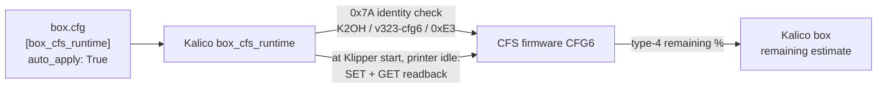

# Experimental CFS firmware

The CFS has its own microcontroller (`cfs0_050_G32`) running Creality's application (stock `cfs0_000_153`, shown as 1.5.3). The **[k2-cfs-rfid-tools](https://github.com/MzTechnology97/k2-cfs-rfid-tools)** project publishes **patched builds of that same stock application**: Creality's code stays, and small hooks add features that the stock firmware keeps locked.

!!! danger "Experimental: read before flashing"
    - These images are **not production qualified**. They change the firmware of a motor controller: a bad image can stop the CFS until you flash a recovery image.
    - Flash **only with the printer idle**, never during a print, and keep a known-good rollback image at hand.
    - The stock CFS firmware works with K2-OpenHost: you do not need these images to use the CFS.

## What the modified firmware unlocks

| Feature | Stock 1.5.3 | Modified (CFG6 v3.25) |
| --- | --- | --- |
| Runtime parameters (hub speeds, timeouts, RFID motion, pretension cycles) | Fixed | **23 writable** of 28, applied by Kalico at startup |
| Firmware identity readable by the host | No | `0x7A` → `K2OH`, revision `v323-cfg6`, features `0xE3` |
| Live remaining filament of type-4 spools while printing | Only with Creality's secure chip | **Yes**: the CFS counts the odometer and Kalico follows it |
| Third-party RFID tags (Bambu, MIFARE) | No | API7 capture in the v3.12 line and later (see [third-party RFID](third-party-rfid.md)) |
| Diagnostics (`BOX_CFS_CONFIG_INFO`, `BOX_CFS_CONFIG_DIAG`) | Stock v1 speeds only | Read-only GET of all 28 parameters with range check |

## How it fits together

- Kalico writes parameters **only** to a CFS that identifies itself with the exact matching identity, **only at Klipper start** (or when the CFS comes back) and **never while printing**. Every write is read back.
- There is **no console write command**: values come only from `box.cfg`. Stock, older K2-OpenHost builds and OpenCFS are only read.
- Values live in the CFS RAM: they are lost when the CFS powers off and written again at the next Klipper start.

## Pages

- [Versions](versions.md): every image, what it adds, which one to use.
- [Flash and roll back](flash.md): helper menu 40, step by step, and the way back.
- [Runtime parameters (CFG6)](parameters.md): what each of the 28 parameters does and how to set it.
- [Live remaining filament](remaining.md): type-4 accounting in the CFS and Kalico.
- [Third-party RFID tags](third-party-rfid.md): Bambu, QIDI and MIFARE spools.

## OpenCFS

[OpenCFS](https://github.com/MzTechnology97/OpenCFS-Firmware) is a separate project: a new firmware written from a specification, not a patch of Creality's. Kalico identifies it (`0x7A` → `OCFS`) and never sends K2OH parameter writes to it.
