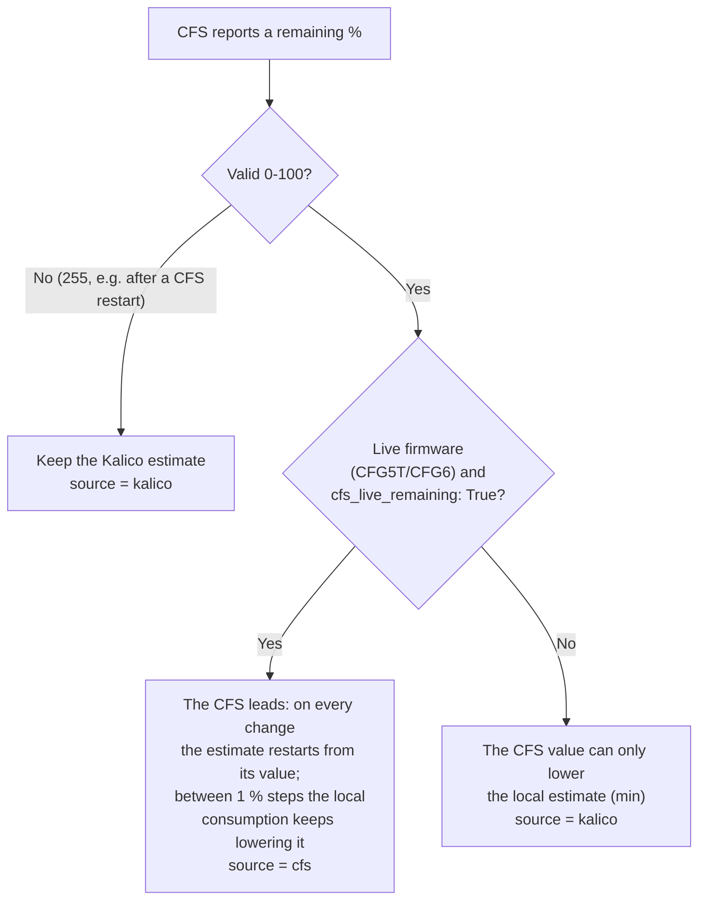

# Live remaining filament

Every spool in the CFS shows a **remaining percentage**. K2-OpenHost has two sources for it and picks the best one per slot.

| Source | Where it is computed | Available on |
| --- | --- | --- |
| **CFS** (`cfs`) | Firmware includes an odometer-based RAM accounting path; continuous accounting for third-party type-4 tags **has not been hardware-qualified** | **CFG5T v3.24** and **CFG6 v3.25** (experimental) |
| **Kalico** (`kalico`) | On the host: nominal spool length, minus the filament measured by the CFS path encoder (or `print_stats` when the encoder is not available), saved by tag UID | Any CFS firmware |

The Kalico estimate is always running: it is the **fallback** when the CFS gives no live value.

The starting percentage the CFS measures depends on the spool size. For spools that are not Creality, see [spool geometry per vendor](spool-geometry.md).

## Why type-4

The stock CFS 1.5.3 firmware has a RAM-only remaining path (`runtime_type = 4`) that updates the remaining byte from the physical path encoder and never writes back to the tag. Stock enables it only together with Creality's secure RFID chip. CFG5T and CFG6 open that gate for the other spools, without writing anything to the tag:

```text
consumed_percent = floor(used_mm * 100 / total_mm)
remaining        = max(initial_percent - consumed_percent, 0)
```

The CFS captures the encoder baseline when the spool is loaded and closes the interval on unload.

## How Kalico merges the two



- With live firmware the CFS value wins **up or down**, so a correction made by the CFS is followed.
- The last CFS value (`cfs_percent`) is saved with the estimate, so a Klipper restart does not re-anchor the spool needlessly.
- With other firmware the CFS value is only the one measured at load: it can lower the estimate, never raise it.

## Remaining in millimetres (R4-PRECISION1)

With the [R4-PRECISION1](https://github.com/MzTechnology97/k2-cfs-rfid-tools/pull/65) candidate firmware and [Kalico](https://github.com/MzTechnology97/kalico-k2pro/pull/107), the CFS also reports millimetres: the starting quantity from the geometry, minus the protected consumption. Kalico restarts from this value instead of the whole percent, so the remaining moves in steps much finer than one percent.

- A repeated or older counter does not rewind the local consumption.
- Kalico goes back to the R3 percentage only if the firmware answers that the read is not supported. With missing or invalid data it keeps the saved estimate.
- Passive console read: `BOX_SPOOL_GEOMETRY_STATUS ADDRESS=1 SLOT=1 PRECISION=1`.

!!! warning "Candidate"
    R3 stays the reference. On R4 the counter is verified to advance while printing on the reference CFS; physical accuracy and a full spool runout are not validated. Details and protocol: [guide in Kalico](https://github.com/MzTechnology97/kalico-k2pro/blob/k2-pro-openhost/docs/CFS_PRECISE_REMAINING.md).

## Configuration

```ini
[box]
cfs_live_remaining: True   # default; False = always use the Kalico estimate
```

The live source is used only when `[box_cfs_runtime]` has identified the CFS as `v323-cfg5t` (`0xE5`) or `v323-cfg6` (`0xE3`). `auto_apply` does **not** need to be on: identification is read-only.

## Check which source a slot uses

In the box status of each slot (Mainsail CFS panel, Moonraker `box` object):

| Field | Meaning |
| --- | --- |
| `rfid_percent` | Percentage shown |
| `rfid_remaining_source` | `cfs` or `kalico` |
| `rfid_usage_source` | Kalico consumption: `cfs_encoder` or `print_stats` |
| `rfid_total_m`, `rfid_remaining_m` | Nominal and remaining length |

And per CFS unit in `box_cfs_runtime`: `live_remaining: true` when the firmware keeps the value live.

In the console:

```text
_BOX_RFID_REMAINING_DIAG SLOT=<global-slot>
```

prints the raw remaining value the CFS returns for that slot.

## Nominal length

Kalico needs the spool length in metres. In order of preference:

1. the length read from the tag (when a decoder reads it);
2. the **Nominal length** of the filament profile (Mainsail filament editor);
3. the reference length of the material for a 1 kg, 1.75 mm spool (PLA 335 m, PETG 327 m, ABS 400 m, ASA 390 m, …).

For one spool that differs (part-used, 3 kg):

```text
_BOX_RFID_SPOOL_NEW SLOT=<global-slot> TOTAL_M=<metres> REMAINING=<0..100>
```

!!! warning "CFG6: type-4 remaining is not hardware-qualified"
    On **October 23, 2026**, CFG6 v3.25 reported a remaining percentage stuck around **35%** during an actual print while filament consumption increased. See [issue #59](https://github.com/MzTechnology97/k2-cfs-rfid-tools/issues/59). An active-print RFID reinitialization counter reset was reproduced **offline** in [PR #60](https://github.com/MzTechnology97/k2-cfs-rfid-tools/pull/60), but that event has **not been confirmed as the cause in the real print**.

    Idle SET/GET and firmware identity readback **do not** validate live type-4 accounting. `rfid_remaining_source: cfs` indicates the host is using the reported value, **not that the value is accurate**. When the value is stuck, the documented `cfs_live_remaining: False` setting uses the Kalico estimate instead; apply configuration changes **only after the print ends**, and verify encoder movement and nominal spool length. The host estimate itself still requires validation.

    **Do not flash the type-4 fix candidate from PR #60**: its first experimental transfer failed on October 24, and the working v3.25 was restored.
