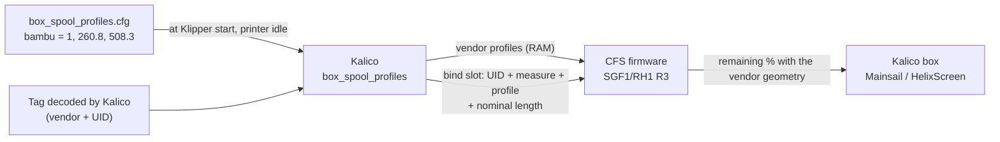

# Spool geometry per vendor

The CFS estimates how much filament is left on a spool from its size. Stock firmware assumes a **Creality spool**, so a full spool from another brand reads low: a new Bambu spool showed **84 %**. With the **SGF1/RH1 R3** candidate firmware and the paired Kalico module `[box_spool_profiles]`, each vendor gets its own geometry and the same full spool reads **100 %**.

!!! warning "Candidate, not a release"
    - Firmware: **CFG6 SGF1/RH1 R3 candidate** ([k2-cfs-rfid-tools PR #64](https://github.com/MzTechnology97/k2-cfs-rfid-tools/pull/64), open). The maintained image is still RDG2 (see [versions](versions.md)).
    - Kalico: `box_spool_profiles` ([kalico-k2pro PR #105](https://github.com/MzTechnology97/kalico-k2pro/pull/105), open), installed on the reference CM5 only.
    - Tested on the reference K2 Pro on 2026-10-29 with two Bambu PETG HF spools. Consumption during a print with R3 and other tag formats are not validated yet.

## How the CFS measures a spool

When a spool is inserted (or its tag is reread), the CFS turns it until the RFID tag passes the reader twice, and notes the filament travel between the two passes. That travel is the **filament length of one turn**, which is the circumference of the outer winding.

- A full spool gives a long turn, an almost empty one a turn close to the core.
- The CFS checks that both passes saw the same tag UID. Only then is the measure **valid** and usable for a geometry.

The remaining percentage is the area of the filament ring between the core and the outer winding:

```text
percent = (C² − core²) / (full² − core²) × 100     rounded, limited to 1..100
```

- `C`: the circumference just measured.
- `core`: circumference of the empty core, where the filament starts.
- `full`: circumference of a new, full spool.

Stock firmware has these two fixed for Creality spools: core Ø 96 mm and full Ø 172 mm (circumferences 301.6 mm and 540.4 mm). A Bambu spool has a smaller core and a smaller full winding, which is why it read wrong.

## What the new firmware and Kalico add



1. **Profiles.** At Klipper start Kalico uploads up to four vendor geometries into the CFS RAM and reads each one back.
2. **Vendor.** The CFS does not decide the brand. Only after Kalico's decoder has read the tag does Kalico tell the CFS which vendor that UID belongs to.
3. **Binding.** Kalico sends the spool's nominal length and binds the slot to the vendor profile. It does so only when the CFS holds a valid measure of that same UID (flags `0x13`).
4. **No second scan.** The CFS recomputes the percentage from the measure it already has. The spool does not turn again.
5. **Later scans.** When the same UID is measured again, the CFS reuses the profile and the length by itself. A part-used spool stays part-used: reading a tag never resets a spool to 100 %.
6. **During a print** the consumption counters are protected, and a doubtful measure never replaces a calibrated value.
7. **RAM only.** Profiles and bindings are lost when the CFS powers off. Kalico uploads the profiles again at the next start; until a valid measure is bound again, Kalico keeps its own estimate for that slot.

Nothing is written to the tag or to the CFS flash. The firmware keeps the CFG6 identity (`K2OH` / `v323-cfg6` / `0xE3`), so the CFG6 runtime parameters keep working. Kalico detects the geometry extension separately.

For Bambu spools R3 also reads the tag in **one CFS cycle**, instead of a stock scan followed by a second full scan.

## Configuration

`macros/box_spool_profiles.cfg` on the reference printer:

```ini
[box_spool_profiles]
serial: serial485
enabled: True
single_cycle_rfid: True
handoff_wait_ms: 3000
handoff_lease_ms: 10000
reconcile_interval: 5.0
vendor_geometries:
    bambu = 1, 260.8, 508.3
```

`vendor_geometries` has one line per vendor:

```text
vendor = profile_id, core_circumference_mm, full_circumference_mm
```

| Field | Meaning | Limits |
| --- | --- | --- |
| `vendor` | name the decoder reports, lower case (`bambulab` and `bambu lab` become `bambu`) | letters, digits, `_`, `-` |
| `profile_id` | slot in the CFS catalog | 1–4, unique |
| `core_circumference_mm` | circumference of the empty core | 50–1000 mm |
| `full_circumference_mm` | circumference of a new full spool | at least 10 mm more than the core, up to 1500 mm |

With `vendor_geometries` empty or commented out, the CFS keeps the stock Creality geometry.

!!! note "Which vendors work today"
    A geometry is applied only to spools whose vendor is reported by Kalico's tag decoder. Today that is **Bambu**. Creality spools already use the stock geometry. Another brand needs a decoder that reports its vendor; a line in `vendor_geometries` alone does nothing for it.

## Calibrating a vendor

You need two numbers: the circumference of a **full** spool, measured by the CFS, and the circumference of the **empty core**, measured by hand.

### 1. The full spool

1. Load a **new, never used** spool of that vendor and let the CFS read it.
2. In the console, with the printer idle:

    ```text
    BOX_SPOOL_GEOMETRY_STATUS ADDRESS=1 SLOT=<0-3>
    ```

    `SLOT` is the position inside the CFS, from 0 (Mainsail slot 1 is `SLOT=0`). The command only reads: nothing turns or moves.
3. Check that `flags=0x13` (valid measure) and note `raw_circumference_mm`.
4. Take it out and put it back two or three times, and use more than one new spool if you have them. Use the largest value, or the average if they are close.

The same Bambu spool measured 509.8 mm and 508.0 mm on two insertions: expect about ±1 mm.

### 2. The empty core

Measure the **outer diameter of the empty core** (where the first turn of filament sits) with a caliper, and multiply by π:

```text
core_circumference = π × diameter        Bambu refill cardboard: 83 mm → 260.8 mm
```

Do not use the reading of a nearly empty spool as the core. A spool that still has a few layers reads several millimetres above the core, and every partly used spool would then show too little. On Bambu, a spool with 12 % left measured 302.8 mm, while the bare core is 260.8 mm.

### 3. Configure and restart

1. Add the line, for example `vendor = 2, <core>, <full>`, with a free `profile_id`.
2. `RESTART` Klipper with the heaters off and the printer idle.
3. Check:
    - the `box_spool_profiles` object (Moonraker or the Mainsail console) lists the vendor and, under `cfs`, a revision for its profile;
    - `BOX_SPOOL_GEOMETRY_STATUS` for the slot shows `geometry_id` equal to the profile and `current` close to 100 % for the new spool.
4. Check a partly used spool against its weight: net weight ÷ nominal net weight should be close to the percentage. If it is consistently higher or lower, the core value is off.

The geometry only sets the starting point. While printing, the remaining amount goes down with the filament measured by the CFS encoder.

## `BOX_SPOOL_GEOMETRY_STATUS` output

```text
CFS 1 slot 1: UID=92C15FEC raw_circumference_mm=508.253 generation=1 flags=0x13
geometry_id=1 revision=2 total_mm=327000 used_mm=172 initial=100% current=100%
```

| Field | Meaning |
| --- | --- |
| `UID` | tag UID the measure belongs to |
| `raw_circumference_mm` | measured length of one turn |
| `generation` | measure counter since the CFS started |
| `flags` | `0x13` = valid measure; without bit 0 (for example `0x02`) the geometry is not bound |
| `geometry_id`, `revision` | bound vendor profile and its revision; `0` = stock geometry |
| `total_mm` | nominal spool length sent by Kalico |
| `used_mm` | filament used since the measure |
| `initial`, `current` | percentage at the measure and now |

In the `box` object, `rfid_remaining_source: cfs` shows that the percentage comes from the CFS. When the vendor has a profile but the slot is not bound yet, Kalico ignores the CFS percentage for that slot and keeps its own estimate.

## Reference values

| Vendor | Core | Full | Source |
| --- | --- | --- | --- |
| Bambu (refill on cardboard core) | 260.8 mm | 508.3 mm | core: caliper, Ø 83 mm; full: CFS, new PETG HF spool (508.25 mm) |

Provisional values from one machine. Other spools of the same brand, or other core types (reusable plastic spool), may need their own measure.
