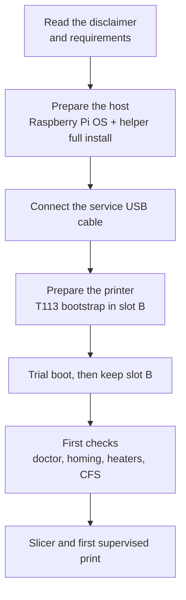

# Getting started

New to K2-OpenHost? Read these pages in order before touching the printer.

1. **[How it works](how-it-works.md)**: what runs where, and what changes compared with the stock printer.
2. **[Requirements](requirements.md)**: the host computer, the cable, the printer firmware and the parts that need rewiring.
3. **[Disclaimer and hardware limits](../DISCLAIMER.md)**: the risks, and what stops working in OpenHost mode.

Then follow the [installation guide](../installation/index.md).

## The path in one picture

## How long it takes

| Step | Time |
| --- | --- |
| Write the card and first host boot | 10 min |
| Full install with the helper | 10–30 min |
| T113 bootstrap (download, build, write slot B, trial boot) | 15–25 min |
| Checks, calibration and first print | 1 h or more |

## Words used in this wiki

| Term | Meaning |
| --- | --- |
| **Host** | The external Linux computer that runs Kalico, Moonraker and Mainsail (reference: Raspberry Pi Compute Module 5). |
| **T113** | The Allwinner board inside the K2 that normally runs Creality's system. In OpenHost mode it runs the screen and three USB serial bridges. |
| **Slot A / slot B** | The T113 has two system slots. Slot A is the printer's stock system and is never written; K2-OpenHost installs into slot B. |
| **Gadget** | USB device mode of the T113's service Micro-USB port: the host sees three serial ports (`/dev/k2-main`, `/dev/k2-nozzle`, `/dev/k2-rs485`). |
| **CFS** | Creality Filament System, the 4-slot filament box on the RS-485 bus. |
| **Box** | Kalico's CFS module (`[box]`); its state is the `box` object in Moonraker. |
| **Kalico** | The Klipper fork used on the host (`kalico-k2pro`, branch `k2-pro-openhost`). |
| **Helper** | The K2-OpenHost Installer Helper, `helper.sh`. |
