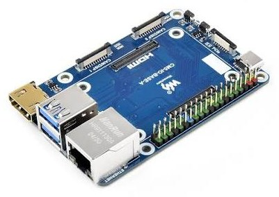
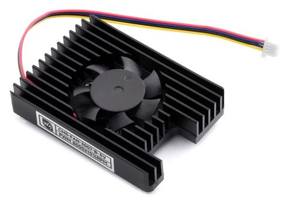
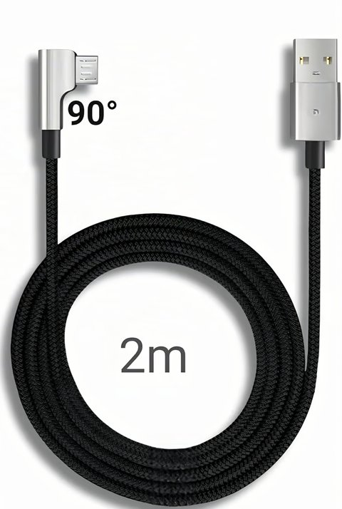

# Requirements

## The printer

| Item | Requirement |
| --- | --- |
| Model | **Creality K2 Pro** only. The tools check Creality model `F012` and board `CR0CN200400C10` and refuse anything else. |
| Stock firmware | Prepared and tested on **1.1.0.94**. Newer releases (1.1.7.0 and later) are accepted with a warning: the T113 bootstrap and the USB gadget (OTG) mode are **not guaranteed** on them. |
| Root SSH | Enabled in the screen settings. The stock root password is `creality_2024`. |
| Network | The printer and the host on the same network during the install. Afterwards HelixScreen uses the network to reach Moonraker. |
| Free space | About 1.5 GB on the printer's UDISK (images, HelixScreen, backup of the old slot B). |
| CFS | Optional. One to four units. CFS firmware 1.1.3 (4-byte state) and 1.5.3 (6-byte state) are supported. |

## The host

| Item | Requirement |
| --- | --- |
| Computer | Raspberry Pi 4, Pi 5 or **Compute Module 5** with at least 2 GB RAM. The reference machine is a CM5 (8 GB RAM, 32 GB eMMC) on a Waveshare CM5-IO-BASE-A, cooled by the Waveshare CM5-FAN-3007-B-5V (all-in-one heatsink, 4-pin PWM fan). Any 64-bit Debian/Ubuntu computer also works. |
| System | **Raspberry Pi OS Lite (64-bit)**, Debian 12 bookworm. |
| Storage | microSD or eMMC, 16 GB or more. |
| Power | The board's official power supply. Under-voltage causes random disconnections. |
| USB | A free port for the T113 cable. On a CM5 carrier, the T113 should be alone on its USB controller (see [Host hardware](../HOST.md#usb)). |
| Network | Ethernet or Wi-Fi with internet access during the install. |

### The reference host

A Raspberry Pi **Compute Module 5** on the Waveshare **CM5-IO-BASE-A** carrier, with the Waveshare **CM5-FAN-3007-B-5V** cooler on the carrier's 4-pin fan header. The CM5's USB 3.0 ports give the T113 a USB controller of its own, and the fan can be driven from Klipper (helper menu 36). Details in [Host hardware](../HOST.md).

| CM5-IO-BASE-A | CM5-FAN-3007-B-5V |
| :---: | :---: |
| { width="340" } | { width="340" } |

## Cables

| Cable | Note |
| --- | --- |
| Host USB to the K2 **service Micro-USB** port | Must be a **data** cable. Charge-only cables do not work. A **90° (right-angle) Micro-USB** plug is recommended (see below). Do not plug or unplug it while printing. |
| Chamber camera to host USB | The chamber camera cannot run through the T113 in OpenHost mode: **disconnect it from the T113** and rewire it to a USB port of the host. The **nozzle camera cannot be used** in OpenHost mode. |
| Cartographer3D to host USB | Optional, direct USB to the host. |

### Where the service Micro-USB port is

The service port is the Micro-USB connector on the **T113 board** (circled in red), next to the mainboard inside the printer's electronics bay. This is the port that switches to USB gadget mode: the host's cable goes here.

<figure markdown="span">
  { width="520" }
  <figcaption>The T113 service Micro-USB port (red circle) on the reference K2 Pro.</figcaption>
</figure>

!!! tip "Use a 90° Micro-USB cable"
    The service port sits at the edge of the T113 board, close to the printer's frame and to the other cables of the electronics bay. A **right-angle (90°) Micro-USB** plug leaves room for the cable, puts no strain on the connector and keeps the link stable. Choose a **data** cable, long enough to reach the host without tension (2 m in the example).

<figure markdown="span">
  { width="240" }
  <figcaption>Example of a 90° Micro-USB to USB-A data cable (2 m, braided).</figcaption>
</figure>

!!! warning "Rewiring inside the printer"
    Disconnect mains power first, and route cables away from moving parts and heated areas. Rewiring is done at your own risk.

## What stops working in OpenHost mode

- The **external USB port** of the printer: no printing from a USB stick, and the port stops working completely. Send files from Mainsail or the slicer.
- **Cameras through the T113**: the chamber camera moves to the host, the nozzle camera is not available.
- **Creality cloud and Creality Print direct connection**: the T113 no longer runs Creality's services. Use the slicer's Moonraker connection.

## Another computer

A Windows, macOS or Linux computer to write the host's card (Raspberry Pi Imager) and to connect over SSH.

## Skills

You should be comfortable with:

- copying commands into an SSH terminal;
- reading Klipper's console and `klippy.log`;
- recovering a printer that does not start (power cycle, going back to slot A).

If not, keep the stock firmware. See the [disclaimer](../DISCLAIMER.md).
