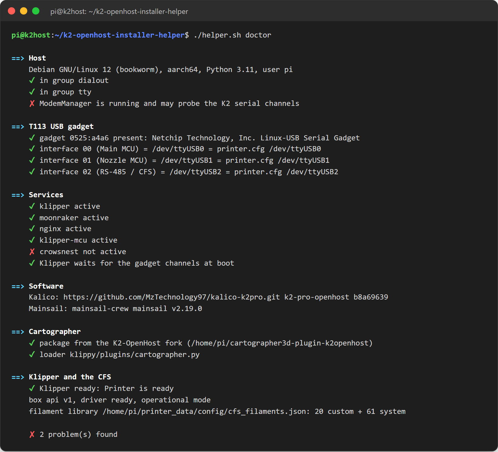

# Doctor and health check

## Doctor

```bash
./helper.sh doctor     # menu 16
```

Read-only: it checks the host without changing anything.



| Section | What it checks |
| --- | --- |
| Host | Operating system, serial groups of your user, ModemManager |
| T113 USB gadget | The gadget (`0525:a4a6`) is connected; each channel (Main MCU, Nozzle MCU, RS-485/CFS) matches the device used in `printer.cfg`; no other process uses the channels; the `usbserial` binding persists across reboots |
| Services | Klipper, Moonraker, nginx and optional services running; the Klipper start gate installed |
| Software | Kalico repository, branch and commit; Mainsail version |
| Cartographer | The official plugin installed (not the retired fork) and exactly one loader |
| Klipper and the CFS | Klipper state, CFS driver and mode, CFS units online, closed-loop motors ready, filament library file, RS-485 link |

Red `✘` lines say what is wrong and how to fix it. Common ones:

| Doctor says | Fix |
| --- | --- |
| `not in group dialout` / `tty` | Reboot the host, or log out and in again. |
| `ModemManager is running` | `sudo systemctl stop ModemManager`, or menu 3 again. |
| `the K2 gadget (0525:a4a6) is not connected` | Data cable in the K2 **service** Micro-USB port; T113 bridges running (slot B booted); `lsusb` must list *Linux-USB Serial Gadget*. |
| `interface .. is /dev/ttyUSBx but printer.cfg uses ...` | Menu 19 (stable serial names), then restart Klipper. |
| `process … also uses /dev/ttyUSBx` | A second reader takes bytes meant for Klipper: stop that process. For the old Cartographer demux: `scripts/system.sh retire-demux`. |
| `RS-485 link LOST` | No RS-485 replies: other readers, T113 RS-485 bridge, CFS power. |

When asking for help, attach the doctor output and `~/printer_data/logs/klippy.log`.

## Automatic health check

Menu 3 installs a check that runs by itself:

- **at every boot** (`k2oh-health@boot.service`): it waits up to 4 minutes for Klipper and the motor startup, then runs the doctor;
- **after every apt/dpkg change** (`k2oh-health@apt.service`, without blocking apt). It also says when a reboot is pending, and fails if the newest installed kernel has no `usbserial` module.

The result:

- appears in the **Klipper console** in Mainsail (`K2-OpenHost check after boot: OK.`, or the problems in red);
- is kept in `~/printer_data/logs/k2oh-health.log`;
- can be sent to your own command (Telegram, apprise, mail): set `K2OH_HEALTH_NOTIFY_CMD="..."` in `~/printer_data/systemd/k2oh-health.env`; it receives the summary as argument.

Run it by hand with `./helper.sh health`; `scripts/system.sh health-remove` removes it.
