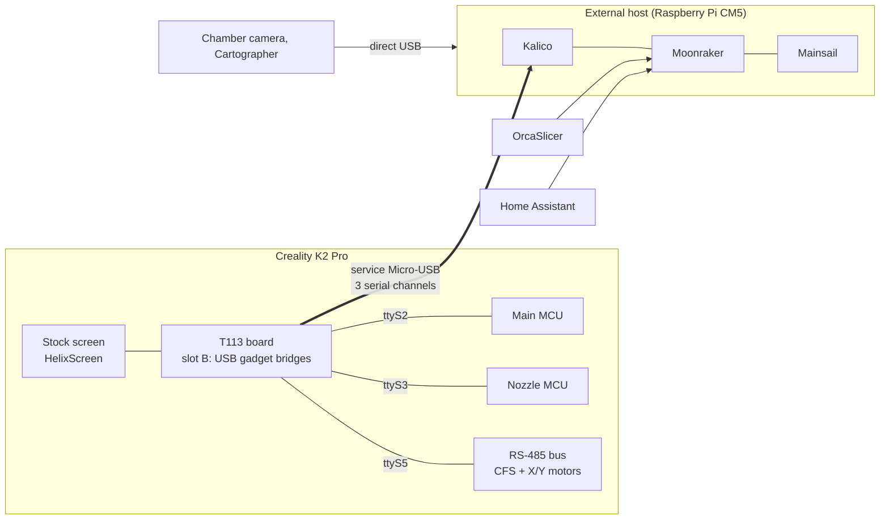

---
hide:
  - navigation
---

# K2-OpenHost

**Run a Creality K2 Pro from an external Linux computer, with Kalico, Moonraker and Mainsail, while keeping the printer's original electronics.**

K2-OpenHost moves the Klipper workload off the printer's T113 board onto a host you control, for example a Raspberry Pi CM5. The T113 stays in the printer as the touch screen and as a USB bridge to the original Main MCU, Nozzle MCU and RS-485 bus (CFS and closed-loop motors).

!!! danger "For experienced users only"
    K2-OpenHost voids the warranty and can damage the printer beyond repair, brick its firmware or, if something fails, cause a fire. The authors accept no liability for damage to property or persons. The chamber camera has to be rewired to the host, the nozzle camera and the printer's external USB port stop working. Read the [disclaimer and hardware limits](DISCLAIMER.md) before you start, and never leave the printer unattended.

-   :material-rocket-launch: **Getting started**

    ---

    What K2-OpenHost is, how the pieces fit together and what you need.

    [:octicons-arrow-right-24: How it works](getting-started/how-it-works.md)

-   :material-download: **Installation**

    ---

    Host, printer (T113 slot B), first start and checks, step by step.

    [:octicons-arrow-right-24: Install guide](installation/index.md)

-   :material-console: **Helper script**

    ---

    One menu to install, update, check, back up and flash.

    [:octicons-arrow-right-24: K2-OpenHost Helper](helper/index.md)

-   :material-printer-3d-nozzle: **The CFS**

    ---

    Slots, RFID, filament library, print mapping, runout swap.

    [:octicons-arrow-right-24: Using the CFS](usage/cfs.md)

-   :material-chip: **Experimental CFS firmware**

    ---

    Unlocked runtime parameters and live remaining filament.

    [:octicons-arrow-right-24: CFS firmware](cfs-firmware/index.md)

-   :material-lifebuoy: **Troubleshooting**

    ---

    Symptoms, causes and fixes, and what to send when asking for help.

    [:octicons-arrow-right-24: Troubleshooting](reference/troubleshooting.md)

## Why an external host

On the stock K2 Pro everything runs on the T113: Klipper, Moonraker, the web interface, the screen, Creality's cloud apps and the camera stream, on a small dual-core chip. K2-OpenHost gives that work to a real computer.

| | Stock K2 Pro (T113) | K2-OpenHost (reference CM5) |
| --- | --- | --- |
| CPU | Allwinner T113, 2× Cortex-A7 at 1.2 GHz | Raspberry Pi CM5, 4× Cortex-A76 at 2.4 GHz |
| RAM | about 512 MB, shared by every service | 8 GB |
| Klipper | Creality's fork on an old Klipper base | Current Kalico, updated from git |
| What the T113 runs | Everything | Three USB↔UART bridges, the screen (HelixScreen) and a small control service |
| Creality cloud apps | Running | Not started: the printer talks only to your host |
| Web interface | Creality's | Mainsail with CFS and motor panels |
| Extra hardware | Limited by the T113 | Cameras, Cartographer3D and more on the host's USB ports |
| Way back | | Stock firmware untouched in slot A, one command to boot it |

The Main MCU, Nozzle MCU, closed-loop motors, PRTouch, CFS and the stock screen keep Creality's own firmware. Nothing is soldered.

## Features

- **Printer:** [Kalico](https://github.com/MzTechnology97/kalico-k2pro) with every K2 Pro extra: closed-loop X/Y motors, PRTouch probing, heated chamber, input shaper, adaptive mesh and purge, power-loss recovery, stock buzzer sounds. [Cartographer3D](CARTOGRAPHER.md) on direct USB. MCU, motor and CFS firmware updates with Creality's own tools.
- **CFS:** up to four units plus the external spool; Creality, Bambu Lab and other MIFARE tags, never written; a filament library with temperatures, pressure advance, max flow and OrcaSlicer preset; remaining filament per spool; automatic tool → slot mapping; runout swap to the next identical spool; clog, low filament and humidity warnings; notifications to Mobileraker and Telegram.
- **Interfaces:** [Mainsail](usage/mainsail.md) with a CFS panel and a motor panel; [HelixScreen](usage/helixscreen.md) on the printer screen with a K2-OpenHost interface; [OrcaSlicer](ORCASLICER.md) filament sync and its [plugin](usage/orca-plugin.md); [Home Assistant](usage/home-assistant.md); Mobileraker, OctoEverywhere, Spoolman, Crowsnest.
- **Tools:** the [helper script](helper/index.md) to install, update, check, back up and flash; a release manifest that pins tested versions; a health check after every boot; the CM5 fan driven by Klipper.

## The project at a glance

## Repositories

| Repository | Role |
| --- | --- |
| [K2-OpenHost](https://github.com/MzTechnology97/K2-OpenHost) | This wiki, architecture, test results, releases |
| [kalico-k2pro](https://github.com/MzTechnology97/kalico-k2pro) | Kalico for the K2 Pro (branch `k2-pro-openhost`) and the K2 Pro profile |
| [k2-openhost-installer-helper](https://github.com/MzTechnology97/k2-openhost-installer-helper) | The helper script: host install, T113 bootstrap, updates, backups, firmware |
| [k2-openhost-t113-bootstrap](https://github.com/MzTechnology97/k2-openhost-t113-bootstrap) | The printer side: K2-OpenHost system in the T113's slot B |
| [mainsail-k2openhost](https://github.com/MzTechnology97/mainsail-k2openhost) | Mainsail fork with the CFS and motor panels |
| [helixscreen](https://github.com/MzTechnology97/helixscreen) | HelixScreen fork for the printer screen (branch `k2-openhost`) |
| [ha-k2-openhost](https://github.com/MzTechnology97/ha-k2-openhost) | Home Assistant integration and CFS card |
| [k2-cfs-rfid-tools](https://github.com/MzTechnology97/k2-cfs-rfid-tools) | Experimental CFS firmware images, sources and tests |
| [k2-openhost-firmware-tools](https://github.com/MzTechnology97/k2-openhost-firmware-tools) | Read-only firmware inventory and protocol notes |

## Status

K2-OpenHost is in daily production use: the reference K2 Pro prints on a CM5 host every day, with long CFS prints, automatic mapping, runout swaps and third-party RFID spools. The modified CFS firmware and the OrcaSlicer plugin are still experimental; the stock CFS firmware is fully supported. What has been verified is in the [test status](TEST_STATUS.md), the next steps in the [roadmap](ROADMAP.md).

K2-OpenHost builds on the work of Klipper, Kalico, Jacob10383, luketot, Moonraker, Mainsail, HelixScreen, Cartographer3D and many others: see the [credits](REFERENCES.md).
