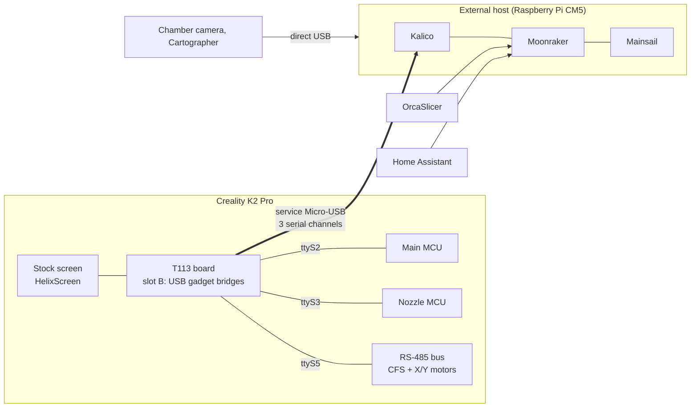

---
hide:
  - navigation
---

# K2-OpenHost

**Run a Creality K2 Pro from an external Linux computer, with Kalico, Moonraker and Mainsail, while keeping the printer's original electronics.**

K2-OpenHost moves the Klipper workload off the printer's T113 board onto a host you control, for example a Raspberry Pi CM5. The T113 stays in the printer as the touch screen and as a transparent USB bridge to the original Main MCU, Nozzle MCU and RS-485 bus (CFS and closed-loop motors). On the host you get current Kalico, Mainsail with a native CFS panel, OrcaSlicer integration and Home Assistant.

!!! danger "For experienced users only"
    K2-OpenHost voids the manufacturer's warranty and can damage the printer beyond repair, brick its firmware or, in case of malfunction, cause a fire. The authors accept no liability for damage to property or persons. In OpenHost mode the chamber camera must be disconnected from the T113 and rewired to the host, the nozzle camera cannot be used, and the printer's external USB port stops working. Read the [disclaimer and hardware limits](DISCLAIMER.md) before you start.

-   :material-rocket-launch: **Getting started**

    ---

    What K2-OpenHost is, how the pieces fit together and what you need.

    [:octicons-arrow-right-24: How it works](getting-started/how-it-works.md)

-   :material-download: **Installation**

    ---

    Host, printer (T113 slot B), first start and checks, step by step.

    [:octicons-arrow-right-24: Install guide](installation/index.md)

-   :material-console: **Helper script**

    ---

    One menu to install, update, check, back up and flash.

    [:octicons-arrow-right-24: K2-OpenHost Helper](helper/index.md)

-   :material-printer-3d-nozzle: **The CFS**

    ---

    Slots, RFID, filament library, print mapping, runout swap.

    [:octicons-arrow-right-24: Using the CFS](usage/cfs.md)

-   :material-chip: **Experimental CFS firmware**

    ---

    Unlocked runtime parameters and live remaining filament.

    [:octicons-arrow-right-24: CFS firmware](cfs-firmware/index.md)

-   :material-lifebuoy: **Troubleshooting**

    ---

    Symptoms, causes and fixes, and what to send when asking for help.

    [:octicons-arrow-right-24: Troubleshooting](reference/troubleshooting.md)

## Why an external host

On the stock K2 Pro **everything** runs on the T113 inside the printer: Klipper, Moonraker, nginx, the web interface, the screen UI, Creality's cloud apps and the camera stream, on a small dual-core chip. K2-OpenHost gives that work to a real computer and leaves the T113 only what it does well.

| | Stock K2 Pro (T113) | K2-OpenHost (reference CM5) |
| --- | --- | --- |
| CPU | Allwinner T113, **2× Cortex-A7 at 1.2 GHz** (32-bit) | Raspberry Pi CM5, **4× Cortex-A76 at 2.4 GHz** (64-bit) |
| RAM | **~512 MB**, shared by every service | **8 GB** |
| Klipper | Creality's fork, frozen on an old Klipper base | Current **Kalico**, updated from git |
| What the T113 runs | Klipper, Moonraker, nginx, UI, cloud apps, camera, everything | Only three USB↔UART bridges, the screen (HelixScreen) and a small control service |
| Creality cloud and UI apps | Running | **Not started** in slot B: no Creality cloud connection, ADB and WebRTC camera off |
| Web interface | Creality's | Current **Mainsail** with CFS and motors panels |
| Extra hardware | Limited by the T113's CPU and its single USB controller | Cameras, Cartographer3D, a host MCU and more on the host's own USB 3.0 ports |
| Way back | — | Stock firmware untouched in **slot A**: one command to boot it again |

With the heavy work on the host:

- **More headroom:** Klipper's motion planning, input shaper, mesh and macros run on a CPU many times faster, with no web server, cloud app or video encoder competing for the same two cores. Overload symptoms of a busy host (`Timer too close`, a slow web UI, stalls while the camera streams) have far less room to appear.
- **No vendor telemetry:** Creality's cloud and UI apps are not started in K2-OpenHost mode. Your printer talks only to the host you own, on your network.
- **Open, current software:** Kalico, Moonraker, Mainsail, OrcaSlicer, Home Assistant, all updatable, all open source, all yours to change.
- **The original electronics stay:** Main MCU, Nozzle MCU, closed-loop motors, PRTouch, CFS and the stock screen keep working with Creality's own firmware. Nothing is soldered: only the chamber camera cable is moved from the T113 to the host.

## Features

### Printer and motion

- [Kalico](https://github.com/MzTechnology97/kalico-k2pro) `k2-pro-openhost` with every K2 Pro extra: **closed-loop X/Y motors** (status, diagnostics and parameter tools), **PRTouch** strain-gauge probing and Z offset, heated chamber, input shaper, bed mesh, KAMP adaptive mesh and purge, power-loss recovery.
- **Cartographer3D** on direct USB to the host, as an alternative probe ([guide](CARTOGRAPHER.md)).
- Stock **buzzer** sounds (print done, pause, error, cancel) and `M300` for slicers.
- **MCU, motor and CFS firmware updates** through Creality's own tools, from the helper (`k2oh-mcu-fw`).
- **T113 control from Klipper:** MCU power rail, board telemetry (`BOARD_STATUS`), bridges and HelixScreen, through `k2oh-ctl`.

### CFS (Creality Filament System)

- Up to **four CFS units** (16 slots) plus the external spool.
- **RFID:** Creality tags, and with an API7 CFS firmware also **Bambu Lab, QIDI and other MIFARE** spools, never writing the tags.
- **Filament library** with Creality's system filaments and your own profiles: temperatures, **pressure advance per filament**, max flow, OrcaSlicer preset ID.
- **Remaining filament** per spool: live from the CFS on CFG5T/CFG6 firmware, Kalico's encoder-based estimate everywhere else.
- **Print mapping:** automatic tool → slot mapping by material and colour, from the slicer's map (`K2OH_TOOL_MAP`), or by hand in Mainsail.
- **Runout swap** to the next spool of the same filament, in an order you choose; **clog detection**; **low filament** and **humidity** warnings at print start.
- **Notifications** of CFS events to Mobileraker and Telegram.
- **Experimental CFS firmware** with **23 tunable runtime parameters** (hub speeds, timeouts, RFID motion, pretension cycles).

### Interfaces

- **Mainsail K2-OpenHost:** native CFS panel with the filament path, slot editor, RFID sheet, filament library and print mapping; closed-loop motors panel.
- **HelixScreen** on the stock touch screen, with the filament pickers synced to the host's library.
- **OrcaSlicer:** filament Sync from the CFS with the right presets, and the **OrcaSlicer 2.5 plugin** with a graphic CFS panel, slot mapping before sending and runout order.
- **Home Assistant** integration: CFS sensors, switches and actions, and a Lovelace card.
- **Mobileraker**, **OctoEverywhere**, **Spoolman**, **Crowsnest** for the chamber camera (with the Creality camera fix).

### Tools

- **K2-OpenHost Helper:** one menu to install the host, build and boot the T113 slot B, update everything, check the system (`doctor`), back up and restore, flash firmware, switch back to stock.
- **Release manifest:** every component pinned to a tested version, with a diff before each update.
- Automatic **health check** after every boot and system upgrade.
- **CPU fan** of the CM5 driven from Klipper, visible in Mainsail.
- Configuration **backup to GitHub** with klipper-backup.

| Area | Where to read more |
| --- | --- |
| Installation | [Install guide](installation/index.md) |
| Web interface | [Mainsail](usage/mainsail.md) |
| Printer screen | [HelixScreen](usage/helixscreen.md) |
| CFS | [Using the CFS](usage/cfs.md) |
| Slicer | [OrcaSlicer](ORCASLICER.md), [OrcaSlicer plugin](usage/orca-plugin.md) |
| Smart home | [Home Assistant](usage/home-assistant.md) |
| Notifications | [Notifications](usage/notifications.md) |
| Host hardware | [Host hardware](HOST.md) |
| Experimental | [CFS firmware](cfs-firmware/index.md) |

## Warnings and risks

!!! danger "Safety"
    - **Fire risk.** Nozzle, bed and chamber heaters are controlled by software running on the external host. If the host stops talking, Klipper's MCU safety timers switch the heaters off, but a software, wiring or power fault can still leave a heater on. **Never leave the printer unattended**, keep a smoke detector near it and a fire extinguisher at hand.
    - **Mechanical damage.** Wrong configuration values, a homing or probing error, or a lost connection mid-move can crash the toolhead into the bed or the frame.
    - **Mains power.** Disconnect the printer from the mains before opening the electronics bay to plug the T113 cable or reroute the chamber camera. Route every cable away from moving parts and hot areas.

!!! warning "Warranty, firmware and hardware"
    - **The warranty is void.** Creality does not support running the printer from an external host.
    - **Bricking.** Writing the T113 slot B or flashing MCU, motor or CFS firmware can leave the printer unable to start. Keep the helper's **backup** and read [Recovery](RECOVERY.md) before any persistent change.
    - **Hardware limits in OpenHost mode:** the chamber camera must be disconnected from the T113 and rewired to the host; the nozzle camera cannot be used; the printer's external USB port (USB stick) stops working; Cartographer3D goes straight to the host. Details in the [disclaimer](DISCLAIMER.md#hardware-limitations-in-openhost-mode).
    - **Supported model:** Creality **K2 Pro** only. The tools refuse other models and boards.

!!! warning "Operation"
    - **The USB cable is the printer's lifeline.** Unplugging or bumping the T113 cable, or a host reboot, stops the print at once: Klipper shuts down. Use a good **data** cable, a **90° plug**, and fix it in place.
    - **The host's power is the printer's power.** If the host loses power, the print is lost even if the printer stays on. Use the host's official power supply; a UPS for both is a good idea.
    - **No changes while printing.** Never restart Klipper, update, flash, edit the CFS runtime values or reboot the T113 during a print.
    - **No Creality OTA from slot B.** An OTA in slot B would overwrite slot A, so it is disabled. From slot A an OTA replaces K2-OpenHost's slot B. Board firmware is updated from slot B with `k2oh-mcu-fw` (helper menu 31).
    - **Know your printer.** K2-OpenHost replaces the whole software stack: you are your own support. Check [test status](TEST_STATUS.md) for what has been exercised on real hardware before relying on a feature.

!!! info "Experimental CFS firmware"
    The [modified CFS firmware](cfs-firmware/index.md) is **not production qualified**: a bad image can stop the CFS until a recovery image is flashed, and an [open issue](https://github.com/MzTechnology97/k2-cfs-rfid-tools/issues/9) means the CFS can report idle while feeding. Flash only with the printer idle and keep the v3.22 recovery image. The stock CFS firmware works fine with K2-OpenHost.

K2-OpenHost is provided **as is**, without any warranty. **The authors and contributors accept no liability** for damage to property or persons, injury, data loss or any other consequence of its use. If you cannot diagnose Linux, Klipper and printer electronics, or cannot accept these risks, keep the stock firmware. Full text: [Disclaimer](DISCLAIMER.md).

## The project at a glance

## Repositories

| Repository | Role |
| --- | --- |
| [K2-OpenHost](https://github.com/MzTechnology97/K2-OpenHost) | This wiki, architecture, test results, releases |
| [kalico-k2pro](https://github.com/MzTechnology97/kalico-k2pro) | Kalico for the K2 Pro (branch `k2-pro-openhost`) and the K2 Pro profile |
| [k2-openhost-installer-helper](https://github.com/MzTechnology97/k2-openhost-installer-helper) | The helper script: host install, T113 bootstrap, updates, backups, firmware |
| [k2-openhost-t113-bootstrap](https://github.com/MzTechnology97/k2-openhost-t113-bootstrap) | The printer side: K2-OpenHost system in the T113's slot B |
| [mainsail-k2openhost](https://github.com/MzTechnology97/mainsail-k2openhost) | Mainsail fork with the CFS and motors panels |
| [ha-k2-openhost](https://github.com/MzTechnology97/ha-k2-openhost) | Home Assistant integration and CFS card |
| [k2-cfs-rfid-tools](https://github.com/MzTechnology97/k2-cfs-rfid-tools) | Experimental CFS firmware images, sources and tests |
| [k2-openhost-firmware-tools](https://github.com/MzTechnology97/k2-openhost-firmware-tools) | Read-only firmware inventory and protocol documentation |

## Status

K2-OpenHost is **in daily production use** on the author's print farm: the reference K2 Pro prints on a CM5 host every day, with long CFS prints, automatic mapping, live runout swap and third-party RFID spools, and **no crashes or problems caused by the CM5 or by K2-OpenHost**.

The only part still marked experimental is the [modified CFS firmware](cfs-firmware/index.md); the stock CFS firmware is fully supported. Per-feature results are in [test status](TEST_STATUS.md), next steps in the [roadmap](ROADMAP.md).

K2-OpenHost builds on the work of Klipper, Kalico, Jacob10383/Jacobean, luketot, Moonraker, Mainsail, HelixScreen, Cartographer3D and many others: see [credits](REFERENCES.md).
