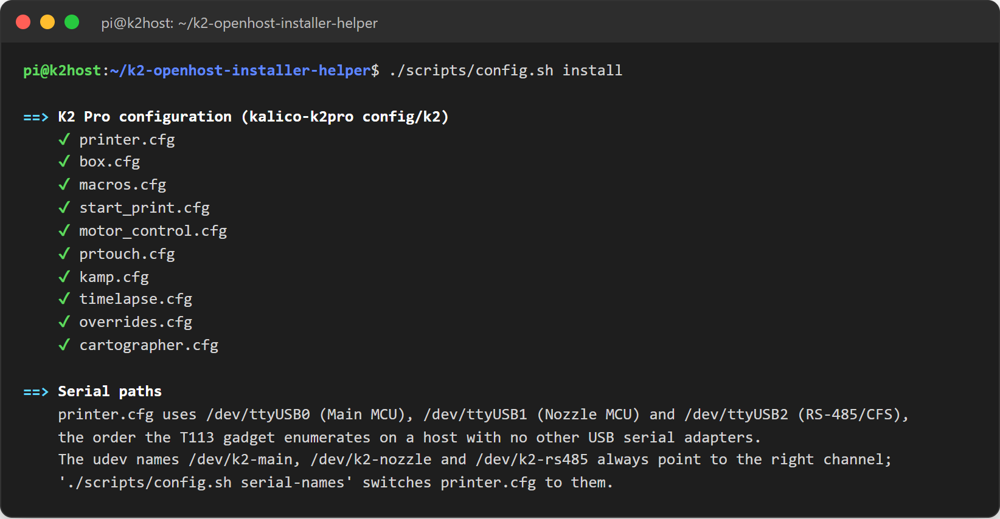

# 1. Prepare the host

No Linux experience is needed: every command can be copied and pasted.

## Write the card

1. Install [Raspberry Pi Imager](https://www.raspberrypi.com/software/) on your computer.
2. **Choose device:** your board (Raspberry Pi 5, CM5, ...).
3. **Choose OS:** *Raspberry Pi OS (other)* → **Raspberry Pi OS Lite (64-bit)**. Lite has no desktop and leaves more resources to Klipper.
4. **Choose storage:** the microSD card, or the CM5 eMMC through `rpiboot`.
5. **Next** → **Edit settings**:
    - **hostname:** `k2host` (Mainsail will be at `http://k2host.local/`);
    - **username and password:** for example `pi` and a password you will remember;
    - **Wi-Fi** (if you do not use Ethernet) and your country;
    - **Services:** **Enable SSH** with password authentication.
6. **Save**, **Yes**, wait for the write to finish.

## First boot and SSH

1. Insert the card, connect Ethernet if you use it, power on and wait two minutes.
2. Find the host: `ping k2host.local`, or look for `k2host` in your router's list of devices.
3. Connect from a terminal (Windows: right-click Start → *Terminal*):

    ```bash
    ssh pi@k2host.local
    ```

    Answer `yes` to the fingerprint question and type your password (nothing appears while typing).

4. Update the system and install Git:

    ```bash
    sudo apt update && sudo apt full-upgrade -y
    sudo apt install -y git
    ```

## Download and run the helper

```bash
git clone https://github.com/MzTechnology97/k2-openhost-installer-helper.git ~/k2-openhost-installer-helper
~/k2-openhost-installer-helper/helper.sh
```


Type `1` (**Full install**) and confirm. During the install:

- every step starts with a `==>` heading and every completed action shows a green `✔`;
- yellow `!` lines are information;
- questions accept the suggested answer (capital letter) with Enter:

| Question | Meaning | Suggested |
| --- | --- | --- |
| Stop and disable ModemManager? | It probes serial ports and disturbs the K2 channels | Yes |
| Remove brltty? | Braille display service that grabs USB serial devices | Yes |
| Allow nginx to reach `/home/pi/mainsail`? | Lets the web server read Mainsail in your home folder | Yes |
| Move it aside and clone ...? | A folder with the same name exists; it is renamed, never deleted | Yes |

The full install takes 10–30 minutes and ends with a summary showing the Mainsail address. Without questions: `helper.sh --yes install full`.

## What the full install puts on the host

| Component | Detail |
| --- | --- |
| Host preparation | Build tools, `dialout`/`tty` groups, udev names `/dev/k2-main`, `/dev/k2-nozzle`, `/dev/k2-rs485`, `/dev/k2-cartographer`; ModemManager stopped, brltty removed; `~/printer_data` |
| Kalico K2-OpenHost | `~/klipper` (`kalico-k2pro`, branch `k2-pro-openhost`), `~/klippy-env`, `klipper.service` and the start gate (waits up to 60 s for the three channels) |
| K2 Pro configuration | The profile from `~/klipper/config/k2` into `~/printer_data/config`: `printer.cfg` and the files in `macros/` |
| Moonraker | Upstream Moonraker with its installer, `moonraker.conf` for a home network, update-manager entries |
| Mainsail K2-OpenHost | Latest prebuilt release served by nginx on port 80 |
| Full install extras | Moonraker timelapse and Klippain Shake&Tune |
| Automatic health check | The doctor after every boot and apt change, reported in the Klipper console |

Optional components from the menu: Cartographer3D, Crowsnest (with the Creality camera fix), host MCU `[mcu rpi]`, Spoolman, Mobileraker, OctoEverywhere, the CM5 fan from Klipper (menu 36). See the [menu reference](../helper/menu.md).

## Reboot once

```bash
sudo reboot
```

This applies the serial-port groups given to your user. Reconnect with `ssh` after a minute, then continue with [2. Prepare the printer](printer.md).

## Your configuration is never overwritten

The helper copies the K2 Pro profile into `~/printer_data/config`. A later run keeps your files: when the profile changed and you edited your copy, the new profile version is saved next to it as `<file>.k2oh-new`. `helper.sh config diff` (menu 18) shows the differences.


