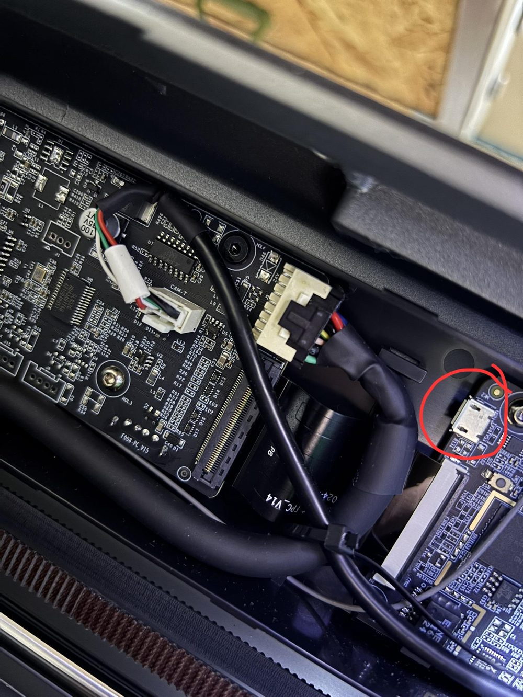
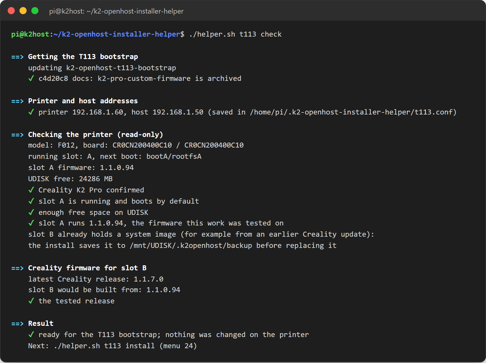

# 2. Prepare the printer (T113 slot B)

The **T113 bootstrap** writes a K2-OpenHost system into the T113's spare **slot B**: the USB gadget bridges, HelixScreen pointed at your host, the control service and the firmware tools. **Slot A, the printer's current system, is never written** and stays your fallback.

!!! important "Firmware version"
    Prepared and tested on the K2 Pro stock firmware **1.1.0.94**. Newer releases are accepted with a warning, but on them the bootstrap and the USB gadget (OTG) mode are **not guaranteed**.

## Before you start

- [ ] The host is installed and rebooted ([step 1](host.md)).
- [ ] Root SSH is enabled on the printer and you know its IP address.
- [ ] The **data** cable connects a host USB port to the printer's **service Micro-USB** port on the T113 board (red circle below). A 90° Micro-USB plug is recommended: it fits next to the frame without straining the connector.
- [ ] The printer is idle, with about 1.5 GB free on its UDISK.

<figure markdown="span">
  { width="480" }
  <figcaption>The T113 service Micro-USB port: the host cable goes here.</figcaption>
</figure>

## Check the printer (menu 23)

```bash
cd ~/k2-openhost-installer-helper
./helper.sh t113 check
```

Read-only. It asks the printer's IP, confirms the host IP, then checks over SSH that the printer is a K2 Pro (model `F012`, board `CR0CN200400C10`), the running slot, free space and slot A's firmware, and shows the Creality release slot B would be built from.



## Install the bootstrap (menu 24)

```bash
./helper.sh t113 install
```

1. Confirm the warning, enter the **printer IP** and the **host IP** as the printer sees it (Enter accepts the proposal).
2. Type the printer's root password once (`creality_2024` on stock).
3. The helper repeats the checks, then proposes the **Creality release** to build slot B from: slot A's release when Creality still lists it, otherwise the latest.
4. It downloads the Creality OTA (130–145 MB) from Creality's CDN, checks it against the image's own MD5 list, and **builds slot B**. No Creality file is redistributed by the project.
5. Answer **yes** to install **HelixScreen** (recommended): the helper downloads the latest release of the [K2-OpenHost fork](../usage/helixscreen.md).
6. Files are uploaded to the printer and checked by SHA-256; `install-slot-b.sh --check` runs on the printer.
7. **Confirm** to write slot B. The printer backs up the U-Boot environment and the old slot B, writes and reads back `bootB` and `rootfsB`, and copies slot A's SSH keys, host keys and Wi-Fi networks.

Slot A still boots by default at this point.

## Trial boot (menu 26)

```bash
./helper.sh t113 boot-b
```

Slot B boots **once**. The very first thing its boot does is point the next boot back at slot A, so **if anything goes wrong, power cycle the printer and it returns to slot A**.

After the trial boot:

1. On the first boot HelixScreen installs itself (about a minute), already pointed at your host.
2. Klipper on the host connects by itself (the start gate waits up to 60 s for the three channels). Mainsail shows the printer ready.
3. If both work, keep slot B.

## Keep slot B (menu 27)

```bash
./helper.sh t113 commit
```

Slot B becomes the default. Menu **28** (`t113 boot-a`) returns to slot A at any time; menu **25** (`t113 status`) shows the running slot, the next boot and the trial flag.

## Link the T113 controls (menu 32)

```bash
./helper.sh t113 link
```

Connects Kalico and Moonraker to `k2oh-ctl` on the printer: it copies the shared token to `~/printer_data/config/k2oh_t113.token`, sets `host` in `macros/k2_t113.cfg` and writes the Moonraker power device `K2_MCU_Power`. You get:

- `BOARD_STATUS`: T113 telemetry and the state of each bridge;
- `BUZZER`, `M300` and the buzzer sounds (print complete, pause, error, ...);
- `USB_BRIDGES_RESTART CONFIRM=1`, `MCU_POWER_CYCLE CONFIRM=1`, `SCREEN_RESTART`;
- the MCU power rail as a Moonraker power device, locked while printing.

Restart Moonraker and Klipper afterwards (menu 22).

## Time zone

The T113 ships on China time. `./helper.sh t113 timezone` gives slot B the host's time zone so the logs line up; `boot-b`, `commit` and `update` do it too.

## Board firmware (optional)

Slot B runs Creality's `mcu_update` at every boot, which keeps the boards at slot B's firmware release. To move every board to the **latest** Creality release, use menu **31**; see [Updates](updates.md#creality-board-firmware).

## If something goes wrong

| Symptom | What to do |
| --- | --- |
| The printer does not come back after the trial boot | Power cycle it: it returns to slot A. Read `/mnt/UDISK/.k2openhost/setup.log` from slot A. |
| Klipper does not connect | `./helper.sh doctor`. On the printer: `logread \| grep -E "k2oh\|bridge"`. See [Troubleshooting](../reference/troubleshooting.md#the-host-does-not-see-the-printer). |
| The screen stays on the boot logo | On the printer: `k2oh-setup status`, `cat /mnt/UDISK/.k2openhost/setup.log`, then run `k2oh-setup` again. |
| HelixScreen cannot reach Moonraker | Wrong host IP: menu 29 or `k2oh-setup --host <IP>` on the printer. |
| No Wi-Fi in slot B | Set Wi-Fi from HelixScreen, or copy `/etc/wifi/wpa_supplicant/wpa_supplicant.conf` from slot A. |

The complete printer-side guide is in the [bootstrap repository](https://github.com/MzTechnology97/k2-openhost-t113-bootstrap#readme) and in [T113 bootstrap](../T113_BOOTSTRAP.md).
