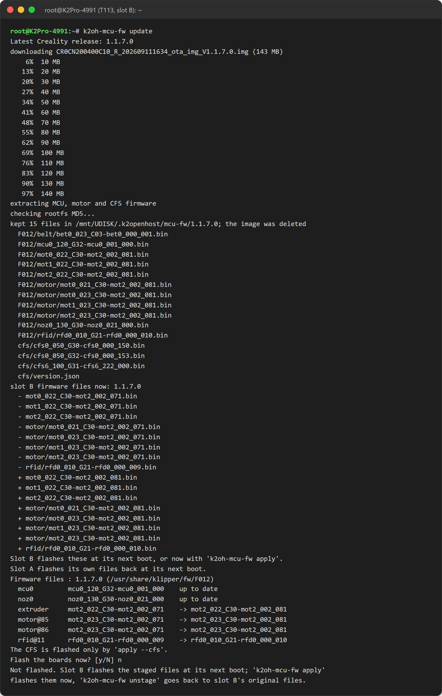

# Updates and releases

!!! warning
    Updates, Klipper restarts and firmware flashing are refused while a print is running or paused. Update with the printer idle.

## Software on the host

=== "From Mainsail"

    *Machine* → **Update Manager** updates Kalico, Moonraker, Mainsail K2-OpenHost (pre-release channel), the Cartographer plugin and the helper itself.

=== "From the helper"

    ```bash
    ./helper.sh update        # menu 17
    ```

    Updates Kalico, Moonraker and Mainsail.

The helper also checks for its own updates at every start, lists the new commits and asks *Update the installer helper now?*. It never touches local changes. `K2OH_NO_UPDATE_CHECK=1` skips the check.

## Releases

The component branches move with every merge. A **release** is the set of commits **validated together on the reference printer**, listed in [`releases/stable.json`](https://github.com/MzTechnology97/K2-OpenHost/blob/main/releases/stable.json) with the firmware it was tested with.

```bash
./helper.sh release status        # menu 34: each component vs the release, read-only
./helper.sh release apply         # menu 35: bring Kalico and Mainsail to the release
./helper.sh release apply --t113  # also the T113 programs
```

`release apply` only fast-forwards: a component newer than the release, on another branch or with local changes is left as it is. Klipper is restarted only if you confirm and only with every heater off.

## T113 programs (slot B)

K2-OpenHost's own programs on the printer (`k2oh-*`) are updated on the running slot B, without reinstalling from slot A:

```bash
./helper.sh t113 update           # menu 33: shows --check first, applies on confirmation
./helper.sh t113 update --revert  # back to the image's programs
```

Programs that only run at boot need a printer reboot, which the helper offers. Only a reinstall (menu 24) changes the kernel or the Creality base.

## Creality board firmware

Slot B runs Creality's `mcu_update` at every boot. To move the Main MCU, Nozzle MCU, extruder, X/Y motors and belt/RFID boards to the **latest** Creality release:

```bash
./helper.sh t113 mcu-fw update    # menu 31
```

1. Downloads the latest Creality release and keeps only the firmware files.
2. Stages them in slot B and shows which boards would change.
3. Flashes **only if you answer yes**, with Creality's own tools (`mcu_util`, `mcu_util_485`), after stopping Klipper on the host.

The CFS is flashed only with `--cfs`. Step by step: `./helper.sh t113 mcu-fw list|download|stage|apply`. Status: menu **30**.



!!! note
    Slot A flashes its own release's files back onto the boards at its next boot. Going back to slot A therefore also brings the boards back to slot A's versions.

The **experimental CFS firmware** has its own menu (40) and procedure: see [Flash and roll back](../cfs-firmware/flash.md).

## Kernel updates on the host

After an `apt full-upgrade` with a new kernel, the automatic health check warns when a reboot is pending and fails if the newest kernel has no `usbserial` module (the T113 channels would not come back after the reboot). Check before rebooting:

```bash
modinfo -k <new-kernel-version> usbserial
```
