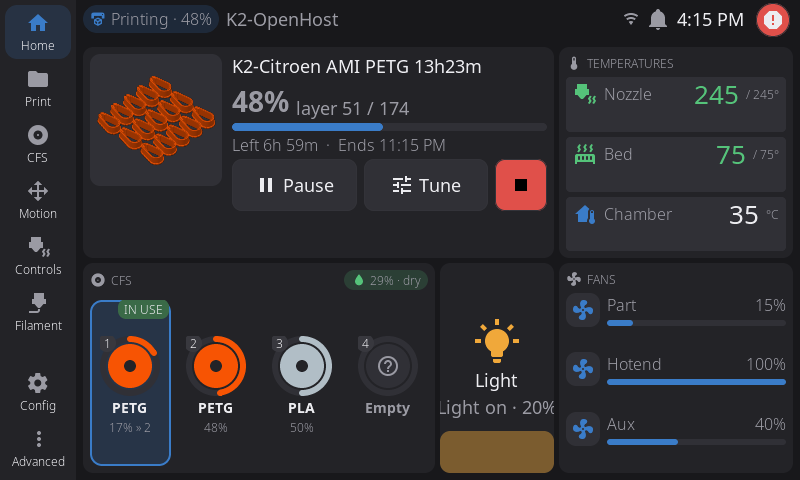
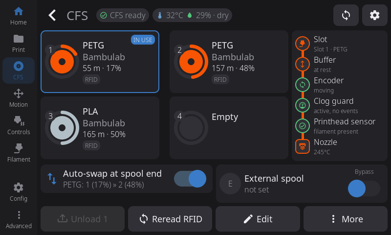
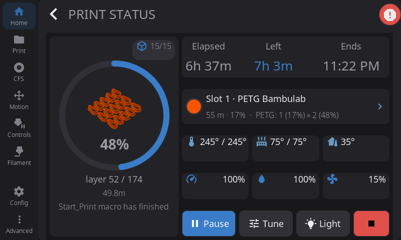
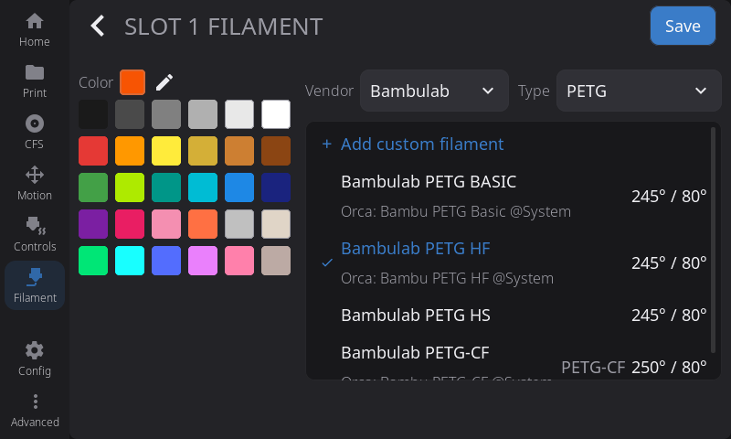
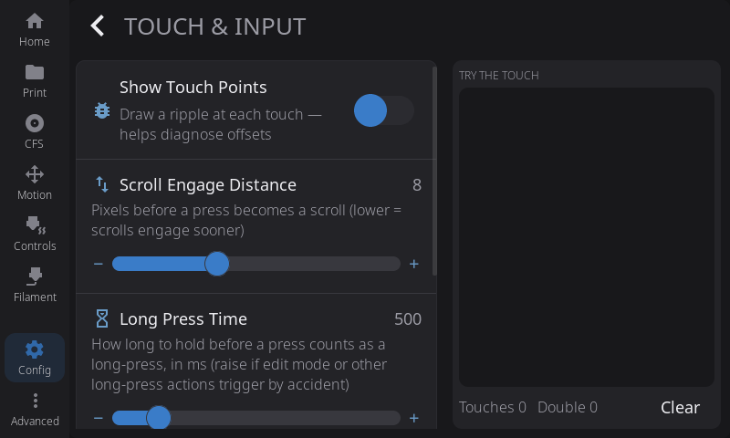

# HelixScreen (printer screen)

In slot B the printer's own touch screen runs **HelixScreen**, connected to Moonraker on the host. The T113 bootstrap installs it on the first boot of slot B, already pointed at the host.

K2-OpenHost uses its own fork, **[MzTechnology97/helixscreen](https://github.com/MzTechnology97/helixscreen)** (branch `k2-openhost`), based on prestonbrown's [HelixScreen](https://github.com/prestonbrown/helixscreen). Fork versions are the base version plus our build number: `1.0.6-k2oh.8` is the eighth build on 1.0.6.

## The K2-OpenHost interface

When HelixScreen is connected to Kalico's CFS it shows its own interface for the K2, with the `k2-openhost` theme. With other printers HelixScreen's own interface stays.

| Home | CFS page |
| --- | --- |
|  |  |

- **Home**: the running job (preview, progress, time left and end, Pause/Tune/Stop) or, when idle, Print a file, the queue, reprint and preheat; temperatures, CFS, light (tap = on/off, drag = brightness) and fans. Home stays customisable as in HelixScreen. On the CFS card the spool in use reads **IN USE** and names the slot the runout swap goes to (`17% » 2`).
- **CFS page**: the four spools with material, brand, remaining metres and percentage; the filament path (slot, buffer, encoder, clog detection, head sensor, nozzle); the runout swap; the **external spool card** with the **Bypass** switch. During a load or unload the header names the stage (`Loading 2 · to the head 3/5`). A spool with an unknown tag shows the tag's code.

| Print status | Spool profile |
| --- | --- |
|  |  |

- **Print status**: progress ring with the preview, times, the spool in use with the swap order, temperatures, speed, flow and fan. **Exclude objects** shows the bed full width: tap the object to exclude. If Kalico stops a CFS change, a warning card takes the spool's place with the reason and what to do: Resume retries the slot, or load another slot from the CFS page and then Resume.
- **Spool profile** (Edit → Change filament): the list is Kalico's filament library, the same one Mainsail uses, with the OrcaSlicer preset under each profile that has one. A profile from the library is assigned whole with `_BOX_SLOT_ASSIGN` (temperature, pressure advance, max flow, Orca id), the external spool included. Slots with a read RFID tag are not edited by hand.

{ width="480" }

- **Touch & Input** (Settings): a touch test pad. The K2's GT911 controller keeps its configuration fixed in the chip, so sensitivity and debounce cannot be changed; after the first rejected attempt the card says so and hides the presets.

## Filament library

From `1.0.6-k2oh.8` HelixScreen takes its filament list straight from Kalico (`box.filaments`): the CFS system filaments and your custom ones from `cfs_filaments.json`. A change in Mainsail shows up on the screen at once, and a new RFID code is recognised without a restart.

A filament created on the screen goes into Kalico's library with `_BOX_FILAMENT_SET` (material, brand, name, temperatures). Created from the editor of a slot with an unknown tag, it carries that tag's code, and Kalico applies it to the slot straight away. Edits to Creality's system filaments stay a local change on the screen, because Kalico keeps them read only.

Earlier builds used the `k2oh-helix-filaments` service on the T113 to rewrite HelixScreen's catalog every 30 s. With k2oh.8 or later the service puts HelixScreen's own catalog back and no longer starts.

## What the fork changes

| | HelixScreen 1.0.6 | K2-OpenHost fork |
| --- | --- | --- |
| Colour after a spool is reinserted | Often grey, in OrcaSlicer too: HelixScreen wrote its own `lane_data` before the RFID read | The tag's: only Kalico writes `lane_data` |
| Tools T0–T3 on the slots | Always T*n* = slot *n* | During a print, the print's mapping (`print_mapping`); otherwise the CFS map (`box.map`) |
| Remaining filament | Not shown | Remaining metres and fill bar, from the CFS or Kalico's estimate (see [Remaining filament](../cfs-firmware/remaining.md)) |
| Filament list | HelixScreen's own presets | Kalico's library |
| "Connection Failed" after a network drop | Stays on screen in languages other than English | Closes by itself when the connection is back |
| Moonraker wait at boot | `127.0.0.1:7125`, reset by every update | The Moonraker host in HelixScreen's settings |
| Camera server on the T113 (`ustreamer`) | Always installed | Skipped when the T113 has no `/dev/video0` |
| In-app updates | From upstream's releases | Only from the fork's releases |

Planned work is in the [fork roadmap](https://github.com/MzTechnology97/helixscreen/blob/k2-openhost/docs/k2-openhost/ROADMAP.md) (Italian).

## Installing or updating the fork

- **New install:** the helper downloads the fork's latest release (menu 24, answer **yes** to HelixScreen).
- **Later updates:** from HelixScreen's own update on the screen, which reads only the fork's releases.
- **By hand**, with the printer idle: download a release on the host, copy it to the printer and install it with `k2oh-setup helix-update`:

  ```sh
  # on the host
  curl -fLO https://github.com/MzTechnology97/helixscreen/releases/download/v1.0.6-k2oh.8/helixscreen-k2-v1.0.6-k2oh.8.tar.gz
  scp -O helixscreen-k2-v1.0.6-k2oh.8.tar.gz root@<printer-IP>:/mnt/UDISK/
  # on the printer (SSH)
  k2oh-setup helix-update /mnt/UDISK/helixscreen-k2-v1.0.6-k2oh.8.tar.gz
  ```

  `helix-update` refuses while the printer is printing or when the host does not answer. It saves HelixScreen (settings included) and its init scripts to `/mnt/UDISK/.k2openhost/helix-backup/<date>`, runs the release's installer, then puts back the wait on the host's Moonraker and turns the camera server off.
- **Going back:** `k2oh-setup helix-restore`, with the printer idle. It puts the last saved version back and moves the replaced one to `/mnt/UDISK/.k2openhost/trash/` (nothing is deleted).

## Useful commands

| Where | Command | What it does |
| --- | --- | --- |
| Klipper console | `SCREEN_RESTART` | Restarts HelixScreen (needs `[k2_t113]` linked) |
| Helper | `./helper.sh t113 host <IP>` (menu 29) | Points HelixScreen at another host address |
| Printer SSH | `k2oh-setup --host <IP>` | Same, on the printer |
| Printer SSH | `k2oh-setup status` | First-boot setup state |
| Printer SSH | `k2oh-setup helix-update <archive>` | Installs another HelixScreen release, printer idle only, with a backup |
| Printer SSH | `k2oh-setup helix-restore` | Puts the last saved version back |

## Troubleshooting

| Symptom | Fix |
| --- | --- |
| The screen stays on the boot logo | `k2oh-setup status`, `cat /mnt/UDISK/.k2openhost/setup.log`, then `k2oh-setup` again. |
| HelixScreen cannot reach Moonraker | Wrong host IP (menu 29), or the printer cannot reach the host on port 7125. |
| The filament list shows HelixScreen's presets | The screen is not connected to Kalico yet, or runs a build older than k2oh.8. |
| A reinserted spool stays grey, in OrcaSlicer too | Upstream HelixScreen: install the fork. To fix the slot now, `_BOX_RFID_READ_SLOT SLOT=<n>` from the console. |
| `helix-update` answers `printer state is printing` | Wait for the print to end. With `unreachable` the printer cannot reach Moonraker on the host. |
| Something is wrong after an update | `k2oh-setup helix-restore`, and report it in [K2-OpenHost](https://github.com/MzTechnology97/K2-OpenHost/issues). |

Log on the printer: `/mnt/UDISK/helixscreen/logs/helix.log`.
