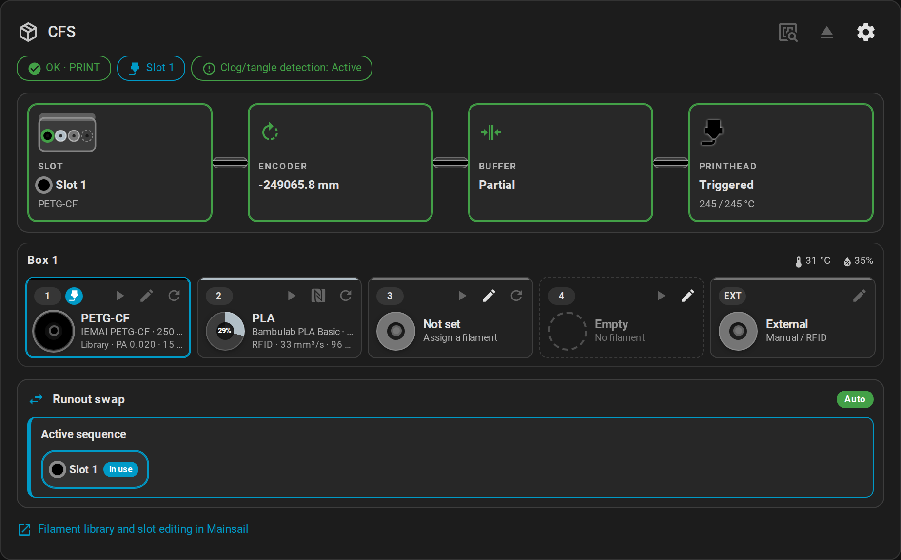
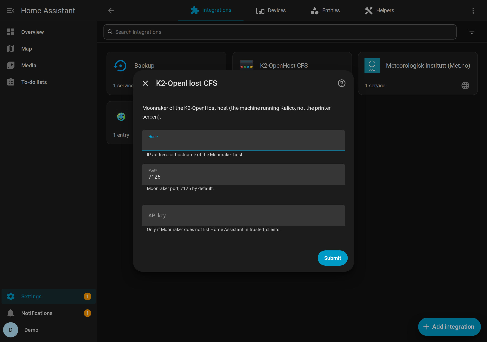
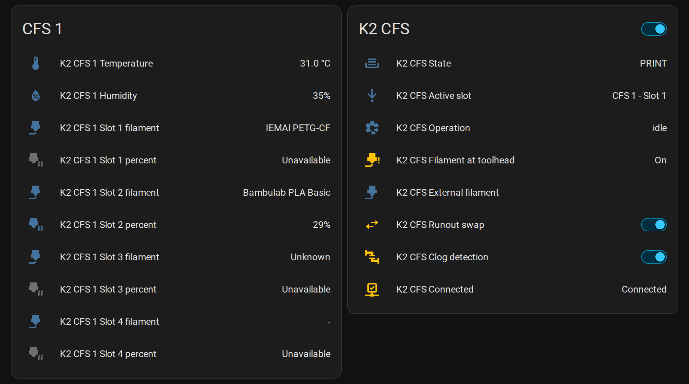
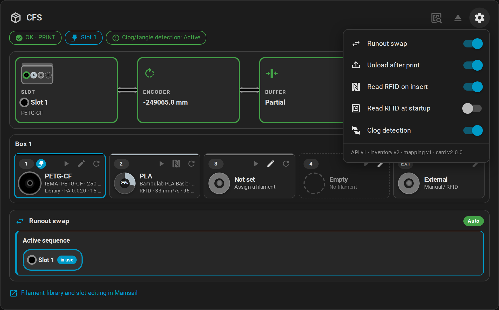
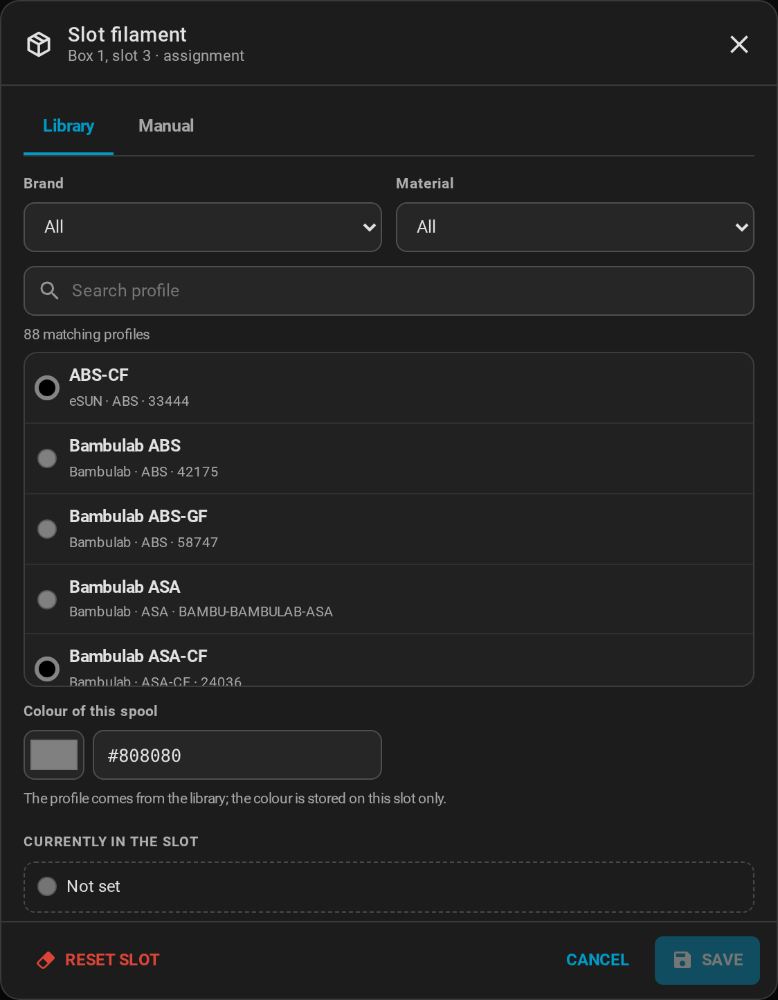

# Home Assistant

The **[K2-OpenHost CFS integration](https://github.com/MzTechnology97/ha-k2-openhost)** connects Home Assistant to Moonraker over the websocket, gets every change of the CFS as it happens, and ships the **K2-OpenHost CFS card**, a port of the Mainsail CFS panel.



## Requirements

- K2-OpenHost Kalico with the box API.
- Moonraker reachable from Home Assistant (port 7125). Either Home Assistant's address is in Moonraker's `[authorization] trusted_clients`, or you enter a Moonraker API key.
- Home Assistant 2025.1 or newer.

## Install with HACS

1. HACS → menu (⋮) → **Custom repositories**.
2. Repository `https://github.com/MzTechnology97/ha-k2-openhost`, type **Integration** → **Add**.
3. Search **K2-OpenHost CFS** → **Download**, then restart Home Assistant.
4. **Settings → Devices & services → Add integration → K2-OpenHost CFS**: host and port of **Moonraker on the K2-OpenHost host** (not the printer's screen).

{ width="620" }

Manual install: copy `custom_components/k2_openhost` into `/config/custom_components/` and restart.

## Entities

Devices: **K2 CFS** (the box) and one **K2 CFS *n*** per CFS unit.

| Entity | Content |
| --- | --- |
| `sensor.k2_cfs_<n>_temperature`, `_humidity` | Environment of CFS *n* |
| `sensor.k2_cfs_<n>_slot_<m>_filament` | Filament in slot *m* |
| `sensor.k2_cfs_<n>_slot_<m>_percent` | RFID remaining (%) |
| `sensor.k2_cfs_external_filament`, `_percent` | External spool |
| `sensor.k2_cfs_active_slot` | `CFS 1 - Slot 2`, `External` or `None` |
| `sensor.k2_cfs_operation` | `idle`, or `load / feeding_to_buffer` and so on |
| `sensor.k2_cfs_state` | Box state |
| `binary_sensor.k2_cfs_filament_at_toolhead` | Filament at the toolhead |
| `binary_sensor.k2_cfs_connected` | Moonraker connected and Klippy ready |
| `switch.k2_cfs_runout_swap`, `_unload_after_print`, `_read_rfid_on_insert`, `_read_rfid_at_startup`, `_clog_detection` | The five CFS settings |



## The card

Added to the dashboard resources by the integration. From the card picker (**K2-OpenHost CFS**) or in YAML:

```yaml
type: custom:k2-openhost-cfs-card
title: CFS
confirm: true             # ask before load, unload and RFID scan
mainsail_url: http://k2host.local
```

It shows the status chips, the filament path, each CFS with its tiles and the runout groups. The pencil of a slot opens the filament dialog (library or manual profile).

| Settings menu | Library profile |
| --- | --- |
|  |  |

## Actions

| Action | G-code | Refused when |
| --- | --- | --- |
| `k2_openhost.load_slot` (`slot`, `flush`, `wait`) | `BOX_SELECT_SLOT` | printing/paused, empty or already loaded slot |
| `k2_openhost.unload` | `BOX_UNLOAD` | printing/paused, nothing loaded |
| `k2_openhost.rfid_scan` | `BOX_RFID_SCAN` | printing/paused |
| `k2_openhost.rfid_read_slot` (`slot`) | `_BOX_RFID_READ_SLOT` | printing/paused, slot loaded toward the printhead |
| `k2_openhost.assign_slot` (`slot`, `filament_id`, `color`) | `_BOX_SLOT_ASSIGN` | RFID slot; slots the print uses |
| `k2_openhost.set_slot`, `clear_slot` | `_BOX_SLOT_SET`, `_BOX_SLOT_CLEAR` | as `assign_slot` |
| `k2_openhost.set_setting` (`setting`, `enabled`) | `_BOX_SET_*` | — |
| `k2_openhost.recover` | the recovery command | no blocked operation |
| `k2_openhost.get_library` | — | returns the filament library |

Example automation, notify when a background command fails:

```yaml
triggers:
  - trigger: event
    event_type: k2_openhost_command_failed
actions:
  - action: notify.notify
    data:
      message: "{{ trigger.event.data.command }}: {{ trigger.event.data.error }}"
```

## Troubleshooting

| Symptom | Check |
| --- | --- |
| *Cannot reach Moonraker* | Host and port of the machine running Moonraker (7125); firewall |
| *Moonraker refused the request* | Add Home Assistant to `trusted_clients`, or use an API key |
| *Klipper has no box object* | Kalico is not a K2-OpenHost build, or Klippy is not ready |
| Entities unavailable | `binary_sensor.k2_cfs_connected`; the integration reconnects by itself |

Full documentation: [ha-k2-openhost](https://github.com/MzTechnology97/ha-k2-openhost#readme).
