# Mainsail

K2-OpenHost uses **[Mainsail K2-OpenHost](https://github.com/MzTechnology97/mainsail-k2openhost)**, a Mainsail fork that adds two panels and a print-start step for the K2. Everything else is upstream Mainsail. Open it at `http://k2host.local/` (or the host's IP).

## Dashboard

| Panel | What it is |
| --- | --- |
| **Status** | Upstream Mainsail: print progress, file, speed, layer, ETA |
| **CFS** | The CFS: filament path, slot tiles, runout groups, settings ([below](#cfs-panel)) |
| **Motors** | Closed-loop X, Y and E motors: readiness, calibration, protection, temperatures |
| **Temperatures** | Bed, extruder, chamber heater, chamber exhaust fans, `cm5_fan` (host CPU fan), MCU and motor temperatures |
| **Toolhead, Console, Macros, Webcam** | Upstream Mainsail |

Panels can be shown, hidden and moved in *Settings → Dashboard*.

## CFS panel

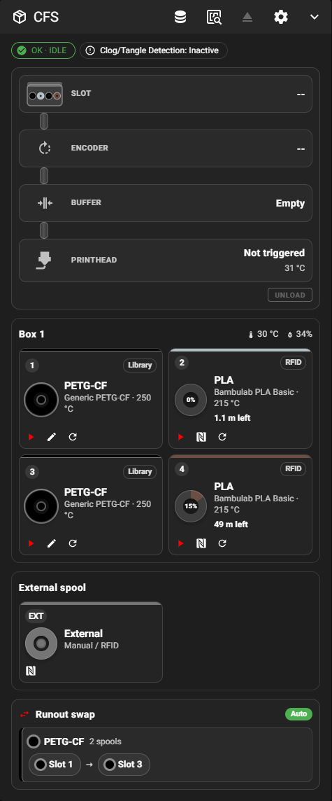{ width="480" }

From top to bottom:

- **Status chips**: box state and mode, the slot loaded in the printhead, clog/tangle detection.
- **Recovery alert** when a CFS operation blocked the print; `RESUME` retries the step.
- **Filament path** from the CFS to the nozzle: slot → encoder → buffer → printhead, with the PTFE tube filled in the spool colour as far as the sensors report. During a load or unload a banner shows the step and the stage pulses.
- **One section per CFS unit** with its temperature and humidity, then the **external spool**.
- **Runout swap** groups.

Header buttons: filament library, RFID scan of all populated slots, unload, settings menu. Manual actions are disabled while printing.

| Idle | Loading |
| --- | --- |
| 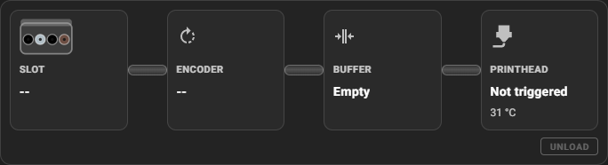 | 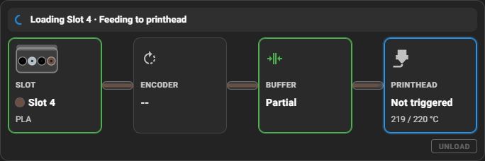 |

### Slot tiles

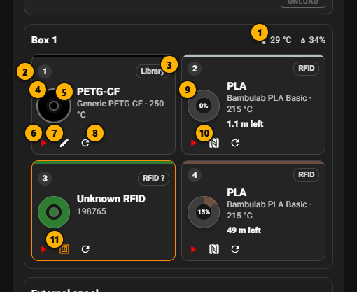{ width="520" }

| Part | Meaning |
| --- | --- |
| Source badge | `RFID`, `RFID ?` (unknown tag), `Library`, `Spoolman` or `Manual` |
| Spool ring | Filament colour; for RFID spools the coloured sector is the filament left, with the percentage in the centre |
| ▶ Load | Loads this physical slot into the printhead (`BOX_SELECT_SLOT`) |
| ✎ Edit | Slot editor for spools without RFID |
| ⟳ Reread | Reads this slot's RFID tag again |
| RFID | Read-only sheet of the tag data |

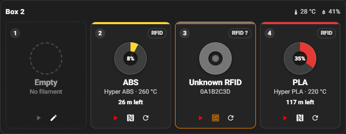

### Settings menu

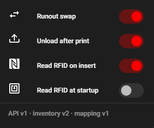{ width="300" }

| Switch | Command |
| --- | --- |
| Runout swap | `_BOX_SET_RUNOUT_SWAP` |
| Unload after print | `_BOX_SET_UNLOAD_AFTER_PRINT` |
| Read RFID on insert | `_BOX_SET_RFID_INSERT_READING` |
| Read RFID at startup | `_BOX_SET_RFID_STARTUP_READING` (off by default) |
| Clog detection | `_BOX_SET_CLOG_DETECTION` |

All settings are saved on the printer and survive restarts.

### Several CFS units and phones

The panel follows its own width: four tiles per row on a wide panel, compact tiles in a narrow column, one column on a phone. With several CFS units each one gets its own section.

| Phone | Several CFS (simulated) |
| --- | --- |
| 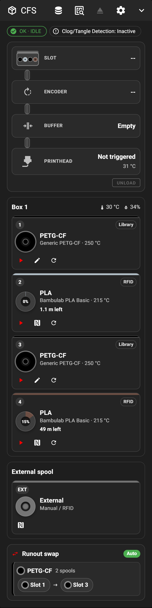{ width="280" } | 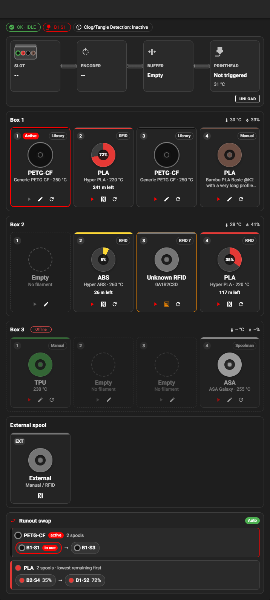 |

The complete guide of every CFS feature is in [Using the CFS](cfs.md) and in the [Mainsail fork documentation](https://github.com/MzTechnology97/mainsail-k2openhost/blob/develop/docs/K2_CFS.md).

## Print dialog with CFS mapping

When you start a print from Mainsail, the normal **Print** dialog reads the file's OrcaSlicer metadata (`BOX_PRINT_INFO`) and shows one row per slicer tool with the CFS slot that will feed it.

| Mapping | Filament source |
| --- | --- |
| 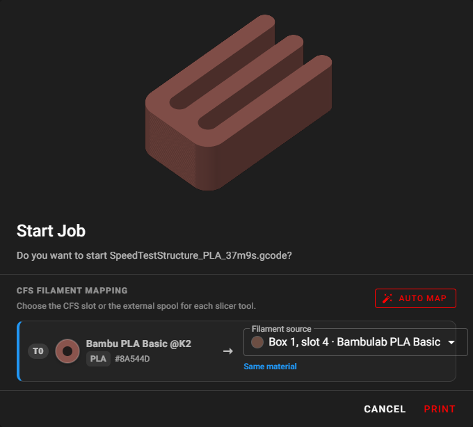 | 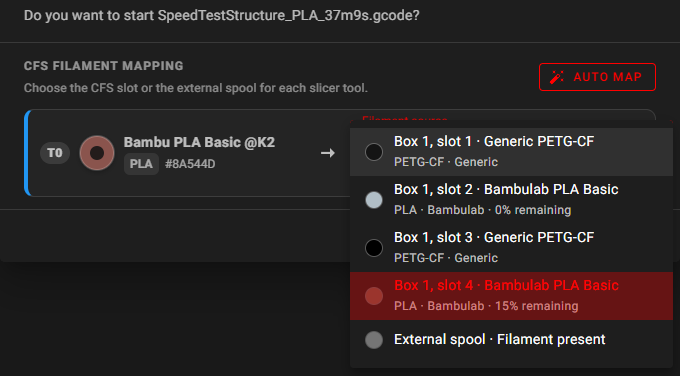 |

- **Auto map** uses the backend matcher: material and colour decide; among equal spools one with enough filament wins, then the lowest remaining one.
- **Filament source** changes any tool by hand.
- **Print** starts the job with `BOX_PRINT_START FILENAME=... MAP=tool:slot,...`.
- Warnings (may run out, material variant, humid CFS) never block the print.

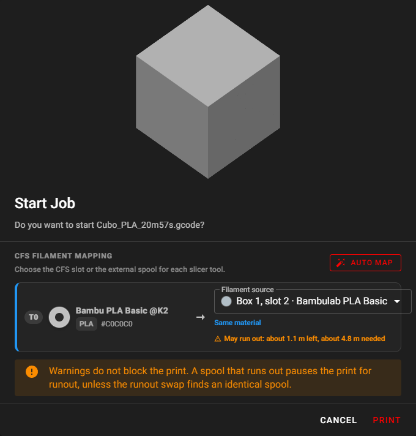{ width="420" }

## Motors panel

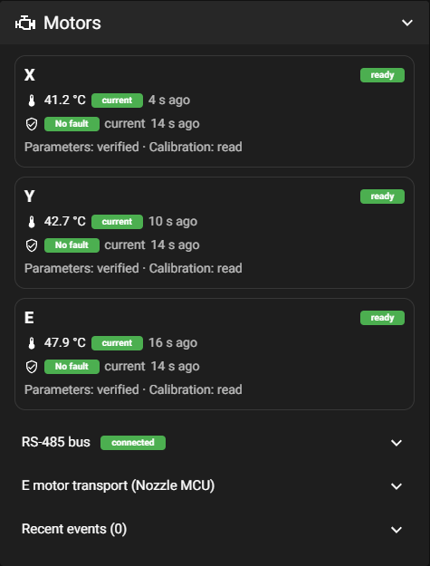

Read-only diagnostics of the closed-loop X, Y and E motors that Kalico publishes: startup and readiness, calibration, protection state and recent events, motor MCU temperatures, RS-485 counters. The console commands behind it are in [G-code commands](../GCODE_COMMANDS.md#7-closed-loop-motors-status-and-maintenance).

## Update manager

*Machine* → **Update Manager** updates Kalico (`kalico-k2pro`), Moonraker, Mainsail K2-OpenHost, the Cartographer plugin and the helper. See [Updates](../installation/updates.md).

## Useful Mainsail tips

- **Console**: every K2-OpenHost message starts with a prefix such as `[BOX]:`, `[k2_t113]` or `serial_485`; warnings start with `!!`.
- **Machine → files**: `cfs_filaments.json` (your filament library) and the `.cfg` files can be edited there; `filament_box.json` is outside the config folder on purpose.
- **Emergency stop**: with `estop_on_shutdown: m112` in `[k2_t113]`, it also cuts the MCU power rail.
