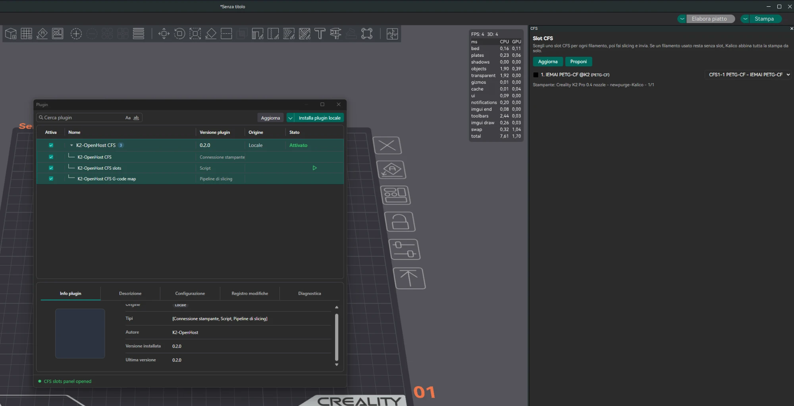
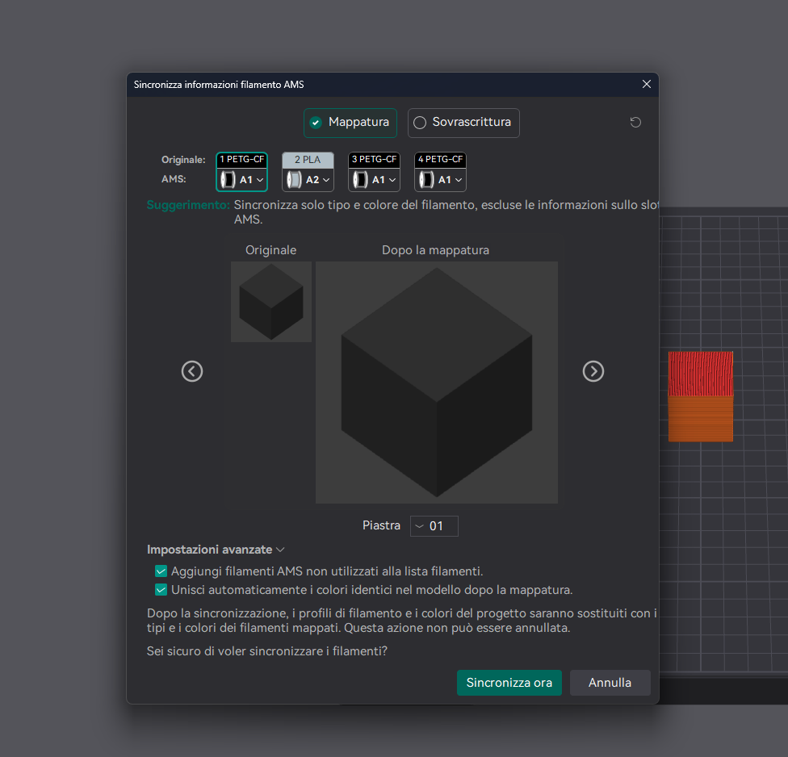
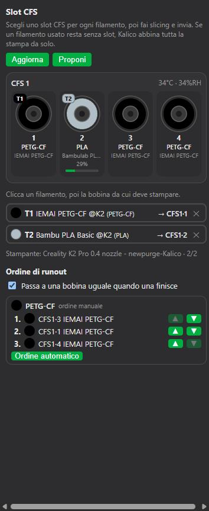

# OrcaSlicer 2.5 plugin

OrcaSlicer 2.5 (alpha since 2026-10-16) loads Python plugins. The **K2-OpenHost CFS** plugin brings the CFS into OrcaSlicer: Sync by exact preset, a CFS panel to choose the slot of each filament, and the runout order.

!!! warning "Experimental"
    OrcaSlicer 2.5 and its plugin API are alpha. The plugin is tested against the reference printer's Moonraker and inside OrcaSlicer (Sync, panel), but a print started with its slot map is not validated yet. Source: [`tools/orcaslicer/k2_openhost_cfs.py`](https://github.com/MzTechnology97/K2-OpenHost/tree/main/tools/orcaslicer).

## What it does

| Part | Type | What it does |
| --- | --- | --- |
| **K2-OpenHost CFS** | Printer agent | Publishes each CFS slot to OrcaSlicer with the `orca_filament_id` Kalico keeps per filament, so **Sync** selects that preset (Bambu PLA Basic, not Generic PLA). Also serves the Device tab. |
| **K2-OpenHost CFS slots** | Script (panel) | A panel beside the 3D view that draws each CFS with its spools; click a filament, then a spool, to choose where it prints from. Also the runout order. Opens by itself after every slice. |
| **K2-OpenHost CFS G-code map** | Slicing pipeline | Writes the panel's choice after the first G-code line, e.g. `; K2OH_TOOL_MAP = 0:1,2:0`. Kalico uses it when the print starts, instead of its automatic mapping. |

## Install

1. Download [`k2_openhost_cfs.py`](https://github.com/MzTechnology97/K2-OpenHost/tree/main/tools/orcaslicer).
2. OrcaSlicer → **Plugins** → **Install local plugin** → choose the file. OrcaSlicer copies it to `%APPDATA%\OrcaSlicer\orca_plugins\`.
3. Printer preset → **Printer settings → Basic information → Advanced → Printer Agent**: **K2-OpenHost CFS**.
4. **Print host**: the Moonraker address **with the port**, for example `10.10.1.97:7125`. Save the preset.
5. OrcaSlicer asks permission for the plugin to create a thread and to connect to that address: allow both. The first connection is refused while the question is open; the plugin retries every 2 s.

!!! important "Use the address with the port"
    OrcaSlicer ties every saved printer to the agent it was added with. A printer saved under the plain address (`10.10.1.97`) stays bound to the built-in Moonraker agent, and selecting the plugin then finds no printer ("target machine was not found"). The address with the port is a new printer for OrcaSlicer, bound to the plugin.

!!! warning "Leave *Use printer agents instead of print hosts* off"
    *Preferences → Developer → Use printer agents instead of print hosts* is a **global** option of OrcaSlicer 2.5-alpha: it changes the print flow and the Device tab of **every** non-Bambu printer, and can break other printers. The plugin does not need it: keep the classic **Upload and print**.

## Sync

Press **Sync** in the filament list. Each CFS slot arrives with its preset ID.

{ width="560" }

!!! info "Why your tuned preset is not picked"
    OrcaSlicer's sync matches **root presets** only: system presets, and your own presets made with **Create filament** (they have their own `P…` ID). A preset saved from another one (it shows a parent under *Dependencies*) is never picked, by any agent: OrcaSlicer takes its parent. To sync to your tuned preset, create it with **Create filament**, copy your settings into it, and give its `P…` ID to the CFS filament in Mainsail (filament library → **OrcaSlicer preset…**). The slot panel below has no such limit.

## CFS panel

After every slice for the K2, the panel opens beside the 3D view (or comes back if you closed it). It shows each CFS with its four spools (colour, material, name, remaining, temperature and humidity) and the project's filaments below.

{ width="360" }

1. The plugin proposes a slot for each filament: same material, then closest colour.
2. To change it: click the filament, then the spool. The ✕ leaves that filament to Kalico.
3. **Upload and print**. The plugin writes the map into the G-code; Kalico applies it when the print starts.

The map is written only for the printer preset and filament list it was chosen for, and only when **every filament the plate uses** has a slot. Otherwise nothing is written and Kalico maps the print automatically. Kalico also ignores, with a console message, a map whose slot is empty or offline.

**Refresh** reloads filaments and slots; **Propose** starts over. Setting `auto_open: false` (capability configuration) stops the opening after slicing; you can always open the panel from the plugin manager (**K2-OpenHost CFS slots** ▶).

## Runout order

Under the filaments, the panel has a **Runout order** section:

- the switch **Switch to an identical spool when one runs out** (`_BOX_SET_RUNOUT_SWAP`);
- every group of identical spools in the order Kalico will use them, with ▲▼ and **Automatic order**.

Changes are saved on the printer with `_BOX_SET_RUNOUT_ORDER`, as Mainsail does, and apply to the next runout.

## Settings

| Capability | Setting | Default | Meaning |
| --- | --- | --- | --- |
| K2-OpenHost CFS | `poll_interval_s` | 2 | Status refresh |
| K2-OpenHost CFS | `model_id` | preset model with `_` (`Creality_K2_Pro`) | Printer model sent to OrcaSlicer |
| K2-OpenHost CFS | `use_slot_map` | true | With the global agent option on: send the print dialog's map |
| K2-OpenHost CFS slots | `auto_open` | true | Open the panel after slicing |

Log: `k2oh_cfs.log` in the plugin's folder, `%APPDATA%\OrcaSlicer\orca_plugins\k2_openhost_cfs.py\`.

## Requirements on the printer

- Kalico with `orca_filament_id` per filament (since 2026-10-09) for Sync.
- Kalico with the slicer map in `box_print_mapping` (kalico-k2pro #87, 2026-10-21) for the panel's map.
