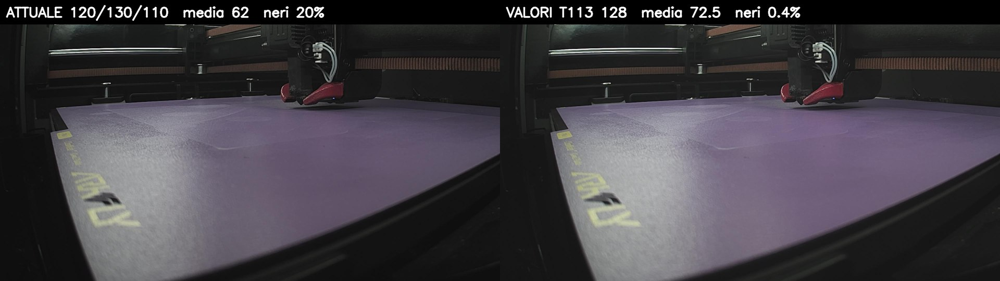
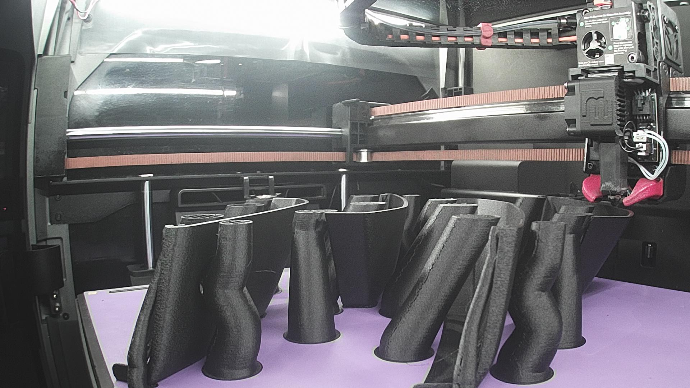

# Fotocamera della camera (Creality CAM)

Aggiornato al **14 ottobre 2026**. [English](../en/CAMERA.md)

La fotocamera della camera del K2 Pro funziona sull'host esterno con crowsnest e il driver `uvcvideo` di serie. Servono due impostazioni, senza le quali l'immagine diventa nera.

## Configurazione

In `~/printer_data/config/crowsnest.conf`, nella sezione `[cam]` della fotocamera:

```ini
[cam 1]
mode: ustreamer
port: 8080
device: /dev/v4l/by-id/usb-Creality_3D_Technology_CREALITY_CAM_<seriale>-video-index0
resolution: 1920x1080
max_fps: 25
v4l2ctl: brightness=128,contrast=128,sharpness=128,saturation=128,power_line_frequency=1,auto_exposure=3
```

- `max_fps: 25` è obbligatorio. A 30 fps l'esposizione automatica della fotocamera si assesta su un'immagine nera.
- `v4l2ctl` contiene i controlli del firmware di serie. Crowsnest li invia alla fotocamera prima di avviare lo stream, che è l'ordine di cui questa fotocamera ha bisogno.
- Poi **riavvia l'host**. La fotocamera recepisce correttamente i controlli solo dopo che è stata spenta e riaccesa, e riavviare il CM5 è ciò che la spegne e la riaccende.

L'[installer helper](https://github.com/MzTechnology97/k2-openhost-installer-helper) lo fa quando installa crowsnest con la fotocamera collegata. `./helper.sh install creality-cam` esegue solo questo passaggio. Modifica la sezione il cui `device` è questa fotocamera e conserva un backup di `crowsnest.conf`.

Usa il percorso `/dev/v4l/by-id/...` invece di `/dev/video0`, così la sezione resta legata a questa fotocamera anche se colleghi altre fotocamere.

**Prima**, con crowsnest a 30 fps:



*14 ottobre 2026, crowsnest a 30 fps. A sinistra ("ATTUALE"): i controlli usati fino ad allora (brightness 120, contrast 130, saturation 110, `auto_exposure=0`), media 62/255 con il 20 % di pixel neri. A destra ("VALORI T113"): i valori di serie (128) impostati dopo l'avvio dello stream, la modalità normale più scura, media 72,5/255. Con i controlli di serie inviati prima dello stream, come fa il firmware di serie, l'immagine diventava nera (media 19/255); di quella non è stata conservata un'istantanea.*

**Dopo**, con le impostazioni qui sopra:



*La stessa fotocamera, 14 ottobre 2026, durante una stampa in PETG-CF: driver `uvcvideo` di serie, crowsnest/ustreamer a 1920x1080 e 25 fps, i controlli qui sopra. Misurata con il LED della camera al 100 %: media 189/255, nessun pixel nero.*

## La fotocamera

| | |
|---|---|
| USB | `1d6c:0103` "CREALITY CAM", Fullhan FH8636, firmware `STD-9613V2` |
| Classe | UVC 1.00, video su endpoint **bulk** (`0x83`) |
| Formati | MJPEG, YUYV, H.264; da 640x360 a 1920x1080; da 5 a 30 fps |
| Controlli | brightness, contrast, saturation, sharpness (0-255, default 128), gain (0-100, nessun effetto visibile), power_line_frequency, bilanciamento del bianco, auto_exposure, exposure_time_absolute |

## Comportamento del firmware

Sono comportamenti del firmware della fotocamera. Anche il T113 di serie li ha: il suo `ustreamer` lavora a 25 fps e il suo script di avvio imposta i controlli prima del primo stream.

| Comportamento | Effetto | Cosa fare |
|---|---|---|
| Esposizione automatica a **30 fps** con i controlli impostati | L'esposizione si assesta su un'immagine nera (media 19/255) in meno di un secondo | `max_fps: 25` |
| Controlli inviati **prima** del primo stream dopo l'accensione, a 25 fps | Immagine luminosa, come col firmware di serie (media 189/255 con il LED della camera al 100 %) | `v4l2ctl` in crowsnest, poi riavvio |
| Nessun controllo inviato | Immagine normale, più scura (media ~72) | — |
| Prima modifica di un controllo **a stream attivo** dopo l'accensione | L'immagine diventa nera; una seconda modifica la ripristina, nella modalità più scura | Cambia `v4l2ctl` e riavvia invece di cambiare i controlli dal vivo |
| `auto_exposure` 1 (manuale) o 2 (priorità otturatore) | L'immagine resta nera finché la fotocamera non viene spenta e riaccesa | Usa 3 (priorità diaframma, come di serie) o 0 |
| `gain` | Nessun effetto visibile | — |

Con il LED della camera al 100 %, nella modalità luminosa circa il 45 % dei pixel è saturato, come col firmware di serie. Se è troppo, abbassa `brightness` in `v4l2ctl` e riavvia.

## Cosa è stato verificato (12-14 ottobre 2026)

Sul CM5 la fotocamera diventava nera ogni volta che i suoi controlli venivano impostati all'avvio. Le possibili cause qui sotto sono state provate una alla volta sulla stampante di riferimento. Riavviare il CM5 è l'unico modo per spegnere e riaccendere la fotocamera, quindi ogni prova ha richiesto un riavvio.

- **Hub USB e gestione energetica:** lo stesso hub funziona sul T113. Disattivare l'autosospensione USB (`on`) non ha cambiato nulla.
- **Tempi dei controlli:** a 30 fps, inviare i controlli a 3, 15 o 18 s dall'accensione, sempre prima del primo stream, dava comunque nero. A 25 fps, sia a 3 s sia a 15 s l'immagine è luminosa.
- **Driver del kernel** (`uvcvideo` 6.12 sul CM5, 5.4 sul T113): due differenze reali, confermate con `usbmon` e con un modulo modificato compilato per la prova.
  - In fase di probe, i kernel 6.8 e successivi scrivono due volte `power_line_frequency` (spento, poi il valore originale) per capire quali valori supporta la fotocamera. Il 5.4 non lo fa.
  - Il kernel 6.12 invia `CLEAR_FEATURE(ENDPOINT_HALT)` all'endpoint bulk solo quando uno stream si ferma. Senza quel comando, il primo stream dopo l'accensione restituisce solo header di errore da 12 byte. ustreamer si riprende da solo: dopo 2 s va in timeout, riparte, e il secondo stream funziona.
  - Con entrambe corrette, a 30 fps l'immagine restava nera. Con il driver di serie a 25 fps è luminosa. Quindi il driver **non** è la causa e non serve un modulo modificato.
- **ustreamer:** `strace` mostra che non invia nessun controllo d'immagine. Le sue uniche differenze rispetto allo stream del firmware di serie erano il frame rate e il numero di buffer.

## H.264

La fotocamera può inviare anche H.264 direttamente. Per ora K2-OpenHost resta su MJPEG:

- ustreamer, quello predefinito in crowsnest, trasmette solo MJPEG. Per vedere l'H.264 in Mainsail serve un server WebRTC come go2rtc, configurato come servizio webcam separato.
- Il CM5 (famiglia Raspberry Pi 5) non ha encoder né decoder H.264 hardware. Le istantanee per timelapse, Mobileraker o OctoEverywhere dovrebbero decodificare fotogrammi H.264 sulla CPU, mentre i fotogrammi MJPEG sono già istantanee JPEG.
- La fotocamera ha una sola interfaccia video, quindi non può inviare H.264 e MJPEG contemporaneamente.
- Il comportamento del firmware descritto sopra non è stato provato in modalità H.264.

L'H.264 fa risparmiare soprattutto banda: circa 4 MB/s di MJPEG a 1080p e 25 fps, contro pochi Mbit/s di H.264. Conta per la visione remota su una connessione lenta, non sulla rete locale.
