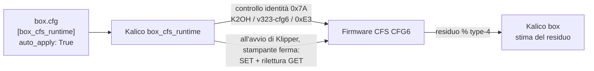

# Firmware CFS sperimentale

Il CFS ha un suo microcontrollore (`cfs0_050_G32`) che esegue l'applicazione di Creality (stock `cfs0_000_153`, mostrata come 1.5.3). Il progetto **[k2-cfs-rfid-tools](https://github.com/MzTechnology97/k2-cfs-rfid-tools)** pubblica **build modificate di quella stessa applicazione stock**: il codice di Creality resta, e piccoli agganci aggiungono funzioni che il firmware stock tiene bloccate.

!!! danger "Sperimentale: leggi prima di flashare"
    - Queste immagini **non sono qualificate per la produzione**. Cambiano il firmware di un controller di motori: un'immagine difettosa può fermare il CFS finché non flashi un'immagine di recupero.
    - Flasha **solo a stampante ferma**, mai durante una stampa, e tieni a portata di mano un'immagine di rollback funzionante.
    - Il firmware CFS stock funziona con K2-OpenHost: queste immagini non servono per usare il CFS.

## Cosa sblocca il firmware modificato

| Funzione | Stock 1.5.3 | Modificato (CFG6 v3.25) |
| --- | --- | --- |
| Parametri runtime (velocità dell'hub, timeout, movimenti RFID, cicli di pretensionamento) | Fissi | **23 scrivibili** su 28, applicati da Kalico all'avvio |
| Identità del firmware leggibile dall'host | No | `0x7A` → `K2OH`, revisione `v323-cfg6`, feature `0xE3` |
| Residuo in tempo reale delle bobine type-4 durante la stampa | Solo con il chip sicuro di Creality | **Sperimentale, non qualificato**: il percorso di contabilizzazione è presente, ma con CFG6 v3.25 è stata osservata una percentuale bloccata ([#59](https://github.com/MzTechnology97/k2-cfs-rfid-tools/issues/59)) |
| Tag RFID di terze parti (Bambu, MIFARE) | No | Cattura API7 nella linea v3.12 e successive (vedi [RFID di terze parti](third-party-rfid.md)) |
| Diagnostica (`BOX_CFS_CONFIG_INFO`, `BOX_CFS_CONFIG_DIAG`) | Solo le velocità v1 stock | GET in sola lettura di tutti i 28 parametri con controllo dei limiti |

## Come si incastra

- Kalico scrive i parametri **solo** su un CFS che si identifica con l'identità esatta, **solo all'avvio di Klipper** (o quando il CFS ritorna) e **mai durante la stampa**. Ogni scrittura viene riletta.
- **Non esiste un comando di scrittura da console**: i valori arrivano solo da `box.cfg`. Firmware stock, build K2-OpenHost precedenti e OpenCFS vengono solo letti.
- I valori vivono nella RAM del CFS: si perdono quando il CFS si spegne e vengono riscritti al successivo avvio di Klipper.
- La build con fix RFID type-4 della [PR #60](https://github.com/MzTechnology97/k2-cfs-rfid-tools/pull/60) **non è qualificata e non va flashata**: il tentativo del 24 ottobre si è interrotto durante il trasferimento.

## Pagine

- [Versioni](versions.md): ogni immagine, cosa aggiunge, quale usare.
- [Flash e rollback](flash.md): menu 40 dell'helper, passo per passo, e come tornare indietro.
- [Parametri runtime (CFG6)](parameters.md): cosa fa ciascuno dei 28 parametri e come impostarlo.
- [Residuo in tempo reale](remaining.md): il conteggio type-4 nel CFS e in Kalico.
- [Tag RFID di terze parti](third-party-rfid.md): bobine Bambu, QIDI e MIFARE.

## OpenCFS

[OpenCFS](https://github.com/MzTechnology97/OpenCFS-Firmware) è un progetto separato: un firmware nuovo scritto da una specifica, non una modifica di quello di Creality. Kalico lo identifica (`0x7A` → `OCFS`) e non gli invia mai scritture di parametri K2OH.
