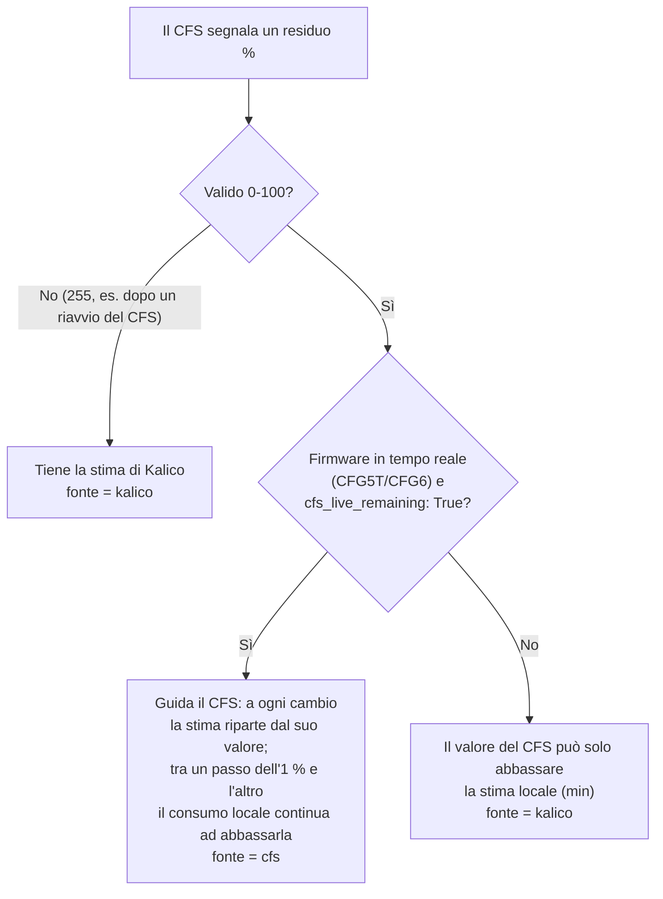

# Residuo in tempo reale

Ogni bobina nel CFS mostra una **percentuale di residuo**. K2-OpenHost ha due fonti per questo valore e sceglie la migliore slot per slot.

| Fonte | Dove viene calcolata | Disponibile con |
| --- | --- | --- |
| **CFS** (`cfs`) | Nel CFS: l'odometro misura il filamento realmente tirato e il conteggio "type-4" stock lo trasforma in percentuale, in tempo reale durante la stampa | **CFG5T v3.24** e **CFG6 v3.25** |
| **Kalico** (`kalico`) | Sull'host: lunghezza nominale della bobina, meno il filamento misurato dall'encoder del percorso del CFS (o `print_stats` se l'encoder non è disponibile), salvato per UID del tag | Qualsiasi firmware CFS |

La stima di Kalico è sempre attiva: è il **fallback** quando il CFS non fornisce un valore in tempo reale.

## Perché type-4

Il firmware CFS stock 1.5.3 ha un percorso di residuo solo in RAM (`runtime_type = 4`) che aggiorna il byte del residuo dall'encoder fisico del percorso e non riscrive mai il tag. Lo stock lo attiva solo insieme al chip RFID sicuro di Creality. CFG5T e CFG6 aprono quel blocco per le altre bobine, senza scrivere nulla sul tag:

```text
consumed_percent = floor(used_mm * 100 / total_mm)
remaining        = max(initial_percent - consumed_percent, 0)
```

Il CFS registra il punto di partenza dell'encoder quando la bobina viene caricata e chiude l'intervallo allo scaricamento.

## Come Kalico unisce le due fonti



- Con il firmware in tempo reale il valore del CFS vince **in su o in giù**, quindi una correzione fatta dal CFS viene seguita.
- L'ultimo valore del CFS (`cfs_percent`) è salvato con la stima, così un riavvio di Klipper non riallinea la bobina senza motivo.
- Con gli altri firmware il valore del CFS è solo quello misurato al caricamento: può abbassare la stima, mai alzarla.

## Configurazione

```ini
[box]
cfs_live_remaining: True   # predefinito; False = usa sempre la stima di Kalico
```

La fonte in tempo reale si usa solo quando `[box_cfs_runtime]` ha identificato il CFS come `v323-cfg5t` (`0xE5`) o `v323-cfg6` (`0xE3`). **Non** serve `auto_apply` attivo: l'identificazione è in sola lettura.

## Controllare quale fonte usa uno slot

Nello stato del box di ogni slot (pannello CFS di Mainsail, oggetto `box` di Moonraker):

| Campo | Significato |
| --- | --- |
| `rfid_percent` | Percentuale mostrata |
| `rfid_remaining_source` | `cfs` o `kalico` |
| `rfid_usage_source` | Consumo di Kalico: `cfs_encoder` o `print_stats` |
| `rfid_total_m`, `rfid_remaining_m` | Lunghezza nominale e rimanente |

E per ogni unità CFS in `box_cfs_runtime`: `live_remaining: true` quando il firmware tiene il valore aggiornato in tempo reale.

In console:

```text
_BOX_RFID_REMAINING_DIAG SLOT=<slot-globale>
```

stampa il valore grezzo del residuo che il CFS restituisce per quello slot.

## Lunghezza nominale

Kalico ha bisogno della lunghezza della bobina in metri. In ordine di preferenza:

1. la lunghezza letta dal tag (quando un decoder la legge);
2. la **lunghezza nominale** del profilo filamento (editor filamenti di Mainsail);
3. la lunghezza di riferimento del materiale per una bobina da 1 kg, 1,75 mm (PLA 335 m, PETG 327 m, ABS 400 m, ASA 390 m, …).

Per una singola bobina diversa (parzialmente usata, da 3 kg):

```text
_BOX_RFID_SPOOL_NEW SLOT=<slot-globale> TOTAL_M=<metri> REMAINING=<0..100>
```

!!! note "Stato"
    Il contratto SET/GET del CFS e l'identità sono verificati su hardware. I valori type-4 durante una **vera stampa lunga** sono ancora in validazione: tieni `cfs_live_remaining: True` e confronta `cfs` con quello che la bobina contiene davvero. Se qualcosa non torna, `cfs_live_remaining: False` torna alla stima di Kalico.
