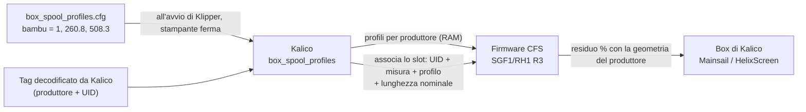

# Geometria delle bobine per produttore

Il CFS stima quanto filamento resta su una bobina dalle sue dimensioni. Il firmware stock presume una **bobina Creality**, quindi una bobina piena di un'altra marca risulta più vuota del vero: una Bambu nuova segnava **84 %**. Con il firmware candidato **SGF1/RH1 R3** e il modulo Kalico abbinato `[box_spool_profiles]`, ogni produttore ha la sua geometria e la stessa bobina piena segna **100 %**.

!!! warning "Candidato, non una versione rilasciata"
    - Firmware: **candidato CFG6 SGF1/RH1 R3** ([PR #64 di k2-cfs-rfid-tools](https://github.com/MzTechnology97/k2-cfs-rfid-tools/pull/64), aperta). L'immagine mantenuta resta RDG2 (vedi [versioni](versions.md)).
    - Kalico: `box_spool_profiles` ([PR #105 di kalico-k2pro](https://github.com/MzTechnology97/kalico-k2pro/pull/105), aperta), installato solo sul CM5 di riferimento.
    - Provato sulla K2 Pro di riferimento il 29 ottobre 2026 con due bobine Bambu PETG HF. Il consumo durante una stampa con R3 e gli altri formati di tag non sono ancora validati.

## Come il CFS misura una bobina

Quando inserisci una bobina (o ne rileggi il tag), il CFS la fa girare finché il tag RFID passa due volte davanti al lettore, e registra quanto filamento è scorso tra i due passaggi. Quella distanza è la **lunghezza di filamento di un giro**, cioè la circonferenza dell'avvolgimento esterno.

- Una bobina piena dà un giro lungo, una quasi vuota un giro vicino all'anima.
- Il CFS controlla che i due passaggi abbiano visto lo stesso UID del tag. Solo allora la misura è **valida** e si può usare per una geometria.

La percentuale rimasta è l'area dell'anello di filamento tra l'anima e l'avvolgimento esterno:

```text
percentuale = (C² − anima²) / (pieno² − anima²) × 100     arrotondata, limitata a 1..100
```

- `C`: la circonferenza appena misurata.
- `anima`: circonferenza dell'anima vuota, dove comincia il filamento.
- `pieno`: circonferenza di una bobina nuova, piena.

Il firmware stock ha questi due valori fissi per le bobine Creality: anima Ø 96 mm e pieno Ø 172 mm (circonferenze 301,6 mm e 540,4 mm). Una bobina Bambu ha anima e avvolgimento pieno più piccoli, ed è per questo che la lettura era sbagliata.

## Cosa aggiungono il nuovo firmware e Kalico



1. **Profili.** All'avvio di Klipper, Kalico carica fino a quattro geometrie nella RAM del CFS e le rilegge una per una.
2. **Produttore.** Non è il CFS a decidere la marca. Solo dopo che il decoder di Kalico ha letto il tag, Kalico comunica al CFS a quale produttore appartiene quell'UID.
3. **Associazione.** Kalico invia la lunghezza nominale della bobina e associa lo slot al profilo del produttore. Lo fa solo se il CFS ha una misura valida di quello stesso UID (flag `0x13`).
4. **Nessuna seconda scansione.** Il CFS ricalcola la percentuale dalla misura che ha già. La bobina non gira di nuovo.
5. **Scansioni successive.** Quando lo stesso UID viene rimisurato, il CFS riusa da solo profilo e lunghezza. Una bobina usata resta usata: leggere un tag non riporta mai una bobina al 100 %.
6. **Durante la stampa** i contatori di consumo sono protetti, e una misura dubbia non sostituisce mai un valore già calibrato.
7. **Solo RAM.** Profili e associazioni si perdono quando il CFS si spegne. Kalico ricarica i profili al successivo avvio; finché non viene riassociata una misura valida, Kalico tiene la sua stima per quello slot.

Non viene scritto niente sul tag né sulla flash del CFS. Il firmware mantiene l'identità CFG6 (`K2OH` / `v323-cfg6` / `0xE3`), quindi i parametri runtime CFG6 continuano a funzionare. Kalico riconosce a parte l'estensione per la geometria.

Per le bobine Bambu, R3 legge anche il tag in **un solo ciclo del CFS**, invece di una scansione stock seguita da una seconda scansione completa.

## Configurazione

`macros/box_spool_profiles.cfg` sulla stampante di riferimento:

```ini
[box_spool_profiles]
serial: serial485
enabled: True
single_cycle_rfid: True
handoff_wait_ms: 3000
handoff_lease_ms: 10000
reconcile_interval: 5.0
vendor_geometries:
    bambu = 1, 260.8, 508.3
```

`vendor_geometries` ha una riga per produttore:

```text
produttore = id_profilo, circonferenza_anima_mm, circonferenza_piena_mm
```

| Campo | Significato | Limiti |
| --- | --- | --- |
| produttore | nome riportato dal decoder, in minuscolo (`bambulab` e `bambu lab` diventano `bambu`) | lettere, cifre, `_`, `-` |
| id profilo | posizione nel catalogo del CFS | 1–4, unico |
| circonferenza anima | circonferenza dell'anima vuota | 50–1000 mm |
| circonferenza piena | circonferenza di una bobina nuova piena | almeno 10 mm più dell'anima, fino a 1500 mm |

Con `vendor_geometries` vuoto o commentato, il CFS tiene la geometria Creality stock.

!!! note "Quali produttori funzionano oggi"
    La geometria si applica solo alle bobine il cui produttore viene riportato dal decoder dei tag di Kalico. Oggi è **Bambu**. Le bobine Creality usano già la geometria stock. Un'altra marca richiede un decoder che ne riporti il produttore: da sola, una riga in `vendor_geometries` non ha effetto.

## Calibrare un produttore

Servono due numeri: la circonferenza di una bobina **piena**, misurata dal CFS, e la circonferenza dell'**anima vuota**, misurata a mano.

### 1. La bobina piena

1. Carica una bobina **nuova, mai usata** di quel produttore e lascia che il CFS la legga.
2. Dalla console, a stampante ferma:

    ```text
    BOX_SPOOL_GEOMETRY_STATUS ADDRESS=1 SLOT=<0-3>
    ```

    `SLOT` è la posizione dentro il CFS, da 0 (lo slot 1 di Mainsail è `SLOT=0`). Il comando legge soltanto: non gira né muove niente.
3. Controlla che sia `flags=0x13` (misura valida) e annota `raw_circumference_mm`.
4. Togli e rimetti la bobina due o tre volte, e se ne hai usa più di una bobina nuova. Prendi il valore più alto, o la media se sono vicini.

La stessa bobina Bambu ha misurato 509,8 mm e 508,0 mm in due inserimenti: aspettati circa ±1 mm.

### 2. L'anima vuota

Misura con un calibro il **diametro esterno dell'anima vuota** (dove poggia il primo giro di filamento) e moltiplicalo per π:

```text
circonferenza_anima = π × diametro        cartone delle ricariche Bambu: 83 mm → 260,8 mm
```

Non usare come anima la lettura di una bobina quasi vuota. Una bobina con ancora qualche strato misura parecchi millimetri più dell'anima, e allora ogni bobina usata risulterebbe più vuota del vero. Su Bambu, una bobina con il 12 % rimasto misurava 302,8 mm, mentre l'anima nuda è 260,8 mm.

### 3. Configura e riavvia

1. Aggiungi la riga, per esempio `produttore = 2, <anima>, <pieno>`, con un `id` libero.
2. Fai `RESTART` di Klipper a riscaldatori spenti e stampante ferma.
3. Controlla:
    - l'oggetto `box_spool_profiles` (Moonraker o console di Mainsail) elenca il produttore e, sotto `cfs`, una revisione per il suo profilo;
    - `BOX_SPOOL_GEOMETRY_STATUS` sullo slot mostra `geometry_id` uguale al profilo e `current` vicino al 100 % per la bobina nuova.
4. Confronta una bobina usata con il suo peso: peso netto ÷ peso netto nominale dovrebbe essere vicino alla percentuale. Se è sempre più alta o più bassa, il valore dell'anima non è giusto.

La geometria fissa solo il punto di partenza. Durante la stampa il residuo scende con il filamento misurato dall'encoder del CFS.

## Uscita di `BOX_SPOOL_GEOMETRY_STATUS`

```text
CFS 1 slot 1: UID=92C15FEC raw_circumference_mm=508.253 generation=1 flags=0x13
geometry_id=1 revision=2 total_mm=327000 used_mm=172 initial=100% current=100%
```

| Campo | Significato |
| --- | --- |
| `UID` | UID del tag a cui appartiene la misura |
| `raw_circumference_mm` | lunghezza misurata di un giro |
| `generation` | contatore delle misure dall'avvio del CFS |
| `flags` | `0x13` = misura valida; senza il bit 0 (per esempio `0x02`) la geometria non viene associata |
| `geometry_id`, `revision` | profilo associato e sua revisione; `0` = geometria stock |
| `total_mm` | lunghezza nominale della bobina inviata da Kalico |
| `used_mm` | filamento usato dalla misura |
| `initial`, `current` | percentuale al momento della misura e adesso |

Nell'oggetto `box`, `rfid_remaining_source: cfs` indica che la percentuale viene dal CFS. Se il produttore ha un profilo ma lo slot non è ancora associato, Kalico ignora la percentuale del CFS per quello slot e tiene la sua stima.

## Valori di riferimento

| Produttore | Anima | Pieno | Origine |
| --- | --- | --- | --- |
| Bambu (ricarica su anima di cartone) | 260,8 mm | 508,3 mm | anima: calibro, Ø 83 mm; pieno: CFS, bobina PETG HF nuova (508,25 mm) |

Valori provvisori, da una sola macchina. Altre bobine della stessa marca, o altri tipi di anima (bobina riutilizzabile in plastica), possono richiedere una misura propria.
