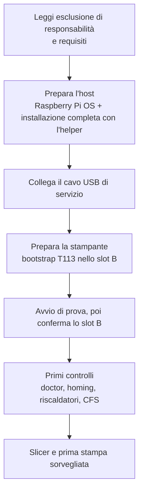

# Primi passi

Nuovo su K2-OpenHost? Leggi queste pagine nell'ordine prima di toccare la stampante.

1. **[Come funziona](how-it-works.md)**: cosa gira dove, e cosa cambia rispetto alla stampante stock.
2. **[Requisiti](requirements.md)**: il computer host, il cavo, il firmware della stampante e le parti da ricablare.
3. **[Esclusione di responsabilità e limiti hardware](../DISCLAIMER.md)**: i rischi, e cosa smette di funzionare in modalità OpenHost.

Poi segui la [guida all'installazione](../installation/index.md).

## Il percorso in un'immagine

## Quanto tempo serve

| Passo | Tempo |
| --- | --- |
| Scrittura della scheda e primo avvio dell'host | 10 min |
| Installazione completa con l'helper | 10–30 min |
| Bootstrap della T113 (download, costruzione, scrittura dello slot B, avvio di prova) | 15–25 min |
| Controlli, calibrazione e prima stampa | 1 ora o più |

## Termini usati in questa wiki

| Termine | Significato |
| --- | --- |
| **Host** | Il computer Linux esterno che esegue Kalico, Moonraker e Mainsail (riferimento: Raspberry Pi Compute Module 5). |
| **T113** | La scheda Allwinner dentro la K2 che normalmente esegue il sistema di Creality. In modalità OpenHost gestisce lo schermo e tre bridge seriali USB. |
| **Slot A / slot B** | La T113 ha due slot di sistema. Lo slot A è il sistema stock della stampante e non viene mai scritto; K2-OpenHost si installa nello slot B. |
| **Gadget** | Modalità USB device della porta Micro-USB di servizio della T113: l'host vede tre porte seriali (`/dev/k2-main`, `/dev/k2-nozzle`, `/dev/k2-rs485`). |
| **CFS** | Creality Filament System, il box filamenti a 4 slot sul bus RS-485. |
| **Box** | Il modulo CFS di Kalico (`[box]`); il suo stato è l'oggetto `box` in Moonraker. |
| **Kalico** | Il fork di Klipper usato sull'host (`kalico-k2pro`, branch `k2-pro-openhost`). |
| **Helper** | Il K2-OpenHost Installer Helper, `helper.sh`. |
