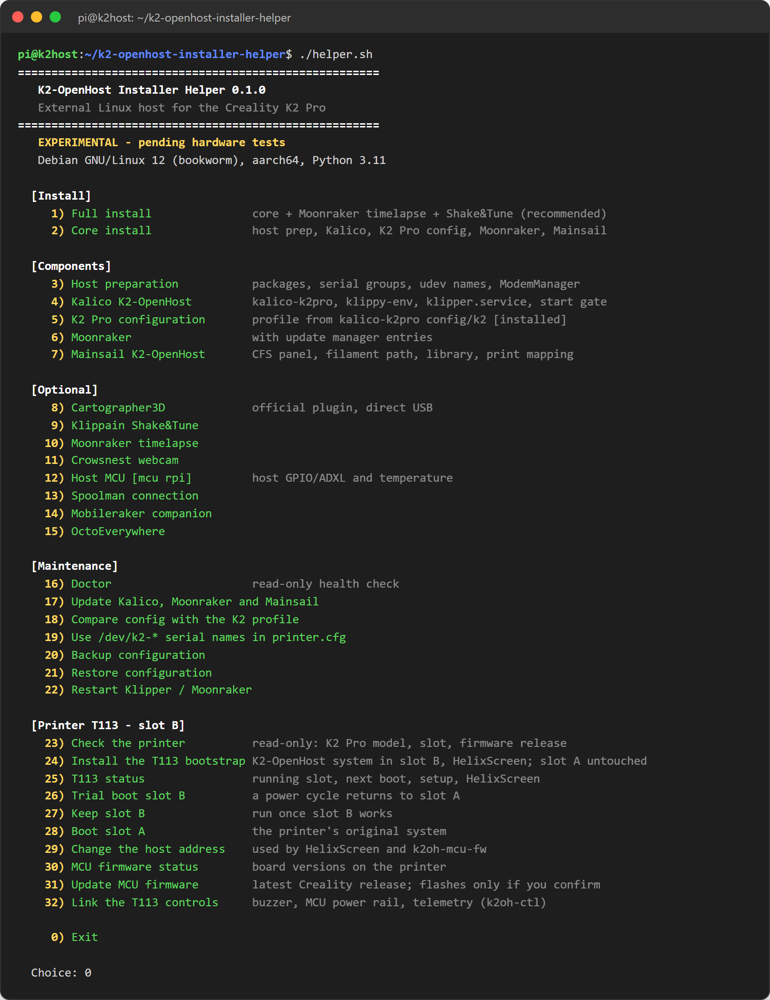
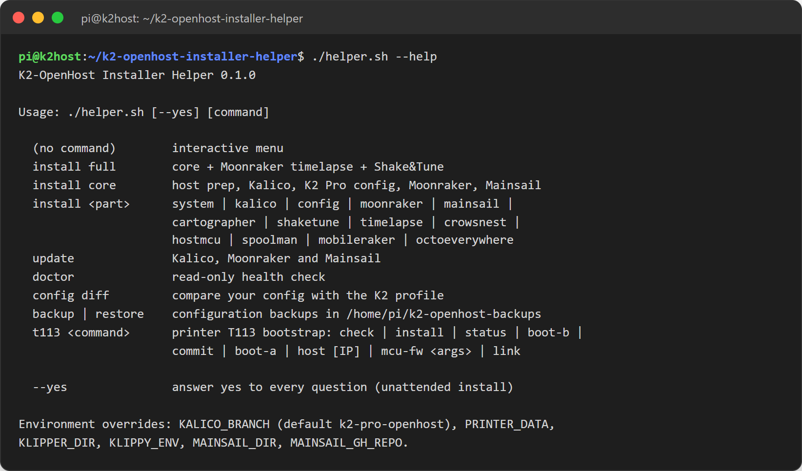

# K2-OpenHost Helper

Il **[K2-OpenHost Installer Helper](https://github.com/MzTechnology97/k2-openhost-installer-helper)** (`helper.sh`) trasforma un computer Linux esterno in un host K2-OpenHost pronto e, dallo stesso menu, prepara la scheda T113 della stampante. Installa, aggiorna, controlla, fa backup e flasha. Il suo menu è ispirato al Creality Helper Script per la serie K2.



## Avviarlo

```bash
~/k2-openhost-installer-helper/helper.sh
```

Eseguilo come utente normale (non root); chiede `sudo` quando serve. Le voci già installate mostrano `[installed]`. Se un passo fallisce, il menu mostra l'errore e resta aperto.

## Usarlo da riga di comando

Ogni voce del menu è anche un comando, per script e sessioni remote:



| Comando | Menu | Cosa fa |
| --- | --- | --- |
| `install full` | 1 | Installazione base più Moonraker timelapse e Shake&Tune |
| `install core` | 2 | Preparazione dell'host, Kalico, configurazione K2 Pro, Moonraker, Mainsail |
| `install <parte>` | 3–15, 36 | `system`, `kalico`, `config`, `moonraker`, `mainsail`, `cartographer`, `shaketune`, `timelapse`, `crowsnest`, `creality-cam`, `host-fan`, `hostmcu`, `spoolman`, `mobileraker`, `octoeverywhere` |
| `update` | 17 | Kalico, Moonraker e Mainsail |
| `doctor` | 16 | Controllo di salute in sola lettura |
| `health` | — | Doctor con il resoconto nella console di Klipper |
| `config diff` | 18 | La tua configurazione rispetto al profilo K2 |
| `config serial-names` | 19 | Nomi seriali stabili `/dev/k2-*` in `printer.cfg` |
| `backup` / `restore` | 20 / 21 | Backup della configurazione in `~/k2-openhost-backups` |
| `t113 <comando>` | 23–33 | `check`, `install`, `status`, `boot-b`, `commit`, `boot-a`, `host [IP]`, `mcu-fw <argomenti>`, `link`, `update [--revert]`, `timezone` |
| `release status` / `release apply [--t113]` | 34 / 35 | Confronta con la release validata e la applica |
| `experimental-cfs` | 40 | Menu del firmware CFS sperimentale |

Opzioni:

- `--yes` risponde sì a ogni domanda (installazione non presidiata). **Non** salta mai la conferma del firmware CFS sperimentale.
- Variabili d'ambiente: `KALICO_BRANCH`, `PRINTER_DATA`, `KLIPPER_DIR`, `KLIPPY_ENV`, `MAINSAIL_DIR`, `MAINSAIL_GH_REPO`, `K2OH_RELEASE_MANIFEST`, `K2OH_NO_UPDATE_CHECK=1`. Esempio: `KALICO_BRANCH=mio-branch ./helper.sh install kalico`.

## Regole di sicurezza dell'helper

- Non cancella nulla: le cartelle esistenti vengono rinominate (`<cartella>.before-k2openhost-<data>`), i file vengono salvati prima delle modifiche, la tua configurazione non viene mai sovrascritta in silenzio.
- Aggiornamenti, riavvii di Klipper, ripristini e flash dei firmware vengono rifiutati mentre una stampa è in corso o in pausa.
- Il firmware delle MCU viene flashato solo dopo una conferma esplicita, con gli strumenti di Creality, e solo dopo aver fermato Klipper sull'host.

## Altro

- [Riferimento del menu](menu.md): ogni voce spiegata.
- [Doctor e controllo di salute](doctor.md): cosa viene controllato e come leggerlo.
- [Installazione](../installation/index.md): l'helper nella sequenza di installazione.
