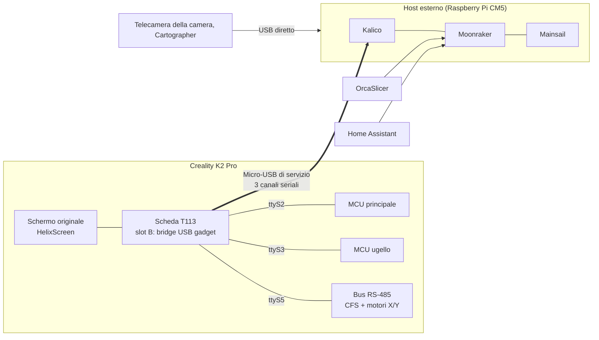

---
hide:
  - navigation
---

# K2-OpenHost

**Usa una Creality K2 Pro da un computer Linux esterno, con Kalico, Moonraker e Mainsail, mantenendo l'elettronica originale della stampante.**

K2-OpenHost sposta il lavoro di Klipper dalla scheda T113 della stampante a un host che controlli tu, per esempio un Raspberry Pi CM5. La T113 resta nella stampante come schermo touch e come ponte USB verso la MCU principale, la MCU dell'ugello e il bus RS-485 originali (CFS e motori a circuito chiuso).

!!! danger "Solo per utenti esperti"
    K2-OpenHost fa decadere la garanzia e può danneggiare la stampante in modo irreparabile, bloccarne il firmware o, in caso di guasto, causare un incendio. Gli autori non si assumono alcuna responsabilità per danni a cose o persone. La telecamera della camera va ricablata all'host, la telecamera dell'ugello e la porta USB esterna della stampante smettono di funzionare. Leggi l'[esclusione di responsabilità e i limiti hardware](DISCLAIMER.md) prima di iniziare, e non lasciare mai la stampante incustodita.

-   :material-rocket-launch: **Per iniziare**

    ---

    Cos'è K2-OpenHost, come si collegano i pezzi e cosa serve.

    [:octicons-arrow-right-24: Come funziona](getting-started/how-it-works.md)

-   :material-download: **Installazione**

    ---

    Host, stampante (slot B della T113), primo avvio e controlli, passo per passo.

    [:octicons-arrow-right-24: Guida all'installazione](installation/index.md)

-   :material-console: **Script helper**

    ---

    Un solo menu per installare, aggiornare, controllare, fare backup e flashare.

    [:octicons-arrow-right-24: K2-OpenHost Helper](helper/index.md)

-   :material-printer-3d-nozzle: **La CFS**

    ---

    Slot, RFID, libreria filamenti, mappatura di stampa, cambio a fine bobina.

    [:octicons-arrow-right-24: Usare la CFS](usage/cfs.md)

-   :material-chip: **Firmware CFS sperimentale**

    ---

    Parametri runtime sbloccati e filamento residuo dal vivo.

    [:octicons-arrow-right-24: Firmware CFS](cfs-firmware/index.md)

-   :material-lifebuoy: **Risoluzione dei problemi**

    ---

    Sintomi, cause e soluzioni, e cosa inviare quando chiedi aiuto.

    [:octicons-arrow-right-24: Risoluzione dei problemi](reference/troubleshooting.md)

## Perché un host esterno

Sulla K2 Pro originale gira tutto sulla T113: Klipper, Moonraker, l'interfaccia web, lo schermo, le app cloud di Creality e lo streaming della telecamera, su un piccolo chip dual-core. K2-OpenHost affida quel lavoro a un computer vero.

| | K2 Pro originale (T113) | K2-OpenHost (CM5 di riferimento) |
| --- | --- | --- |
| CPU | Allwinner T113, 2× Cortex-A7 a 1,2 GHz | Raspberry Pi CM5, 4× Cortex-A76 a 2,4 GHz |
| RAM | circa 512 MB, condivisi da tutti i servizi | 8 GB |
| Klipper | Il fork di Creality, su una base Klipper vecchia | Kalico aggiornato, da git |
| Cosa esegue la T113 | Tutto | Tre bridge USB↔UART, lo schermo (HelixScreen) e un piccolo servizio di controllo |
| App cloud di Creality | Attive | Non avviate: la stampante parla solo con il tuo host |
| Interfaccia web | Quella di Creality | Mainsail con i pannelli della CFS e dei motori |
| Hardware aggiuntivo | Limitato dalla T113 | Telecamere, Cartographer3D e altro sulle porte USB dell'host |
| Come tornare indietro | | Firmware originale intatto nello slot A, un comando per riavviarlo |

MCU principale, MCU dell'ugello, motori a circuito chiuso, PRTouch, CFS e schermo originale tengono il firmware di Creality. Non si salda niente.

## Funzioni

- **Stampante:** [Kalico](https://github.com/MzTechnology97/kalico-k2pro) con tutte le estensioni della K2 Pro: motori X/Y a circuito chiuso, tastatura PRTouch, camera riscaldata, input shaper, mesh e spurgo adattivi, ripresa dopo un'interruzione di corrente, suoni originali del cicalino. [Cartographer3D](CARTOGRAPHER.md) via USB diretto. Aggiornamento del firmware di MCU, motori e CFS con gli strumenti di Creality.
- **CFS:** fino a quattro unità più la bobina esterna; tag Creality, Bambu Lab e altri MIFARE, mai scritti; una libreria filamenti con temperature, pressure advance, flusso massimo e preset di OrcaSlicer; filamento residuo per bobina; mappatura automatica utensile → slot; cambio alla bobina identica successiva quando finisce; avvisi di intasamento, filamento scarso e umidità; notifiche su Mobileraker e Telegram.
- **Interfacce:** [Mainsail](usage/mainsail.md) con un pannello della CFS e uno dei motori; [HelixScreen](usage/helixscreen.md) sullo schermo della stampante con un'interfaccia K2-OpenHost; sincronizzazione dei filamenti con [OrcaSlicer](ORCASLICER.md) e il suo [plugin](usage/orca-plugin.md); [Home Assistant](usage/home-assistant.md); Mobileraker, OctoEverywhere, Spoolman, Crowsnest.
- **Strumenti:** lo [script helper](helper/index.md) per installare, aggiornare, controllare, fare backup e flashare; un manifest delle release che fissa le versioni provate; un controllo automatico dopo ogni avvio; la ventola del CM5 gestita da Klipper.

## Il progetto in sintesi

## Repository

| Repository | Ruolo |
| --- | --- |
| [K2-OpenHost](https://github.com/MzTechnology97/K2-OpenHost) | Questa wiki, architettura, risultati dei test, release |
| [kalico-k2pro](https://github.com/MzTechnology97/kalico-k2pro) | Kalico per la K2 Pro (ramo `k2-pro-openhost`) e il profilo della K2 Pro |
| [k2-openhost-installer-helper](https://github.com/MzTechnology97/k2-openhost-installer-helper) | Lo script helper: installazione dell'host, bootstrap della T113, aggiornamenti, backup, firmware |
| [k2-openhost-t113-bootstrap](https://github.com/MzTechnology97/k2-openhost-t113-bootstrap) | Il lato stampante: il sistema K2-OpenHost nello slot B della T113 |
| [mainsail-k2openhost](https://github.com/MzTechnology97/mainsail-k2openhost) | Fork di Mainsail con i pannelli della CFS e dei motori |
| [helixscreen](https://github.com/MzTechnology97/helixscreen) | Fork di HelixScreen per lo schermo della stampante (ramo `k2-openhost`) |
| [ha-k2-openhost](https://github.com/MzTechnology97/ha-k2-openhost) | Integrazione Home Assistant e scheda della CFS |
| [k2-cfs-rfid-tools](https://github.com/MzTechnology97/k2-cfs-rfid-tools) | Immagini, sorgenti e test del firmware CFS sperimentale |
| [k2-openhost-firmware-tools](https://github.com/MzTechnology97/k2-openhost-firmware-tools) | Inventario del firmware in sola lettura e note sui protocolli |

## Stato

K2-OpenHost è in uso quotidiano in produzione: la K2 Pro di riferimento stampa ogni giorno con un host CM5, con stampe lunghe dalla CFS, mappatura automatica, cambi a fine bobina e bobine RFID di terze parti. Il firmware CFS modificato e il plugin di OrcaSlicer sono ancora sperimentali; il firmware CFS originale è pienamente supportato. Cosa è verificato è nello [stato dei test](TEST_STATUS.md), i prossimi passi nella [roadmap](ROADMAP.md).

K2-OpenHost si basa sul lavoro di Klipper, Kalico, Jacob10383, luketot, Moonraker, Mainsail, HelixScreen, Cartographer3D e molti altri: vedi i [riconoscimenti](REFERENCES.md).
