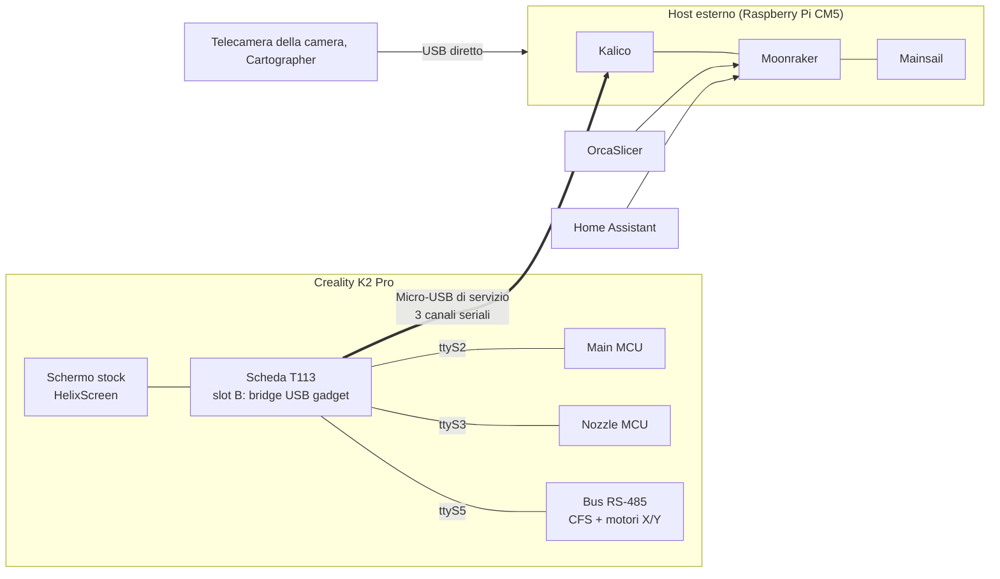

---
hide:
  - navigation
---

# K2-OpenHost

**Fai funzionare una Creality K2 Pro da un computer Linux esterno, con Kalico, Moonraker e Mainsail, mantenendo l'elettronica originale della stampante.**

K2-OpenHost sposta il lavoro di Klipper dalla scheda T113 della stampante a un host che controlli tu, per esempio un Raspberry Pi CM5. La T113 resta nella stampante come schermo touch e come bridge USB trasparente verso le schede originali: Main MCU, Nozzle MCU e bus RS-485 (CFS e motori closed-loop). Sull'host hai Kalico aggiornato, Mainsail con un pannello CFS nativo, l'integrazione con OrcaSlicer e Home Assistant.

!!! danger "Solo per utenti esperti"
    K2-OpenHost invalida la garanzia del produttore e può danneggiare la stampante in modo irreparabile, renderne inutilizzabile il firmware o, in caso di malfunzionamento, provocare un incendio. Gli autori non si assumono alcuna responsabilità per danni a cose o persone. In modalità OpenHost la telecamera della camera va scollegata dalla T113 e ricablata all'host, la telecamera del nozzle non si può usare e la porta USB esterna della stampante smette di funzionare. Leggi l'[esclusione di responsabilità e i limiti hardware](DISCLAIMER.md) prima di iniziare.

-   :material-rocket-launch: **Primi passi**

    ---

    Cos'è K2-OpenHost, come si collegano i pezzi e cosa ti serve.

    [:octicons-arrow-right-24: Come funziona](getting-started/how-it-works.md)

-   :material-download: **Installazione**

    ---

    Host, stampante (slot B della T113), primo avvio e controlli, passo per passo.

    [:octicons-arrow-right-24: Guida all'installazione](installation/index.md)

-   :material-console: **Helper script**

    ---

    Un solo menu per installare, aggiornare, controllare, fare backup e flashare.

    [:octicons-arrow-right-24: K2-OpenHost Helper](helper/index.md)

-   :material-printer-3d-nozzle: **Il CFS**

    ---

    Slot, RFID, libreria filamenti, abbinamento in stampa, cambio bobina a fine filamento.

    [:octicons-arrow-right-24: Usare il CFS](usage/cfs.md)

-   :material-chip: **Firmware CFS sperimentale**

    ---

    Parametri runtime sbloccati e residuo del filamento in tempo reale.

    [:octicons-arrow-right-24: Firmware CFS](cfs-firmware/index.md)

-   :material-lifebuoy: **Risoluzione problemi**

    ---

    Sintomi, cause e soluzioni, e cosa inviare quando chiedi aiuto.

    [:octicons-arrow-right-24: Risoluzione problemi](reference/troubleshooting.md)

## Perché un host esterno

Sulla K2 Pro stock **tutto** gira sulla T113 dentro la stampante: Klipper, Moonraker, nginx, l'interfaccia web, l'interfaccia dello schermo, le app cloud di Creality e lo stream della telecamera, su un piccolo chip dual-core. K2-OpenHost affida quel lavoro a un vero computer e lascia alla T113 solo ciò che sa fare bene.

| | K2 Pro stock (T113) | K2-OpenHost (CM5 di riferimento) |
| --- | --- | --- |
| CPU | Allwinner T113, **2× Cortex-A7 a 1,2 GHz** (32 bit) | Raspberry Pi CM5, **4× Cortex-A76 a 2,4 GHz** (64 bit) |
| RAM | **~512 MB**, condivisi da tutti i servizi | **8 GB** |
| Klipper | Fork di Creality, fermo su una base Klipper datata | **Kalico** aggiornato, da git |
| Cosa fa la T113 | Klipper, Moonraker, nginx, UI, app cloud, telecamera, tutto | Solo tre bridge USB↔UART, lo schermo (HelixScreen) e un piccolo servizio di controllo |
| App cloud e UI di Creality | Attive | **Non avviate** nello slot B: nessuna connessione al cloud Creality, ADB e telecamera WebRTC spenti |
| Interfaccia web | Quella di Creality | **Mainsail** aggiornato con pannelli CFS e motori |
| Hardware aggiuntivo | Limitato dalla CPU della T113 e dal suo unico controller USB | Telecamera, Cartographer3D, MCU host e altro sulle porte USB 3.0 dell'host |
| Via di ritorno | — | Firmware stock intatto nello **slot A**: un comando per riavviarlo |

Con il lavoro pesante sull'host:

- **Più margine:** pianificazione dei movimenti, input shaper, mesh e macro di Klipper girano su una CPU molte volte più veloce, senza web server, app cloud o encoder video che si contendono gli stessi due core. I sintomi di un host sovraccarico (`Timer too close`, interfaccia web lenta, blocchi mentre la telecamera trasmette) hanno molto meno spazio.
- **Nessuna telemetria del produttore:** le app cloud e UI di Creality non vengono avviate in modalità K2-OpenHost. La stampante parla solo con il tuo host, nella tua rete.
- **Software aperto e aggiornato:** Kalico, Moonraker, Mainsail, OrcaSlicer, Home Assistant, tutto aggiornabile, open source e modificabile.
- **L'elettronica originale resta:** Main MCU, Nozzle MCU, motori closed-loop, PRTouch, CFS e schermo stock continuano a funzionare con il firmware di Creality. Nessuna saldatura: si sposta solo il cavo della telecamera della camera dalla T113 all'host.

## Funzionalità

### Stampante e movimento

- [Kalico](https://github.com/MzTechnology97/kalico-k2pro) `k2-pro-openhost` con tutte le aggiunte per la K2 Pro: **motori X/Y closed-loop** (stato, diagnostica e strumenti per i parametri), sonda a estensimetro **PRTouch** e Z offset, camera riscaldata, input shaper, bed mesh, mesh e spurgo adattivi KAMP, ripresa dopo un'interruzione di corrente.
- **Cartographer3D** collegato via USB direttamente all'host, come sonda alternativa ([guida](CARTOGRAPHER.md)).
- Suoni del **cicalino** come lo stock (fine stampa, pausa, errore, annullamento) e `M300` per gli slicer.
- **Aggiornamenti firmware di MCU, motori e CFS** con gli strumenti di Creality, dall'helper (`k2oh-mcu-fw`).
- **Controllo della T113 da Klipper:** alimentazione delle MCU, telemetria della scheda (`BOARD_STATUS`), bridge e HelixScreen, tramite `k2oh-ctl`.

### CFS (Creality Filament System)

- Fino a **quattro unità CFS** (16 slot) più la bobina esterna.
- **RFID:** tag Creality e, con un firmware CFS API7, anche bobine **Bambu Lab, QIDI e altre MIFARE**, senza mai scrivere i tag.
- **Libreria filamenti** con i filamenti di sistema Creality e i tuoi profili: temperature, **pressure advance per filamento**, flusso massimo, ID del preset OrcaSlicer.
- **Residuo del filamento** per bobina: in tempo reale dal CFS con firmware CFG5T/CFG6, altrimenti la stima di Kalico basata sull'encoder.
- **Abbinamento in stampa:** automatico tool → slot per materiale e colore, dalla mappa dello slicer (`K2OH_TOOL_MAP`) o a mano in Mainsail.
- **Cambio bobina a fine filamento** sulla bobina successiva dello stesso filamento, nell'ordine che scegli; **rilevamento intasamenti**; avvisi di **filamento scarso** e **umidità** all'avvio della stampa.
- **Notifiche** degli eventi CFS su Mobileraker e Telegram.
- **Firmware CFS sperimentale** con **23 parametri runtime regolabili** (velocità dell'hub, timeout, movimenti RFID, cicli di pretensionamento).

### Interfacce

- **Mainsail K2-OpenHost:** pannello CFS nativo con il percorso del filamento, editor degli slot, scheda RFID, libreria filamenti e abbinamento in stampa; pannello dei motori closed-loop.
- **HelixScreen** sullo schermo touch stock, con l'elenco filamenti sincronizzato con la libreria dell'host.
- **OrcaSlicer:** Sync dei filamenti dal CFS con i preset giusti, e il **plugin per OrcaSlicer 2.5** con un pannello grafico del CFS, abbinamento degli slot prima dell'invio e ordine di runout.
- Integrazione **Home Assistant**: sensori, interruttori e azioni del CFS, e una card Lovelace.
- **Mobileraker**, **OctoEverywhere**, **Spoolman**, **Crowsnest** per la telecamera della camera (con la correzione per la telecamera Creality).

### Strumenti

- **K2-OpenHost Helper:** un solo menu per installare l'host, costruire e avviare lo slot B della T113, aggiornare tutto, controllare il sistema (`doctor`), fare backup e ripristino, flashare firmware, tornare allo stock.
- **Release manifest:** ogni componente fissato a una versione provata, con un confronto prima di ogni aggiornamento.
- **Controllo di salute** automatico dopo ogni avvio e aggiornamento di sistema.
- **Ventola della CPU** della CM5 comandata da Klipper, visibile in Mainsail.
- **Backup della configurazione su GitHub** con klipper-backup.

| Area | Dove approfondire |
| --- | --- |
| Installazione | [Guida all'installazione](installation/index.md) |
| Interfaccia web | [Mainsail](usage/mainsail.md) |
| Schermo della stampante | [HelixScreen](usage/helixscreen.md) |
| CFS | [Usare il CFS](usage/cfs.md) |
| Slicer | [OrcaSlicer](ORCASLICER.md), [plugin OrcaSlicer](usage/orca-plugin.md) |
| Casa intelligente | [Home Assistant](usage/home-assistant.md) |
| Notifiche | [Notifiche](usage/notifications.md) |
| Hardware dell'host | [Hardware host](HOST.md) |
| Sperimentale | [Firmware CFS](cfs-firmware/index.md) |

## Avvertenze e rischi

!!! danger "Sicurezza"
    - **Rischio di incendio.** I riscaldatori di nozzle, piatto e camera sono comandati da software che gira sull'host esterno. Se l'host smette di comunicare, i timer di sicurezza delle MCU di Klipper spengono i riscaldatori, ma un guasto software, di cablaggio o di alimentazione può comunque lasciarne uno acceso. **Non lasciare mai la stampante incustodita**, tieni un rilevatore di fumo vicino e un estintore a portata di mano.
    - **Danni meccanici.** Valori di configurazione sbagliati, un errore di homing o di tastatura, o un collegamento perso durante un movimento possono far urtare la testina contro il piatto o il telaio.
    - **Corrente di rete.** Scollega la stampante dalla rete prima di aprire il vano dell'elettronica per collegare il cavo della T113 o spostare la telecamera della camera. Fai passare ogni cavo lontano da parti in movimento e zone calde.

!!! warning "Garanzia, firmware e hardware"
    - **La garanzia decade.** Creality non supporta il funzionamento della stampante da un host esterno.
    - **Rischio di bloccare la stampante.** Scrivere lo slot B della T113 o flashare il firmware di MCU, motori o CFS può lasciare la stampante incapace di avviarsi. Tieni il **backup** dell'helper e leggi la [procedura di recupero](RECOVERY.md) prima di ogni modifica permanente.
    - **Limiti hardware in modalità OpenHost:** la telecamera della camera va scollegata dalla T113 e ricablata all'host; la telecamera del nozzle non si può usare; la porta USB esterna (chiavetta) smette di funzionare; Cartographer3D va collegato direttamente all'host. Dettagli nell'[esclusione di responsabilità](DISCLAIMER.md#limiti-hardware-in-modalità-openhost).
    - **Modello supportato:** solo **Creality K2 Pro**. Gli strumenti rifiutano altri modelli e schede.

!!! warning "Uso"
    - **Il cavo USB è vitale per la stampa.** Staccare o urtare il cavo della T113, o riavviare l'host, ferma subito la stampa: Klipper va in shutdown. Usa un buon cavo **dati**, con **spina a 90°**, e fissalo.
    - **L'alimentazione dell'host è quella della stampa.** Se l'host perde corrente, la stampa è persa anche se la stampante resta accesa. Usa l'alimentatore ufficiale dell'host; un UPS per entrambi è una buona idea.
    - **Nessuna modifica durante la stampa.** Non riavviare Klipper, non aggiornare, non flashare, non modificare i valori runtime del CFS e non riavviare la T113 durante una stampa.
    - **Niente OTA Creality dallo slot B.** Un OTA nello slot B sovrascriverebbe lo slot A, quindi è disattivato. Dallo slot A un OTA sostituisce lo slot B di K2-OpenHost. Il firmware delle schede si aggiorna dallo slot B con `k2oh-mcu-fw` (menu 31 dell'helper).
    - **Conosci la tua stampante.** K2-OpenHost sostituisce l'intero software: il supporto sei tu. Controlla lo [stato dei test](TEST_STATUS.md) per sapere cosa è stato provato su hardware reale prima di affidarti a una funzione.

!!! info "Firmware CFS sperimentale"
    Il [firmware CFS modificato](cfs-firmware/index.md) **non è qualificato per la produzione**: un'immagine difettosa può fermare il CFS finché non si flasha un'immagine di recupero, e un [problema aperto](https://github.com/MzTechnology97/k2-cfs-rfid-tools/issues/9) fa sì che il CFS possa dichiararsi fermo mentre sta ancora alimentando. Flasha solo a stampante ferma e tieni l'immagine di recupero v3.22. Il firmware CFS stock funziona benissimo con K2-OpenHost.

K2-OpenHost è fornito **così com'è**, senza alcuna garanzia. **Autori e collaboratori non si assumono alcuna responsabilità** per danni a cose o persone, lesioni, perdita di dati o qualsiasi altra conseguenza del suo uso. Se non sai diagnosticare Linux, Klipper e l'elettronica della stampante, o non puoi accettare questi rischi, tieni il firmware stock. Testo completo: [Esclusione di responsabilità](DISCLAIMER.md).

## Il progetto in sintesi

## Repository

| Repository | Ruolo |
| --- | --- |
| [K2-OpenHost](https://github.com/MzTechnology97/K2-OpenHost) | Questa wiki, architettura, risultati dei test, release |
| [kalico-k2pro](https://github.com/MzTechnology97/kalico-k2pro) | Kalico per la K2 Pro (branch `k2-pro-openhost`) e il profilo K2 Pro |
| [k2-openhost-installer-helper](https://github.com/MzTechnology97/k2-openhost-installer-helper) | Lo script helper: installazione dell'host, bootstrap della T113, aggiornamenti, backup, firmware |
| [k2-openhost-t113-bootstrap](https://github.com/MzTechnology97/k2-openhost-t113-bootstrap) | Il lato stampante: il sistema K2-OpenHost nello slot B della T113 |
| [mainsail-k2openhost](https://github.com/MzTechnology97/mainsail-k2openhost) | Fork di Mainsail con i pannelli CFS e motori |
| [ha-k2-openhost](https://github.com/MzTechnology97/ha-k2-openhost) | Integrazione Home Assistant e card CFS |
| [k2-cfs-rfid-tools](https://github.com/MzTechnology97/k2-cfs-rfid-tools) | Immagini, sorgenti e test del firmware CFS sperimentale |
| [k2-openhost-firmware-tools](https://github.com/MzTechnology97/k2-openhost-firmware-tools) | Inventario firmware in sola lettura e documentazione dei protocolli |

## Stato

K2-OpenHost è **in uso quotidiano in produzione** sulla print farm dell'autore: la K2 Pro di riferimento stampa ogni giorno con un host CM5, con lunghe stampe dal CFS, abbinamento automatico, cambio bobina in tempo reale e bobine RFID di terze parti, e **nessun crash o problema causato dalla CM5 o da K2-OpenHost**.

L'unica parte ancora sperimentale è il [firmware CFS modificato](cfs-firmware/index.md); il firmware CFS stock è pienamente supportato. I risultati funzione per funzione sono nello [stato dei test](TEST_STATUS.md), i prossimi passi nella [roadmap](ROADMAP.md).

K2-OpenHost si basa sul lavoro di Klipper, Kalico, Jacob10383/Jacobean, luketot, Moonraker, Mainsail, HelixScreen, Cartographer3D e molti altri: vedi i [riconoscimenti](REFERENCES.md).
