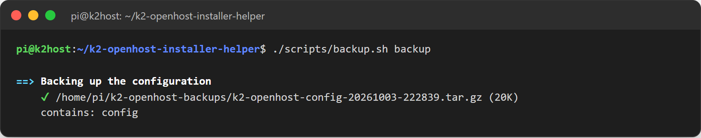

# Backup e ripristino

## Backup locale con l'helper

```bash
./helper.sh backup     # menu 20
./helper.sh restore    # menu 21
```

Il backup salva in `~/k2-openhost-backups`:

- `~/printer_data/config` (tutta la configurazione della stampante);
- la libreria filamenti del CFS `config/cfs_filaments.json`;
- lo stato del CFS `~/printer_data/filament_box.json` (assegnazioni degli slot, stime del residuo, impostazioni);
- il database di Moonraker (storico, impostazioni di Mainsail).



`restore` elenca gli archivi, fa prima un backup dello stato attuale, poi ripristina quello scelto. I ripristini vengono rifiutati durante la stampa.

## Backup automatico su GitHub (klipper-backup)

[Klipper-Backup](https://github.com/Staubgeborener/klipper-backup) fa il commit di `~/printer_data/config` su un repository GitHub **privato** a ogni modifica, all'avvio o su richiesta. L'host di riferimento lo usa.

### 1. Creare un repository privato

Su GitHub crea un repository **privato** vuoto, per esempio `K2-OpenHost-CM5`.

!!! danger "Tienilo privato"
    La cartella di configurazione contiene dati segreti: `moonraker.conf`, `telegram.conf`, il token della T113 `k2oh_t113.token`, token delle integrazioni. Un repository pubblico li pubblicherebbe. Se mai lo rendi pubblico, aggiungi prima quei file a `exclude`.

### 2. Creare un token

github.com → **Settings** → **Developer settings** → **Personal access tokens** → **Fine-grained tokens** → **Generate new token**:

- **Repository access:** *Only select repositories* → il tuo repository di backup;
- **Repository permissions → Contents:** **Read and write**;
- copia subito il token: GitHub non lo mostra più.

Il token va solo in `~/klipper-backup/.env` sull'host, mai in un repository o in una chat.

### 3. Installare

```bash
cd ~
git clone https://github.com/Staubgeborener/klipper-backup.git
./klipper-backup/install.sh
```

`install.sh` chiede token, utente, repository e branch, e può installare i servizi `klipper-backup-filewatch` (backup a ogni modifica della configurazione) e `klipper-backup-on-boot`.

### Esempio di `~/klipper-backup/.env`

```bash
github_token=METTI_QUI_IL_TUO_TOKEN
github_username=<il tuo utente GitHub>
github_repository=K2-OpenHost-CM5
branch_name="main"
commit_username="<nome>"
commit_email="<nome>@k2host"

backupPaths=( \
"printer_data/config/*" \
)

exclude=( \
"*.swp" \
"*.tmp" \
"printer-[0-9]*_[0-9]*.cfg" \
"*.bak" \
"*.bkp" \
"*.csv" \
"*.zip" \
)
```

### 4. Provare

```bash
bash ~/klipper-backup/script.sh
systemctl status klipper-backup-filewatch.service
```

Lo script deve terminare con il push su GitHub senza errori di autenticazione. Macro opzionale per Mainsail (richiede `gcode_shell_command`):

```ini
[gcode_shell_command backupgit]
command: bash /home/pi/klipper-backup/script.sh
timeout: 600
verbose: True

[gcode_macro BackupGit]
gcode:
    RUN_SHELL_COMMAND CMD=backupgit
```

### Da sapere

- Klipper-Backup tiene la sua copia di lavoro in `~/config_backup`. A ogni esecuzione svuota quella cartella (tenendo solo `README.md`) e ricopia `backupPaths`, quindi i file aggiunti a mano nella radice del repository spariscono: tieni le note in `README.md`.
- Quando il token scade il backup si ferma: creane uno nuovo, aggiorna `github_token` in `.env`, poi revoca quello vecchio.
- Hai rinominato il repository su GitHub? Aggiorna `github_repository` in `.env`: GitHub reindirizza il vecchio nome, ma solo finché un altro repository non lo prende.

| Errore | Soluzione |
| --- | --- |
| `403 Write access to repository not granted` | Il token non include il repository, oppure *Contents* è in sola lettura. Modifica il token su GitHub. |
| `Invalid username or token` eseguendo `git push` a mano | La copia di lavoro legge il token da una variabile impostata solo dallo script. Esegui `script.sh`, non `git push`. |
| `rejected (fetch first)` su un repository nuovo | La copia locale ha iniziato una propria storia prima che il token funzionasse. Sposta `~/config_backup` (`mv ~/config_backup ~/config_backup.old`) ed esegui di nuovo `script.sh`. |
| `object file ... is empty` / `loose object ... is corrupt` | La copia di lavoro locale è danneggiata (per esempio copiata da un altro host). Sposta `~/config_backup` ed esegui di nuovo `script.sh`: la ricrea da GitHub. |
| `remove the file manually to continue` | Un `index.lock` rimasto da un'esecuzione interrotta: ferma il servizio filewatch, poi la soluzione sopra. |
