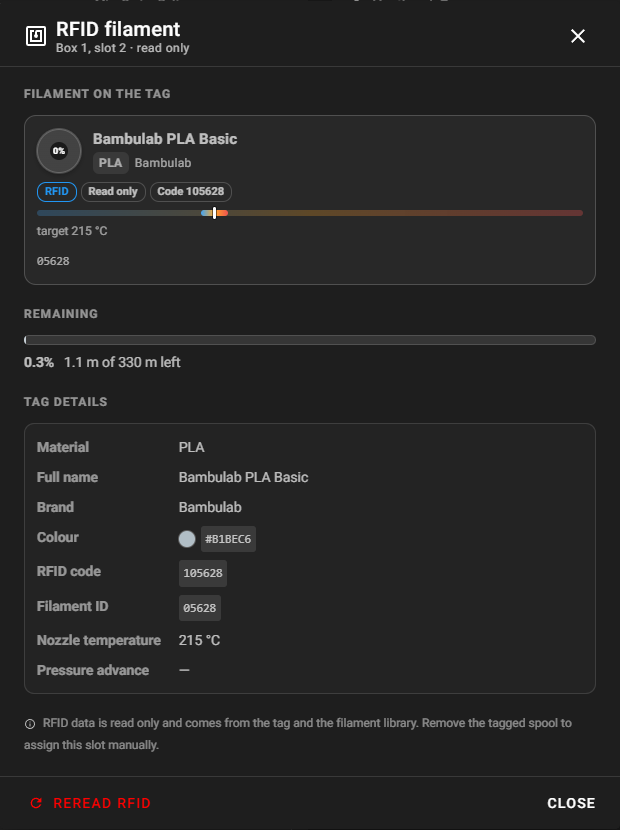
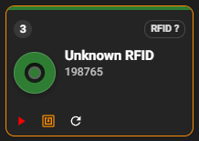
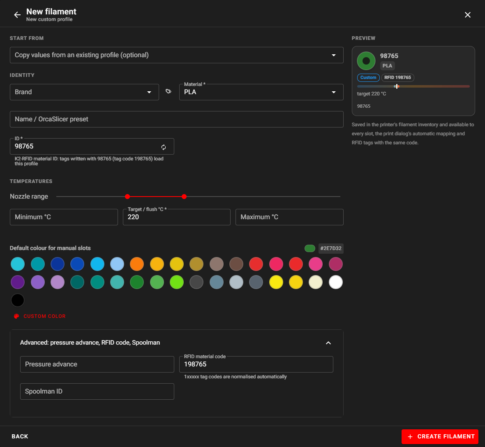
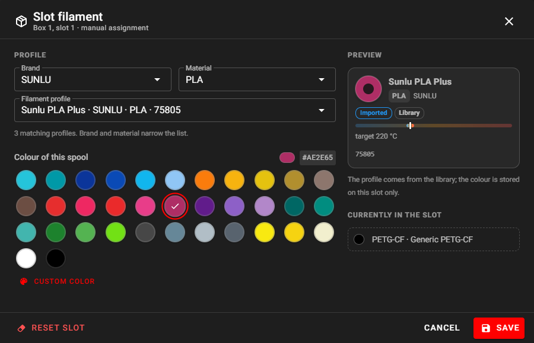
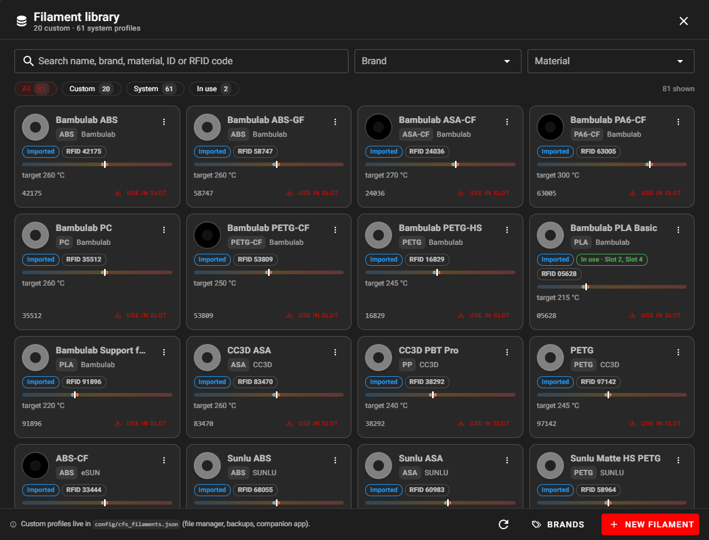
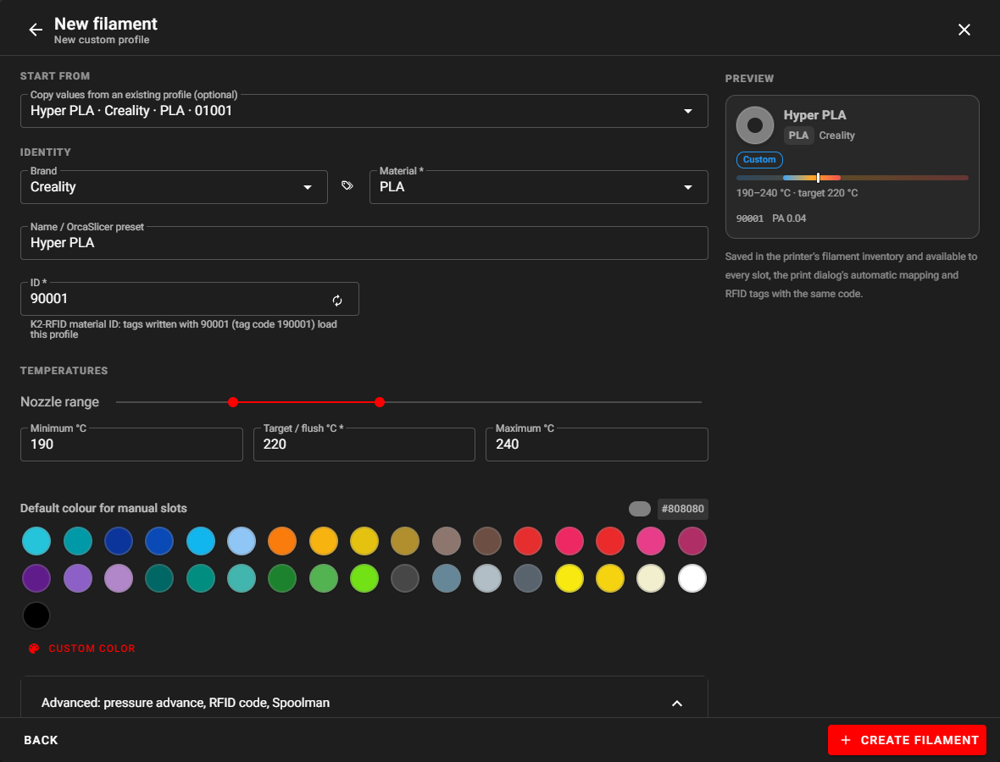
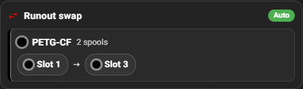
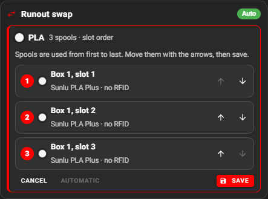
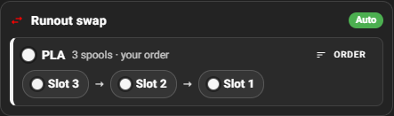

# Usare il CFS

Il Creality Filament System è gestito dal modulo `box` di Kalico attraverso il canale RS-485. Questa pagina spiega cosa ci fai ogni giorno. L'interfaccia è il [pannello CFS di Mainsail](mainsail.md#cfs-panel); ogni azione è anche un [comando G-code](../GCODE_COMMANDS.md).

## Slot e nomi

| | Un CFS | Più CFS |
| --- | --- | --- |
| Numeri degli slot nei comandi | 0–3 (`SLOT=0` è lo slot 1) | box 1: 0–3, box 2: 4–7, box 3: 8–11, box 4: 12–15 |
| Nomi nell'interfaccia e in console | `Box 1, slot 3` / `Slot 3` | `Box 2, slot 4` / `B2·S4` |
| Bobina esterna | lo slot dopo l'ultimo slot CFS (4 con un CFS) | uguale |

I tool dello slicer mantengono i nomi `T0`, `T1`…: un tool è **logico**, abbinato a uno slot fisico all'avvio della stampa.

## Caricare e scaricare

| Azione | Pannello | Comando |
| --- | --- | --- |
| Caricare uno slot nella testina | ▶ sul riquadro | `BOX_SELECT_SLOT SLOT=<n>` (cambio completo con taglio, scaricamento del filamento attuale e spurgo) oppure `BOX_LOAD SLOT=<n>` (hotend vuoto, senza taglio né spurgo) |
| Scaricare | **Unload** sotto il percorso | `BOX_UNLOAD` (scalda, taglia, va al cestino, riporta il filamento nel CFS) |
| Solo ritirare, a freddo | — | `BOX_UNLOAD MANUAL=1` |
| Tagliare | — | `BOX_CUT` (richiede `cut_pos_x`, vedi `CALIBRATE_CUT_POS`) |

Durante un caricamento o scaricamento il percorso del filamento mostra ogni passo: `Feeding to buffer`, `Feeding to printhead`, `Seating in the extruder`, `Retracting to CFS`… I caricamenti manuali sono disattivati durante la stampa.

!!! tip "Rilettura RFID su uno slot caricato"
    Uno slot caricato verso la testina non si può rileggere: il CFS tirerebbe indietro il filamento oltre il lettore e si bloccherebbe contro gli ingranaggi dell'estrusore. Scaricalo prima.

## Bobine RFID

Quando inserisci una bobina, il CFS legge il suo tag e Kalico compila lo slot da solo (fonte `RFID`). La scheda in sola lettura mostra i dati del tag e il filamento residuo.

{ width="520" }

| Tag | Supportato |
| --- | --- |
| RFID Creality (bobine stock, tag dell'app K2-RFID) | Sì, con qualsiasi firmware CFS |
| Bambu Lab | Con il firmware CFS API7 ([RFID di terze parti](../cfs-firmware/third-party-rfid.md)) |
| QIDI e altri produttori MIFARE Classic | Con il firmware CFS API7 |

Comandi: `BOX_RFID_SCAN` (tutti gli slot occupati), `_BOX_RFID_READ_SLOT SLOT=<n>` (uno slot).

### Tag sconosciuti

Un tag con un codice materiale che non è in libreria mostra `Unknown RFID` e un bordo arancione. Premi il pulsante del tag: la libreria apre un nuovo profilo già compilato con il codice e il colore del tag. Completalo e salva: ogni bobina con quel codice viene riconosciuta subito.

| Riquadro | Nuovo profilo dal tag |
| --- | --- |
| { width="200" } |  |

## Bobine senza RFID { #spools-without-rfid }

Premi ✎ sul riquadro, scegli **marca → materiale → profilo filamento**, poi il **colore di questa bobina**, e **Save** (`_BOX_SLOT_ASSIGN`). Il colore appartiene allo slot, non al profilo. **Reset slot** lo svuota (`_BOX_SLOT_CLEAR`).

La **bobina esterna** (alimentata dal retro della stampante) usa lo stesso editor; **Read external RFID** legge una bobina con tag tramite il lettore esterno.

## Libreria filamenti

La libreria contiene il **catalogo di sistema** in sola lettura (61 profili Creality e Generic dal database pubblico K2-RFID) e **i tuoi profili**, salvati in `~/printer_data/config/cfs_filaments.json`.

Ogni profilo ha: marca, materiale, nome (idealmente il nome del preset OrcaSlicer), un ID a 5 cifre (`90001` e successivi per i tuoi; codice del tag `1` + ID), temperature, colore predefinito, pressure advance, flusso massimo, lunghezza nominale della bobina, codice RFID, ID Spoolman e il **preset OrcaSlicer**.

- **New filament** → parti da un profilo simile → compila → **Create filament** (`_BOX_FILAMENT_SET`).
- **Use in slot** lo assegna senza aprire l'editor dello slot.
- I profili di sistema sono in sola lettura: **Create custom from this** ne crea una copia modificabile.
- Il file si può modificare dal file manager di Mainsail; `_BOX_FILAMENT_RELOAD` lo ricarica.

### Pressure advance e flusso massimo

Quando uno slot viene caricato, il box applica all'estrusore il pressure advance dello slot (a meno che lo slicer non imposti il PA nel file). Ordine delle fonti: profilo dello slot → filamento della libreria → valore predefinito del materiale. `_BOX_SLOT_PA_SET SLOT=<n> PRESSURE_ADVANCE=<v>` salva un valore calibrato nel profilo del filamento dello slot. `apply_pressure_advance: False` in `[box]` disattiva questa funzione.

## Filamento residuo

Ogni bobina RFID mostra quanto filamento resta, come settore dell'anello, percentuale e metri.

- **La stima di Kalico** parte dalla lunghezza della bobina indicata dal tag e scende con il filamento usato in stampa (encoder del CFS, altrimenti `print_stats`). È salvata in `~/printer_data/filament_box.json` e resta dopo i riavvii.
- **La percentuale del CFS** viene letta ogni 30 s. Con il firmware stock può solo abbassare la stima. Con il firmware sperimentale **CFG5T/CFG6** il CFS conta in tempo reale il consumo type-4 e **guida** la stima: vedi [Residuo in tempo reale](../cfs-firmware/remaining.md).
- **Tag senza numero di serie** (stock `000000`, K2-RFID `000001`): la stima appartiene all'alloggiamento. Togliendo la bobina si perde; il prossimo inserimento parte da una bobina nuova al 100 % (o dal valore del CFS).
- **Una bobina nuova con una stima vecchia**: `_BOX_RFID_SPOOL_NEW SLOT=<n> [REMAINING=100]`.

## Runout swap

Con **Runout swap** attivo, le bobine con **esattamente lo stesso materiale e colore** formano un gruppo. Quando la bobina caricata finisce durante una stampa, il box continua con la bobina successiva del gruppo senza mettere in pausa. Senza una sostituta la stampa va in pausa.

{ width="420" }

L'ordine delle bobine è:

1. il tuo **ordine manuale**, se impostato;
2. altrimenti **prima quella con il residuo RFID più basso**;
3. altrimenti l'ordine degli slot.

### Scegliere l'ordine

Utile per le bobine senza RFID (una bobina piena da 1 kg, una da 300 g e una quasi vuota): nel gruppo premi **Order**, sposta le bobine con ↑ ↓ e **Save**.

| Editor | Salvato |
| --- | --- |
|  |  |

Comando: `_BOX_SET_RUNOUT_ORDER ORDER=2,1,0` (slot numerati da 0), `ORDER=AUTO` per azzerare. Si può cambiare durante la stampa; il runout successivo lo segue. Lo stesso ordine si modifica dal [pannello CFS del plugin OrcaSlicer](orca-plugin.md#runout-order).

## Abbinare una stampa agli slot

Un file dello slicer usa tool logici (`T0`, `T1`…). All'avvio della stampa ogni tool viene abbinato a uno slot fisico:

| Come parte la stampa | Chi abbina |
| --- | --- |
| Finestra **Print** di Mainsail | Tu, nella finestra (abbinamento automatico proposto): `BOX_PRINT_START ... MAP=` |
| Upload-and-print di OrcaSlicer, API Moonraker | L'**abbinamento automatico** di Kalico (`auto_map_prints: true`), per materiale e colore |
| OrcaSlicer con il [plugin K2-OpenHost](orca-plugin.md) | Gli slot scelti nel pannello CFS del plugin (`; K2OH_TOOL_MAP` nel file), altrimenti automatico |

L'abbinamento automatico non accoppia mai un materiale base con la sua variante caricata (PETG con PETG-CF). Un tool che non si riesce ad abbinare blocca l'avvio (`auto_map_block_unresolved: true`) invece di tirare a indovinare. Dettagli: [Abbinamento della stampa CFS](../CFS_PRINT_MAPPING.md).

### Avvisi

Gli avvisi non bloccano mai la stampa. Compaiono nella finestra, nella console all'avvio e nel pannello durante la stampa:

| Avviso | Quando |
| --- | --- |
| **Potrebbe finire** | Il residuo RFID della bobina scelta (più le bobine identiche con runout swap) è sotto quanto previsto dallo slicer + 10 % + 1 m |
| **Variante di materiale** | Un materiale base sulla sua variante caricata, o il contrario (scelto a mano) |
| **CFS umido** | Il CFS è più umido di quanto il materiale tolleri: PVA 20 %, PA 25 %, PC 35 %, TPU 40 %, PETG-CF 45 %, PETG/ABS/ASA 50 %, PLA 55 % (`humidity_limits` li modifica) |

Durante la stampa un controllo in tempo reale confronta, ogni minuto, il filamento che serve ancora a ogni tool con quanto resta sulla sua bobina (`low_filament_live`).

## Rilevamento intasamenti

Mette in pausa la stampa quando l'estrusore spinge `clog_extruder_length` (80 mm) mentre il CFS non ricarica. Interruttore: **Clog detection** nel menu impostazioni del CFS, oppure `_BOX_SET_CLOG_DETECTION ENABLE=0|1`.

## Altre impostazioni

| Impostazione | Comando | Predefinito |
| --- | --- | --- |
| Scarica a fine stampa | `_BOX_SET_UNLOAD_AFTER_PRINT ENABLE=1` | spento |
| Leggi RFID all'inserimento | `_BOX_SET_RFID_INSERT_READING ENABLE=1` | acceso |
| Leggi RFID all'avvio | `_BOX_SET_RFID_STARTUP_READING ENABLE=1` | spento: gli slot in cache vengono ripristinati senza rilettura |

## Dove stanno i dati

| File | Contenuto |
| --- | --- |
| `~/printer_data/config/cfs_filaments.json` | I tuoi profili filamento e le personalizzazioni dei preset OrcaSlicer |
| `~/printer_data/filament_box.json` | Assegnazioni degli slot, stime del residuo, impostazioni, ordine di runout, identità dei box |
| `~/klipper/config/k2/cfs_system_filaments.json` | Il catalogo di sistema in sola lettura |

Entrambi i file di `printer_data` sono inclusi nel [backup](../installation/backup.md) dell'helper.
