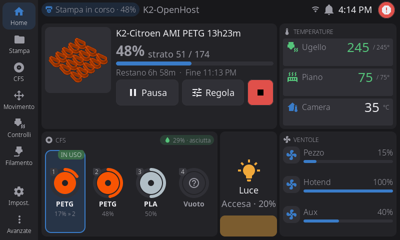
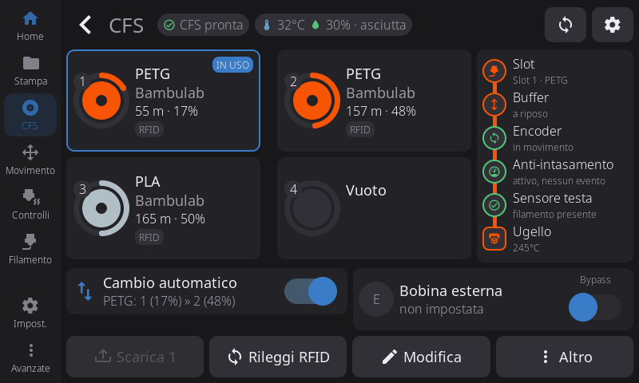
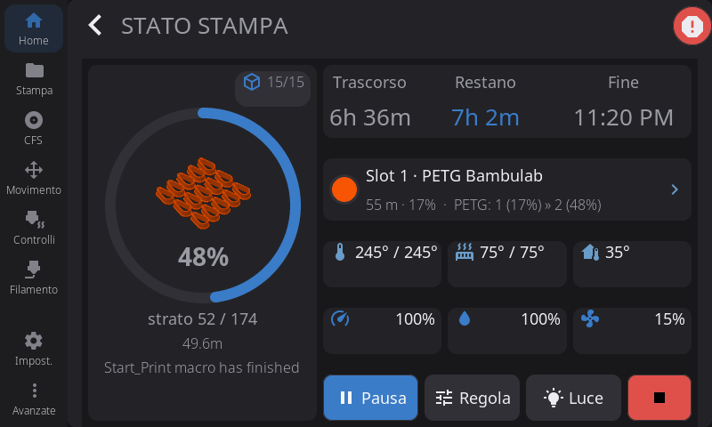
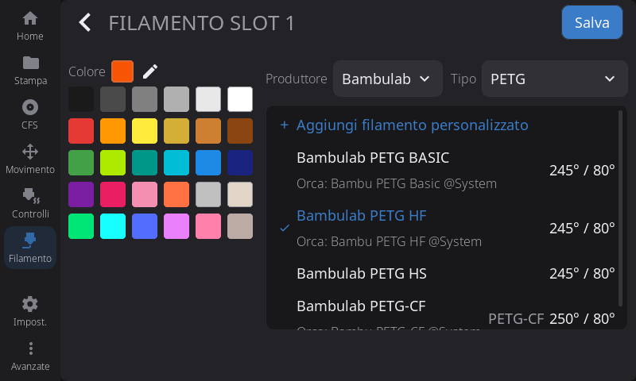
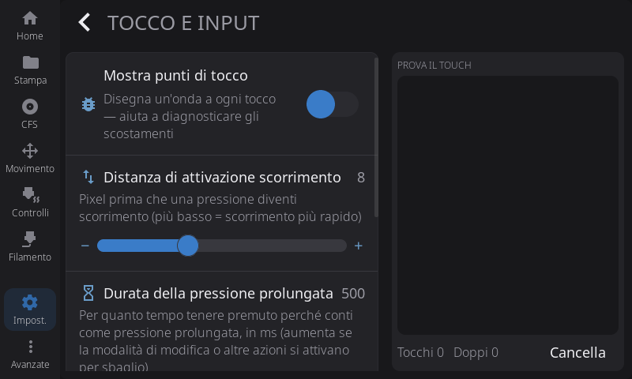

# HelixScreen (schermo della stampante)

Nello slot B lo schermo touch della stampante esegue **HelixScreen**, collegato a Moonraker sull'host. Il bootstrap della T113 lo installa al primo avvio dello slot B, già puntato all'host.

K2-OpenHost usa un suo fork, **[MzTechnology97/helixscreen](https://github.com/MzTechnology97/helixscreen)** (ramo `k2-openhost`), basato su [HelixScreen](https://github.com/prestonbrown/helixscreen) di prestonbrown. Le versioni del fork sono la versione di base più il nostro numero di build: `1.0.6-k2oh.8` è l'ottava build sulla 1.0.6.

## L'interfaccia K2-OpenHost

Quando HelixScreen è collegato alla CFS di Kalico mostra un'interfaccia sua per la K2, con il tema `k2-openhost`. Con altre stampanti resta l'interfaccia originale di HelixScreen.

| Home | Pagina CFS |
| --- | --- |
|  |  |

- **Home**: la stampa in corso (anteprima, avanzamento, tempo rimanente e fine, Pausa/Regola/Stop) oppure, a stampante ferma, Stampa un file, la coda, ristampa e preriscaldamento; temperature, CFS, luce (tocco = accesa/spenta, trascinamento = luminosità) e ventole. La Home resta personalizzabile come in HelixScreen. Nella scheda CFS la bobina in uso riporta **IN USO** e lo slot a cui passa il cambio a fine bobina (`17% » 2`).
- **Pagina CFS**: le quattro bobine con materiale, marca, metri e percentuale residui; il percorso del filamento (slot, buffer, encoder, anti-intasamento, sensore della testa, ugello); il cambio a fine bobina; la **scheda della bobina esterna** con l'interruttore **Bypass**. Durante un carico o uno scarico l'intestazione indica la fase (`Caricamento 2 · verso la testa 3/5`). Una bobina con un tag sconosciuto mostra il codice del tag.

| Stato di stampa | Profilo della bobina |
| --- | --- |
|  |  |

- **Stato di stampa**: anello di avanzamento con l'anteprima, tempi, la bobina in uso con l'ordine di cambio, temperature, velocità, flusso e ventola. **Escludi oggetti** mostra il piatto a tutta larghezza: tocca l'oggetto da escludere. Se Kalico ferma un cambio della CFS, al posto della bobina compare una scheda di avviso con il motivo e cosa fare: Riprendi riprova lo slot, oppure carica un altro slot dalla pagina CFS e poi Riprendi.
- **Profilo della bobina** (Modifica → Cambia filamento): l'elenco è la libreria filamenti di Kalico, la stessa di Mainsail, con il preset OrcaSlicer sotto ogni profilo che ne ha uno. Un profilo della libreria viene assegnato per intero con `_BOX_SLOT_ASSIGN` (temperatura, pressure advance, flusso massimo, id Orca), bobina esterna compresa. Gli slot con un tag RFID letto non si modificano a mano.

{ width="480" }

- **Touch e input** (Impostazioni): un'area di prova del tocco. Il controller GT911 della K2 tiene la configurazione fissa nel chip, quindi sensibilità e antirimbalzo non si possono cambiare; dopo il primo tentativo rifiutato la scheda lo dice e nasconde i preset.

## Libreria filamenti

Da `1.0.6-k2oh.8` HelixScreen prende l'elenco dei filamenti direttamente da Kalico (`box.filaments`): i filamenti di sistema della CFS e i tuoi da `cfs_filaments.json`. Una modifica in Mainsail compare subito sullo schermo, e un nuovo codice RFID viene riconosciuto senza riavvii.

Un filamento creato dallo schermo va nella libreria di Kalico con `_BOX_FILAMENT_SET` (materiale, marca, nome, temperature). Se lo crei dall'editor di uno slot con un tag sconosciuto, porta con sé il codice di quel tag e Kalico lo applica subito allo slot. Le modifiche ai filamenti di sistema di Creality restano una modifica locale dello schermo, perché Kalico li tiene in sola lettura.

Le build precedenti usavano il servizio `k2oh-helix-filaments` sulla T113, che riscriveva il catalogo di HelixScreen ogni 30 s. Con k2oh.8 o successive il servizio rimette il catalogo originale di HelixScreen e non parte più.

## Cosa cambia il fork

| | HelixScreen 1.0.6 | Fork K2-OpenHost |
| --- | --- | --- |
| Colore dopo il reinserimento di una bobina | Spesso grigio, anche in OrcaSlicer: HelixScreen scriveva il suo `lane_data` prima della lettura RFID | Quello del tag: `lane_data` lo scrive solo Kalico |
| Utensili T0–T3 sugli slot | Sempre T*n* = slot *n* | In stampa, la mappatura della stampa (`print_mapping`); altrimenti la mappa della CFS (`box.map`) |
| Filamento residuo | Non mostrato | Metri residui e barra, dalla CFS o dalla stima di Kalico (vedi [Filamento residuo](../cfs-firmware/remaining.md)) |
| Elenco filamenti | I preset di HelixScreen | La libreria di Kalico |
| "Connessione fallita" dopo una caduta di rete | Resta sullo schermo nelle lingue diverse dall'inglese | Si chiude da sola quando la connessione torna |
| Attesa di Moonraker all'avvio | `127.0.0.1:7125`, ripristinato da ogni aggiornamento | L'host Moonraker delle impostazioni di HelixScreen |
| Server della telecamera sulla T113 (`ustreamer`) | Sempre installato | Saltato quando la T113 non ha `/dev/video0` |
| Aggiornamenti dall'app | Dalle release di upstream | Solo dalle release del fork |

Il lavoro previsto è nella [roadmap del fork](https://github.com/MzTechnology97/helixscreen/blob/k2-openhost/docs/k2-openhost/ROADMAP.md).

## Installare o aggiornare il fork

- **Installazione nuova:** l'helper scarica l'ultima release del fork (menu 24, rispondi **sì** a HelixScreen).
- **Aggiornamenti successivi:** dall'aggiornamento di HelixScreen sullo schermo, che legge solo le release del fork.
- **A mano**, a stampante ferma: scarica una release sull'host, copiala sulla stampante e installala con `k2oh-setup helix-update`:

  ```sh
  # sull'host
  curl -fLO https://github.com/MzTechnology97/helixscreen/releases/download/v1.0.6-k2oh.8/helixscreen-k2-v1.0.6-k2oh.8.tar.gz
  scp -O helixscreen-k2-v1.0.6-k2oh.8.tar.gz root@<IP-stampante>:/mnt/UDISK/
  # sulla stampante (SSH)
  k2oh-setup helix-update /mnt/UDISK/helixscreen-k2-v1.0.6-k2oh.8.tar.gz
  ```

  `helix-update` rifiuta durante una stampa o quando l'host non risponde. Salva HelixScreen (impostazioni comprese) e i suoi script di avvio in `/mnt/UDISK/.k2openhost/helix-backup/<data>`, esegue l'installatore della release, poi rimette l'attesa sul Moonraker dell'host e spegne il server della telecamera.
- **Tornare indietro:** `k2oh-setup helix-restore`, a stampante ferma. Rimette l'ultima versione salvata e sposta quella sostituita in `/mnt/UDISK/.k2openhost/trash/` (non si cancella niente).

## Comandi utili

| Dove | Comando | Cosa fa |
| --- | --- | --- |
| Console di Klipper | `SCREEN_RESTART` | Riavvia HelixScreen (serve `[k2_t113]` collegato) |
| Helper | `./helper.sh t113 host <IP>` (menu 29) | Punta HelixScreen a un altro indirizzo dell'host |
| SSH sulla stampante | `k2oh-setup --host <IP>` | Lo stesso, dalla stampante |
| SSH sulla stampante | `k2oh-setup status` | Stato della configurazione al primo avvio |
| SSH sulla stampante | `k2oh-setup helix-update <archivio>` | Installa un'altra release di HelixScreen, solo a stampante ferma, con backup |
| SSH sulla stampante | `k2oh-setup helix-restore` | Rimette l'ultima versione salvata |

## Risoluzione dei problemi

| Sintomo | Soluzione |
| --- | --- |
| Lo schermo resta sul logo di avvio | `k2oh-setup status`, `cat /mnt/UDISK/.k2openhost/setup.log`, poi di nuovo `k2oh-setup`. |
| HelixScreen non raggiunge Moonraker | IP dell'host sbagliato (menu 29), oppure la stampante non raggiunge l'host sulla porta 7125. |
| L'elenco dei filamenti mostra i preset di HelixScreen | Lo schermo non è ancora collegato a Kalico, oppure ha una build precedente a k2oh.8. |
| Una bobina reinserita resta grigia, anche in OrcaSlicer | HelixScreen originale: installa il fork. Per sistemare subito lo slot, `_BOX_RFID_READ_SLOT SLOT=<n>` dalla console. |
| `helix-update` risponde `printer state is printing` | Aspetta la fine della stampa. Con `unreachable` la stampante non raggiunge Moonraker sull'host. |
| Qualcosa non va dopo un aggiornamento | `k2oh-setup helix-restore`, e segnalalo in [K2-OpenHost](https://github.com/MzTechnology97/K2-OpenHost/issues). |

Log sulla stampante: `/mnt/UDISK/helixscreen/logs/helix.log`.
