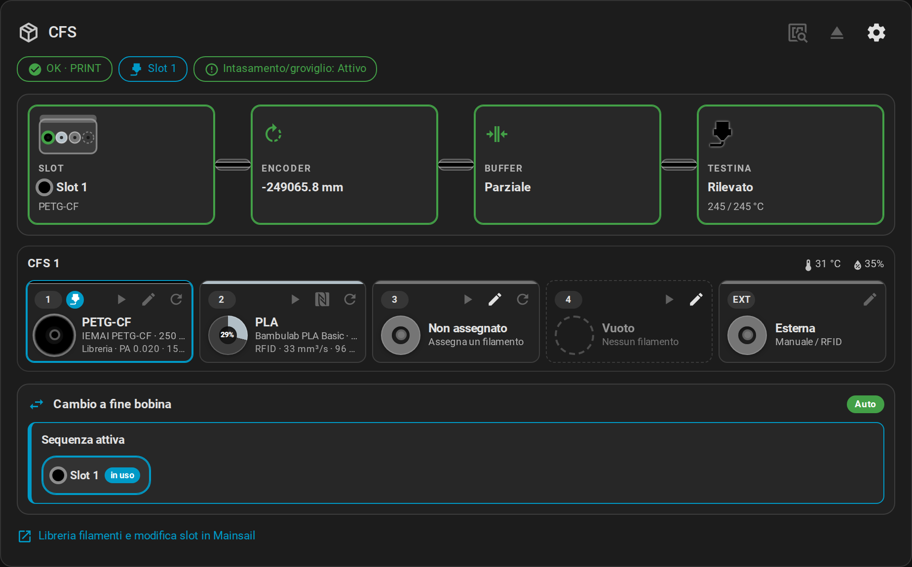
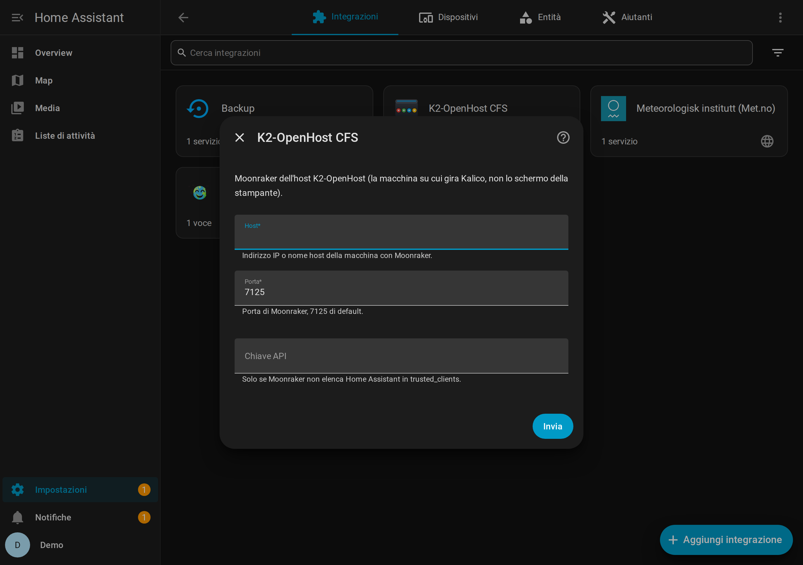
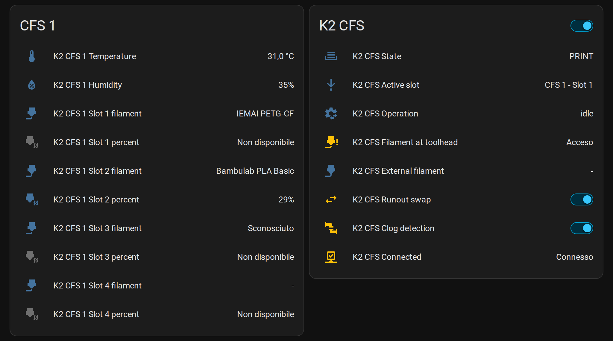
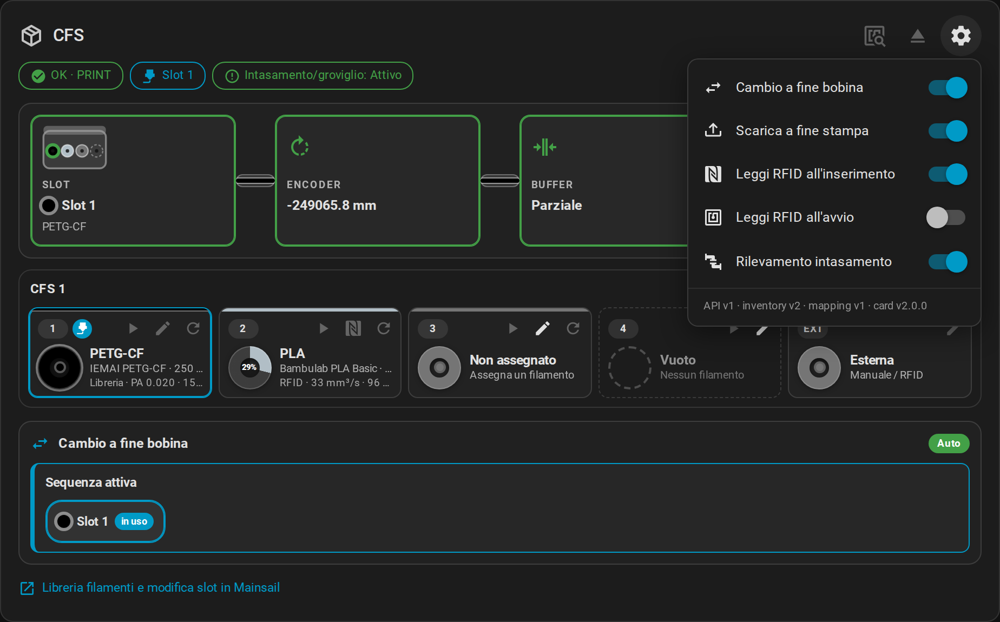
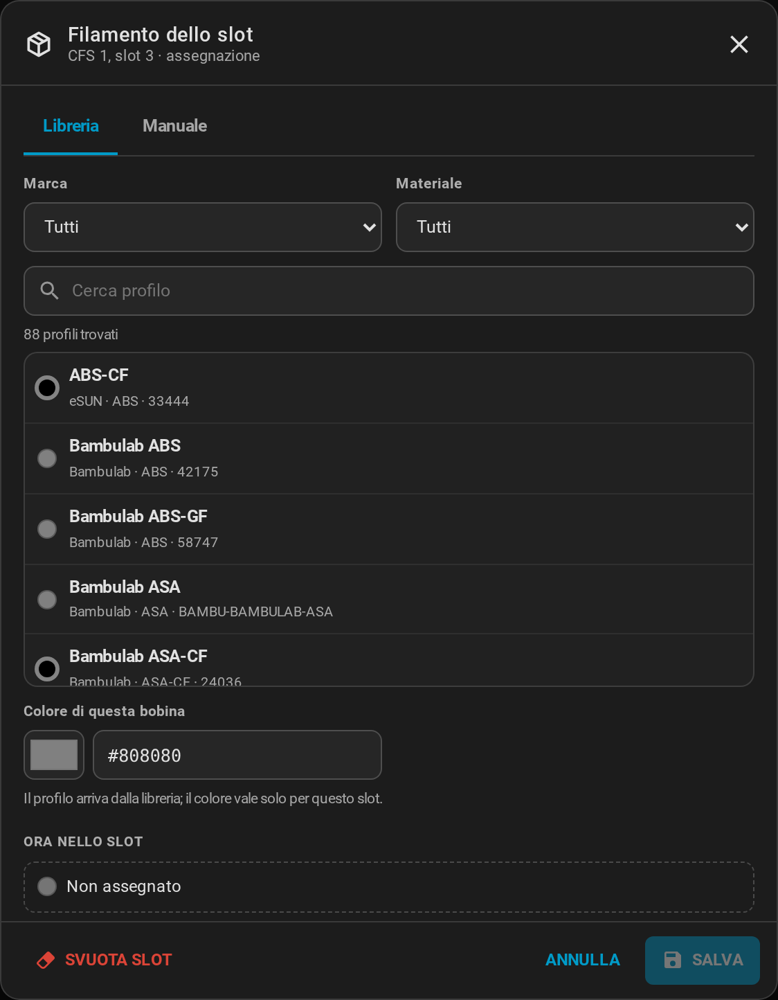

# Home Assistant

L'**[integrazione K2-OpenHost CFS](https://github.com/MzTechnology97/ha-k2-openhost)** collega Home Assistant a Moonraker tramite websocket, riceve ogni cambiamento del CFS nel momento in cui avviene e include la **card K2-OpenHost CFS**, un adattamento del pannello CFS di Mainsail.



## Requisiti

- Kalico K2-OpenHost con l'API del box.
- Moonraker raggiungibile da Home Assistant (porta 7125). L'indirizzo di Home Assistant deve essere in `[authorization] trusted_clients` di Moonraker, oppure inserisci una chiave API di Moonraker.
- Home Assistant 2025.1 o successivo.

## Installazione con HACS

1. HACS → menu (⋮) → **Repository personalizzati**.
2. Repository `https://github.com/MzTechnology97/ha-k2-openhost`, tipo **Integrazione** → **Aggiungi**.
3. Cerca **K2-OpenHost CFS** → **Scarica**, poi riavvia Home Assistant.
4. **Impostazioni → Dispositivi e servizi → Aggiungi integrazione → K2-OpenHost CFS**: host e porta di **Moonraker sull'host K2-OpenHost** (non lo schermo della stampante).

{ width="620" }

Installazione manuale: copia `custom_components/k2_openhost` in `/config/custom_components/` e riavvia.

## Entità

Dispositivi: **K2 CFS** (il box) e un **K2 CFS *n*** per ogni unità CFS.

| Entità | Contenuto |
| --- | --- |
| `sensor.k2_cfs_<n>_temperature`, `_humidity` | Ambiente del CFS *n* |
| `sensor.k2_cfs_<n>_slot_<m>_filament` | Filamento nello slot *m* |
| `sensor.k2_cfs_<n>_slot_<m>_percent` | Residuo RFID (%) |
| `sensor.k2_cfs_external_filament`, `_percent` | Bobina esterna |
| `sensor.k2_cfs_active_slot` | `CFS 1 - Slot 2`, `External` o `None` |
| `sensor.k2_cfs_operation` | `idle`, oppure `load / feeding_to_buffer` e così via |
| `sensor.k2_cfs_state` | Stato del box |
| `binary_sensor.k2_cfs_filament_at_toolhead` | Filamento nella testina |
| `binary_sensor.k2_cfs_connected` | Moonraker collegato e Klippy pronto |
| `switch.k2_cfs_runout_swap`, `_unload_after_print`, `_read_rfid_on_insert`, `_read_rfid_at_startup`, `_clog_detection` | Le cinque impostazioni del CFS |



## La card

Viene aggiunta alle risorse della dashboard dall'integrazione. Dal selettore delle card (**K2-OpenHost CFS**) oppure in YAML:

```yaml
type: custom:k2-openhost-cfs-card
title: CFS
confirm: true             # chiede conferma prima di caricamento, scaricamento e scansione RFID
mainsail_url: http://k2host.local
```

Mostra gli indicatori di stato, il percorso del filamento, ogni CFS con i suoi riquadri e i gruppi di runout. La matita di uno slot apre la finestra del filamento (profilo della libreria o manuale).

| Menu impostazioni | Profilo della libreria |
| --- | --- |
|  |  |

## Azioni

| Azione | G-code | Rifiutata quando |
| --- | --- | --- |
| `k2_openhost.load_slot` (`slot`, `flush`, `wait`) | `BOX_SELECT_SLOT` | in stampa/pausa, slot vuoto o già caricato |
| `k2_openhost.unload` | `BOX_UNLOAD` | in stampa/pausa, nulla caricato |
| `k2_openhost.rfid_scan` | `BOX_RFID_SCAN` | in stampa/pausa |
| `k2_openhost.rfid_read_slot` (`slot`) | `_BOX_RFID_READ_SLOT` | in stampa/pausa, slot caricato verso la testina |
| `k2_openhost.assign_slot` (`slot`, `filament_id`, `color`) | `_BOX_SLOT_ASSIGN` | slot RFID; slot usati dalla stampa |
| `k2_openhost.set_slot`, `clear_slot` | `_BOX_SLOT_SET`, `_BOX_SLOT_CLEAR` | come `assign_slot` |
| `k2_openhost.set_setting` (`setting`, `enabled`) | `_BOX_SET_*` | — |
| `k2_openhost.recover` | il comando di recupero | nessuna operazione bloccata |
| `k2_openhost.get_library` | — | restituisce la libreria filamenti |

Esempio di automazione, notifica quando un comando in background fallisce:

```yaml
triggers:
  - trigger: event
    event_type: k2_openhost_command_failed
actions:
  - action: notify.notify
    data:
      message: "{{ trigger.event.data.command }}: {{ trigger.event.data.error }}"
```

## Risoluzione problemi

| Sintomo | Controlla |
| --- | --- |
| *Impossibile raggiungere Moonraker* | Host e porta della macchina che esegue Moonraker (7125); firewall |
| *Moonraker ha rifiutato la richiesta* | Aggiungi Home Assistant a `trusted_clients`, oppure usa una chiave API |
| *Klipper non ha l'oggetto box* | Kalico non è una build K2-OpenHost, oppure Klippy non è pronto |
| Entità non disponibili | `binary_sensor.k2_cfs_connected`; l'integrazione si ricollega da sola |

Documentazione completa: [ha-k2-openhost](https://github.com/MzTechnology97/ha-k2-openhost#readme).
